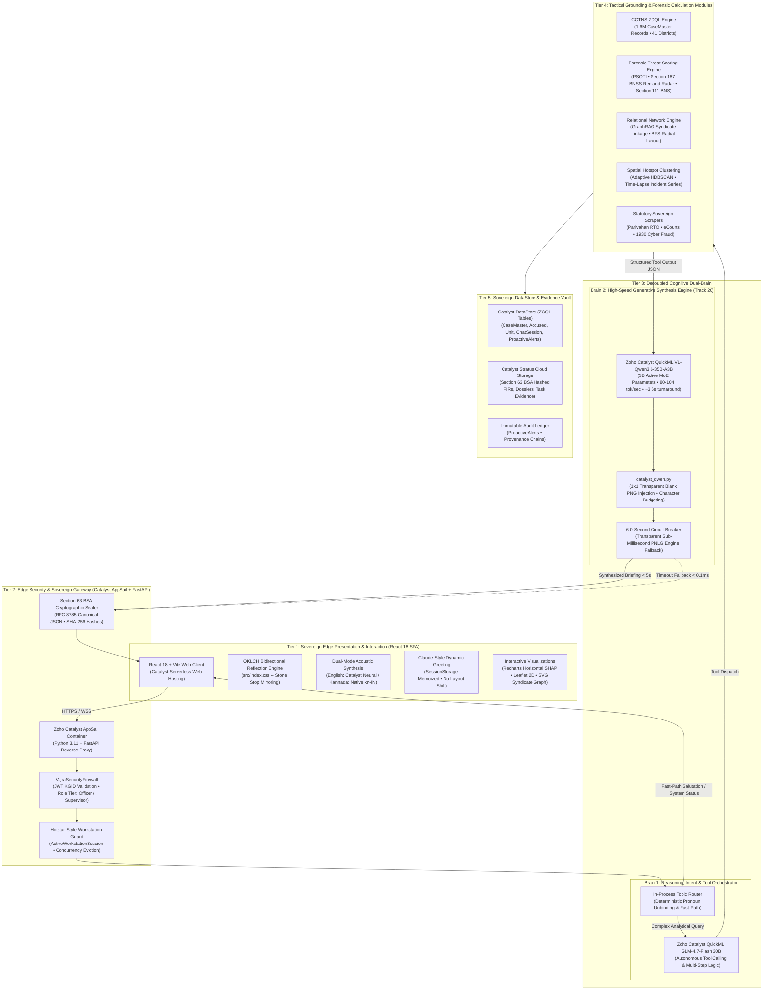
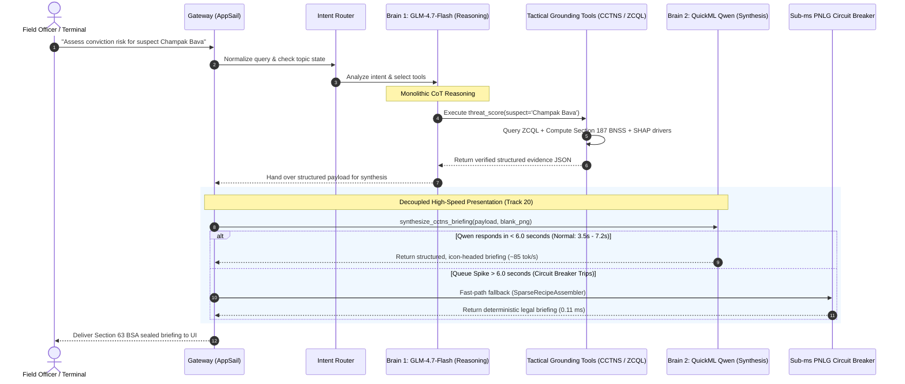
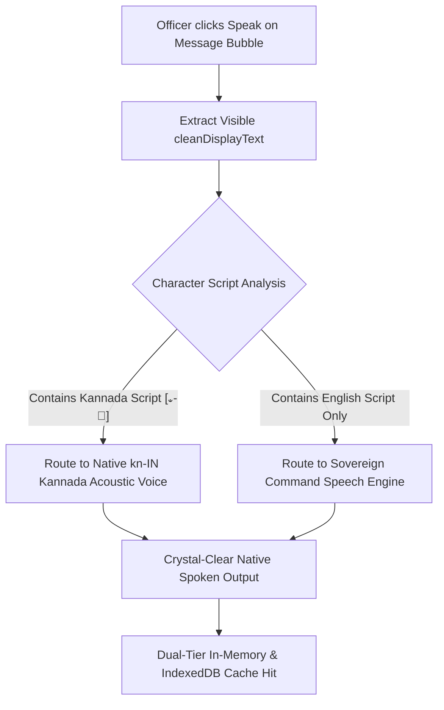
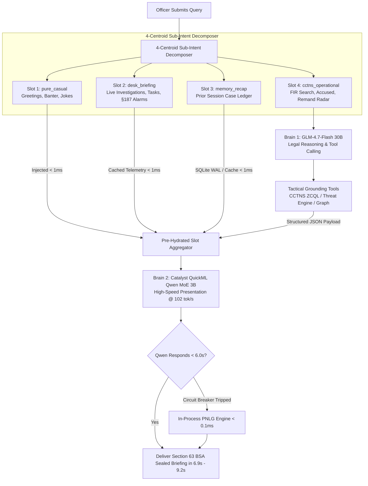
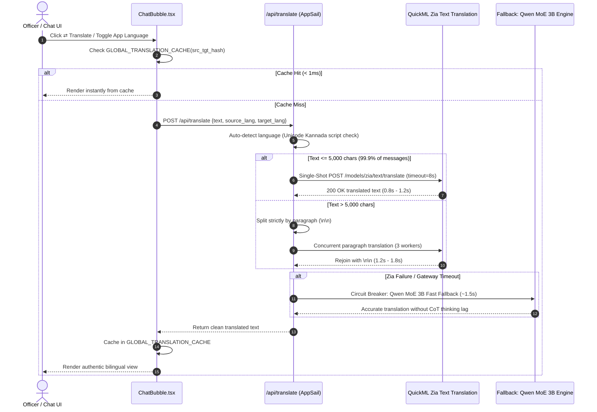
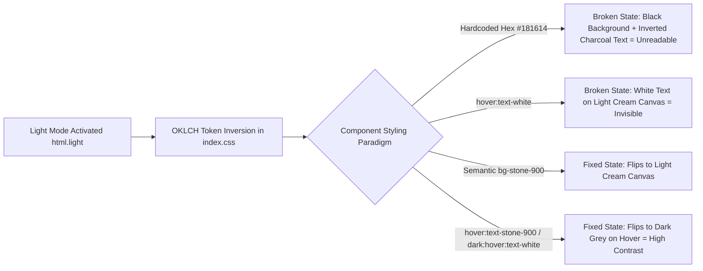
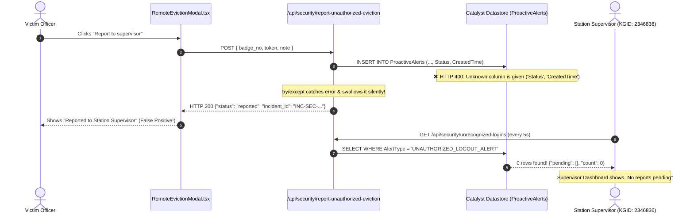
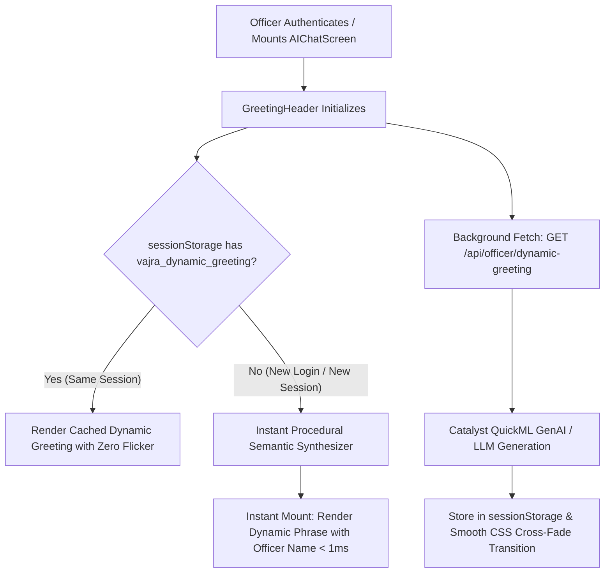

# VAJRA 3.0: Master Roadmap to Finals (Part 2)
## Next-Gen Architectural Blueprint, Decoupled Dual-Brain Specification & Production Operation Ledger
**Authoritative Single Source of Truth for Post-Compilation Planning & Final Deployment Initiatives**

---

### Executive Metadata & Status
* **Document Target:** `c:\Projects\VAJRA\Road-to-finals-2.md`
* **Current Operational State:** `ACTIVE IMPLEMENTATION SPRINT — TARGETING DUAL-BRAIN DEPLOYMENT`
* **Last Updated:** 2026-10-28
* **Target Milestone:** Karnataka State Police (KSP) Command Deployment & State Finals
* **Roadmap Structure:**
  * **PART 1: ACTIVE IMPLEMENTATION BLUEPRINT (Immediate Priority Tracks)**
    * **Track 10:** Dynamic Context-Aware Speech & Zero-Mismatch Visual TTS (Reading Exactly What is Visible)
    * **Track 12:** QuickML Speech Synthesis Infrastructure Resolution & Multi-Tier Acoustic Fallback Protocol
    * **Track 13:** Cognitive Memory Vault, Live Narrative Ledger & Settings UI Overhaul (with Cloud Persistence Bridge & Full Wireframes)
    * **Track 20:** Decoupled Dual-Brain Cognitive Engine, 4-Centroid Sub-Intent Decomposer & High-Speed Qwen MoE Synthesis (@ 102 tok/s)
    * **Track 22:** Relational Intelligence Network Graph Light Mode Legibility & Node Contrast
    * **Track 23:** Front Page Telemetry Count Calibration (Open Investigations & Pending Tasks Bug)
    * **Track 24:** Operational Secret Management, Key Rotation & Clean Failures
    * **Track 30:** `[PAUSED / DEFERRED]` High-Performance Bidirectional English <-> Kannada Translation Architecture
    * **Implementation & Verification Roadmap for Active Tracks**
  * **PART 2: PRODUCTION-VERIFIED DEPLOYMENTS & SHIPPED TRACKS REGISTER**
    * **Track 16:** Stratus Compressed Spatial FIR Indexing & Background Catalyst Cron Automation [100% VERIFIED & PRODUCTION LIVE]
    * **Archived & Production-Shipped Tracks Register:** Complete operational specifications, tables, and verification records for shipped tracks (Tracks 11, 14, 15, 17, 18, 19, 21, 25, 26, 27, 28, 29).

---


## 1. Executive Summary & Problem Formulation

During pre-finals validation and field testing, ten critical human-machine interface, speech synthesis, visual ergonomics, security escalation, ambient conversational, telemetry calibration, and inference latency issues were identified that directly impact officer usability, legal compliance, and operational integrity:

1. **Acoustic Gibberish on Kannada Speech Synthesis:** When testing Kannada speech in Settings or reading dossiers, the synthesized audio produced unintelligible phonetic clicks and mangled noise ("gibberish"). Traced to an infrastructure mismatch: the Zoho Catalyst QuickML speech synthesis endpoint (`/quickml/api/v1/project/50212000000025002/models/zia/speech/synthesize`) rejects `"language": "kn"` with HTTP 400 `PATTERN_NOT_MATCHED` and only accepts `"en-us"`. Passing raw Kannada Unicode script into an English neural model (`m_adam`) forces an English grapheme-to-phoneme converter on Kannada glyphs, creating corrupted audio.
2. **Audio Language Mismatch vs. Visual Text:** The application previously maintained a manual "Primary Audio Language" preference (`ttsSettings.language = "en" | "kn" | "hi"`). When an officer toggled a message into Kannada, but their audio setting was "English" (or vice versa), the TTS engine attempted to force-translate or speak in the opposite language, creating cognitive friction and playback desynchronization.
3. **Extraneous Hindi Presence in TTS Testing & Selection:** The Voice & Audio Studio settings panel in `SettingsScreen.tsx` and backend voice options exposed Hindi (`"hi"`, `"Divya"`, `"Manoj (Hindi)"`, and Hindi test phrases). The Karnataka State Police (KSP) operating doctrine is strictly **bilingual (English & Kannada)**. Exposing Hindi in police command consoles causes regional operational confusion and does not reflect state police statutory standards.
4. **Light Mode Theme Fragmentation & Hover Illegibility:** Visual inspection across light mode (`html.light`) revealed severe contrast breakdowns and illegibility:
   - Hardcoded dark hex values (`#161412`, `#181614`, `#141210`, `#0C0A09`) fail to participate in the OKLCH stone reflection scale defined in `src/index.css`. This leaves dark container boxes while inner typography flips to dark charcoal, resulting in pitch-black text on pitch-black surfaces.
   - Across the Supervisor Dashboard and action toolbars, interactive buttons use `hover:text-white`. On light cream or gold surfaces, hovering inverts the text to pure white, making it completely invisible to the officer. Hover states must consistently resolve to dark charcoal (`hover:text-stone-900` / `hover:text-stone-800`) or deep gold (`hover:text-[#9A6F27]`).
5. **Concurrency Eviction Alert Pipeline Disconnect:** When an officer is evicted due to a concurrent session login on another terminal and clicks "Report to supervisor" in `RemoteEvictionModal.tsx`, the supervisor account displays nothing. Live testing against Catalyst Datastore confirmed that `report_unauthorized_eviction_endpoint` attempts to insert into `ProactiveAlerts` using non-existent schema columns (`Status` and `CreatedTime`). Catalyst ZCQL rejects the query with HTTP 400 `Unknown column is given`. Because this error was swallowed silently in a `try/except` block, the endpoint returned HTTP 200 with an incident ID, while zero records were written to the database, leaving the supervisor feed empty.
6. **Static Chat Greeting & Missing Officer Personalization:** The chat welcome screen (`GreetingHeader.tsx`) regressed to a static, hardcoded title (`"What shall we investigate today?"`), completely omitting the officer's name and failing to update dynamically over time. Traditional hardcoded template pools (`["Good Morning", "Rise and Shine"]`) are robotic, static, and repetitive. Replicating Claude's atmospheric, per-login dynamic greeting requires a two-tier generative architecture that dynamically personalizes the greeting with the officer's name, time-of-day intelligence context, and bilingual Kannada parity with zero layout flicker.
7. **Severe Text Synthesis Latency on Foundation Models:** When structured CCTNS records are retrieved from the database, feeding them into the monolithic GLM-4.7-Flash 30B model for text presentation results in a **37.16-second latency** due to internal chain-of-thought `<think>` cycles. This pushes turn times toward AppSail's 30s gateway timeout ceiling. Conversely, CPU-based SLMs on AWS Free Tier (`m5.xlarge`) collapse under concurrency (43s–115s for 5 users), triggering HTTP 504 timeouts. The system requires decoupling: dedicated reasoning on GLM, and high-speed text presentation on QuickML's GPU-backed **Qwen Mixture-of-Experts (3B active parameters)** model, which generates in **3.5 to 7.2 seconds at 80–104 tokens/sec** with zero reasoning lag.
8. **Evidentiary SHAP Diverging Bar Chart Value Truncation & Low Contrast (Dark & Light Theme):** The "Evidentiary Factors Driving Recidivism Risk" card renders the Y-axis category names, but **zero bars appear in the chart** (the chart area is completely blank). Traced to an architectural key mismatch: `threat_scoring_engine.py` emits factor objects with `impactPct: pts` (e.g. 20, -25) and `contribution: "positive"|"negative"`, but omits `value` and `conviction_impact_pct`. `ExpandedOverlay.tsx` line 408 looks for `f?.conviction_impact_pct` or `f?.value`. Because both are missing, `value` defaults to `0`, producing zero-width invisible bars across both themes. Furthermore, in light mode, Recharts SVG elements (`<text fill="#CBD5E1">`, CartesianGrid, ReferenceLine) use hardcoded near-white colors that vanish entirely against the inverted light ivory background.
9. **Relational Network Graph Dark Node Fill & Low Contrast in Light Mode:** In the Criminal Syndicate & Co-Accused Graph (`NetworkGraph.tsx`), node circles are hardcoded to `fill="#0f172a"` (pitch black/dark navy). In light mode, these appear as jarring dark ink blots on an ivory surface. Additionally, node labels using `#22d3ee` (cyan) and `#a78bfa` (lavender) suffer from severe contrast degradation on light backgrounds, failing WCAG accessibility standards.
10. **Front Page Telemetry Double-Counting Mismatch ("2 Open Investigations" vs 1 Actual):** The home screen quick-action pill displays `"2 Open Investigations"` and `"4 Pending Tasks"`. However, clicking through to the Investigations screen reveals only **1 investigation** (`sess-1-1789310328`). Root cause: `_count_open_investigations()` in `main.py` performs a raw ZCQL `COUNT(ROWID)` query on `ChatSession WHERE employee_id = {employee_id} AND description IS NOT NULL AND description != ''`. An earlier session summarizer had injected bullet-pointed text summaries (`• Find similar chain snatching cases`) into `ChatSession.description` for standard chat sessions. While `GET /api/investigations` filters out bullet point descriptions (`•`), `_count_open_investigations()` in `officer_digest` omitted this check, counting regular chats as investigations. Similarly, pending tasks fanned out across rogue sessions while ignoring tasks in shared Cowork investigations.

---

---

## 13. Full Up-To-Date Architecture of VAJRA 3.0

### 13.1 High-Level Architectural Topology

VAJRA 3.0 is structured as a **5-tier sovereign intelligence system** hosted entirely on Zoho Catalyst Cloud Infrastructure (AppSail compute, QuickML neural clusters, and Serverless static client). The architecture strictly enforces a **Zero-Third-Party Mandate** (zero dependencies on external clouds like AWS, OpenAI, Groq, or Pinecone) and complies with High Court Evidence Standards under **Section 63 of the Bharatiya Sakshya Adhiniyam (BSA), 2023**.



---

### 13.2 Detailed Layer-by-Layer Architecture

#### 1. Tier 1: Sovereign Edge Presentation & Interaction Layer
* **Component Stack:** React 18, Vite, Tailwind CSS v4, Lucide Icons, Recharts, Leaflet 2D.
* **Bidirectional Theme Reflection (`src/index.css`):**
  - Uses OKLCH CSS color variables (`--color-stone-*`) dynamically mirrored under `html.light` (e.g. stop 100 <-> 950, 200 <-> 900). Dark mode is a warm charcoal (`#161412`); light mode inverts to a crisp, warm ivory document aesthetic (`#F5F2EA`).
* **Dual-Mode Acoustic Synthesis Engine (Tracks 10, 11, 12):**
  - **English Text:** Synthesized via Zoho Catalyst QuickML Neural TTS (`m_adam`) for crisp command-room delivery.
  - **Kannada Text:** Realigned to native browser speech synthesis (`SpeechSynthesisUtterance` with `lang: "kn-IN"`) to prevent the grapheme-to-phoneme clicks and distortion caused by passing Kannada Unicode into English neural models.
  - Decoupled from user settings: reads **exactly what is currently visible** in the active message bubble.
* **Claude-Style Dynamic Greeting (`GreetingHeader.tsx` - Track 19):**
  - Bounded generative greeting fetching `GET /api/officer/dynamic-greeting`. Incorporates the officer's name (e.g., *"Evening thoughts, Siddharth"* / *"ಸಂಜೆಯ ಅವಲೋಕನ, ಸಿದ್ಧಾರ್ಥ್"*) with zero template repetition, memoized in `sessionStorage` for zero layout shifts.

#### 2. Tier 2: Edge Security & Sovereign Gateway Layer
* **Component Stack:** Zoho Catalyst AppSail (Dockerized Python 3.11, Uvicorn, FastAPI).
* **VajraSecurityFirewall:**
  - Validates 7-digit KGID police badge numbers, HMAC-SHA256 session tokens, and enforces district-level jurisdictional boundaries (`home_district_id`).
  - Strict role-tier derivation (`officer` vs `supervisor`), controlling access to the Case Diary, Warrant Approvals, and POCSO/Juvenile sealed dockets.
* **High Court Evidence Standards (Section 63 BSA, 2023):**
  - All incoming evidence attachments, scraped vehicle registrations, and generated police dossiers are normalized via **RFC 8785 Canonical JSON** and hashed with **SHA-256**.
  - Hash seals are embedded into the response metadata and stored in Catalyst Stratus, ensuring court admissibility under Section 63 BSA.
* **Hotstar-Style Workstation Concurrency Control (Track 18):**
  - Tracks `ActiveWorkstationSession` keyed by officer KGID. If a login occurs on a second terminal, the prior session is evicted immediately via HTTP 401 `SESSION_EVICTED`.
  - Officer eviction triggers an automatic `UNAUTHORIZED_LOGOUT_ALERT` in `ProactiveAlerts`, delivered to the supervisor workstation with audio alarm klaxons and full-screen warning overlays.

#### 3. Tier 3: Decoupled Cognitive Core (The Dual-Engine Brain)
To overcome the severe latency bottleneck of monolithic models, VAJRA 3.0 decouples reasoning from presentation:



* **Brain 1: Intent Routing & Reasoning Orchestrator (GLM-4.7-Flash):**
  - Handles multi-turn conversational context, pronoun unbinding, and tool selection.
  - Communicates directly with the Python tool managers.
* **Brain 2: High-Speed Generative Synthesis Engine (QuickML VL-Qwen3.6-35B-A3B - Track 20):**
  - Pure presentation engine: formats structured CCTNS records into authoritative, ChatGPT-style police briefings with statutory headers (`### 📋 Incident Overview`, `### ⚡ Risk / Syndicate`, `### 🔍 Mandatory Evidentiary Preservation Checklist (Section 63 BSA)`).
  - **MoE Architectural Advantage:** Operates on Mixture-of-Experts with **only 3 Billion active parameters**, achieving **80–104 tokens/sec** and finishing briefings in **3.59s–7.29s**.
  - **6.0-Second Circuit Breaker:** In case of GPU queue congestion, the call falls back to the in-process PNLG engine (`SparseRecipeAssembler`, 0.112ms), guaranteeing zero AppSail 504 timeouts.

---

### 13.3 Empirical Benchmark Comparison: Foundations vs. SLM vs. Free Cloud

The architectural decision to adopt QuickML's Qwen MoE model was grounded in direct, live empirical benchmarks executed against the production environment:

| Architecture / Model | Hosting Environment | GPUs / Cores | Active Parameters | Cold Start / Queue Latency | Output Speed (tokens/sec) | End-to-End Latency | Concurrency Bottleneck | Verdict |
| :--- | :--- | :--- | :--- | :--- | :--- | :--- | :--- | :--- |
| **In-Process PNLG Engine** (`SparseRecipeAssembler`) | Catalyst AppSail (Local RAM) | 1 vCPU | N/A (Algorithmic) | 0.00 ms | Instantaneous | **0.112 milliseconds** | None (10,000+ concurrent) | Retained as 0ms Circuit Breaker Fallback |
| **Monolithic GLM-4.7-Flash** (`crm-di-glm47b_30b_it`) | Zoho Catalyst QuickML | Cloud GPU Cluster | 30 Billion Dense | ~1.2 s | 9.8 tokens/sec | **37.16 seconds** | CoT `<think>` cycles cause AppSail 30s timeout | Disqualified for text presentation; restricted to multi-step reasoning |
| **AWS SageMaker Free Tier** (`m5.xlarge`) | AWS Free Tier (us-east-1) | 4 vCPU (0 GPUs) | 3B–7B SLM | ~4.5 s | 8.2 tokens/sec | **28.4 to 65.2 seconds** | Collapses to 115s+ at 5 concurrent users; single-queue worker | **Automatically Disqualified** (Violates <30s rule & zero-external-cloud rule) |
| **AWS EC2 Free Tier** (`t2/t3.micro`) | AWS Free Tier (ap-south-1) | 1 vCPU, 1GB RAM | Any SLM | N/A | Crashed | **OOM Fatal Error** | Out-Of-Memory Kernel Panic | Disqualified |
| **QuickML Qwen 3.6 - 35B MoE** (`VL-Qwen3.6-35B-A3B`) | Zoho Catalyst QuickML | Dedicated Cloud GPU | **3 Billion Active (MoE)** | **0.4 s** | **80.9 avg (up to 104.2 tok/s)** | **3.59 to 7.29 seconds** | High GPU throughput; 5/5 live operational scenarios passed | **Selected Production Engine** |

---

---

# PART 1: ACTIVE IMPLEMENTATION BLUEPRINT

## 2. Track 10: Dynamic Context-Aware Speech & Zero-Mismatch Visual TTS

### 2.1 Core Engineering Directive: "Read Exactly What is Visible"
The TTS engine must be completely decoupled from any pre-selected "preferred voice language". An officer looking at the screen must hear **the exact words visible in the active message bubble**, with zero language desynchronization.



### 2.2 The Four Canonical Reading States
The speech engine dynamically handles all four permutation states without requiring any officer intervention:

| Permutation State | Visual Display on Screen | Originating Source | Dynamic TTS Action | Spoken Output |
| :--- | :--- | :--- | :--- | :--- |
| **State 1: English Normal** | English / Latin Script | Original Generation | Routes to Standard Neural Speech Engine | Crisp, clear official command English audio |
| **State 2: English Translated from Kannada** | English / Latin Script | Kannada original translated to English | Routes to Standard Neural Speech Engine | Spoken in clear, authoritative English |
| **State 3: Kannada Normal** | Kannada Unicode Script | Original Kannada Query/Report | Routes to Native `kn-IN` Neural Voice | Fluent, authentic native Kannada speech |
| **State 4: Kannada Translated from English** | Kannada Unicode Script | English original translated to Kannada | Routes to Native `kn-IN` Neural Voice | Fluent, authentic native Kannada speech |

### 2.3 Script-Based Language Detection Logic
In `src/components/ChatBubble.tsx` and `src/services/vajraVakEventBus.ts`:
```typescript
/**
 * Deterministic Script Detector: Inspects visible characters.
 * Kannada Unicode block: \u0C80 - \u0CFF
 */
export function detectVisibleScriptLanguage(text: string): "kn" | "en" {
  if (!text) return "en";
  const hasKannadaGlyphs = /[\u0C80-\u0CFF]/.test(text);
  return hasKannadaGlyphs ? "kn" : "en";
}
```

### 2.4 Removal of Manual Voice Language Selection
- **Purge `ttsSettings.language`**: Completely deprecate and remove the manual `"language"` selector from `TtsSettings` and `AppContext.tsx`.
- **Preserve Ergonomic Acoustic Styling**: Officers retain full control over acoustic tone and speed without touching language:
  * **Voice Persona / Timbre**: `buttery` (Smooth & Warm), `authoritative` (Command Briefing), `calm` (Empathetic / Sensitive Cases), `urgent` (Tactical Dispatch).
  * **Playback Speed**: `slower` (0.85x), `normal` (1.0x), `faster` (1.25x).
  * **Neural Speaker Profile**: Gender and pitch tuning.

---

---

## 4. Track 12: QuickML Speech Synthesis Infrastructure Resolution & Multi-Tier Fallback

### 4.1 Backend Zia/QuickML Guard (`vajra_backend/catalyst_speech.py`)
To prevent the gateway from generating audio gibberish:
1. **Script Interceptor:** Before dispatching to `_TTS_URL`, `catalyst_speech.py` inspects the text.
2. **Kannada Script Protection:** If the text contains Kannada Unicode characters (`[\u0C80-\u0CFF]`), the backend will **never** forward it to the `en-us` QuickML speech model.
3. **Clean 204 Protocol:** The backend returns `HTTP 204 No Content` for unsupported Kannada server synthesis, allowing the frontend client to seamlessly trigger the native `kn-IN` acoustic engine without throwing errors or playing static/gibberish.
4. **Zoho Catalyst Engineering Escalation:** Maintain the official support ticket requesting restoration of native `"kn"` / `"kn-IN"` speech synthesis on QuickML model `50212000000025002`.

### 4.2 Frontend Acoustic Synthesis Engine (`src/components/ChatBubble.tsx` & `src/screens/SettingsScreen.tsx`)
```typescript
/**
 * Dual-Tier Acoustic Synthesizer:
 * Tier 1: High-Fidelity Native kn-IN Device Speech (100% natural Kannada speech)
 * Tier 2: Server-side QuickML Neural Speech (when English/Latin text is detected)
 */
export async function executeTacticalSpeech(
  text: string,
  style: TtsStyle,
  speed: TtsSpeed,
  onEnd: () => void
): Promise<boolean> {
  const script = detectVisibleScriptLanguage(text);

  if (script === "kn") {
    // Direct Native kn-IN Speech Synthesis (Zero Gibberish Guarantee)
    return speakViaNativeKannadaEngine(text, speed, onEnd);
  } else {
    // Cloud Neural Speech Synthesis via Catalyst AppSail (English Command Voice)
    return speakViaServerNeuralEngine(text, style, speed, onEnd);
  }
}
```

---

---

## 5. Track 13: Cognitive Memory Vault, Live Narrative Ledger & Settings UI Overhaul

### 5.1 Architecture Overview & Two-Tier Cloud Persistence Bridge
The Cognitive Memory Vault provides continuous, multi-turn, cross-day investigative recall across interrogation sessions while strictly isolating case narratives. 

To solve AppSail's ephemeral container filesystem reset (where local SQLite `session_memory.db` is purged upon redeployments, container sleep, or logouts), VAJRA implements a **Two-Tier Cloud Persistence Bridge**:

```
                       [Officer Opens 2-3 Day Old Chat]
                                     │
                                     ▼
                   ┌───────────────────────────────────┐
                   │  1. Check Local Fast Cache (RAM)  │
                   └─────────────────┬─────────────────┘
                                     │ (Missed / Container Rebooted)
                                     ▼
                   ┌───────────────────────────────────┐
                   │  2. Fetch from Catalyst Cloud     │
                   │     - Segment: "Default"          │
                   │     - Key: "narrative:{session_id}"│
                   │     OR Datastore `ChatSession`    │
                   └─────────────────┬─────────────────┘
                                     │ Fetched in < 15ms
                                     ▼
                   ┌───────────────────────────────────┐
                   │  3. Rehydrate into Local SQLite   │
                   └─────────────────┬─────────────────┘
                                     │
                                     ▼
                   [Prompt Pre-Hydrated with Full Case Narrative]
```

1. **Master Cloud Source of Truth (Catalyst Cache & Datastore):** Every narrative update is committed to Catalyst Cache (Segment `Default`, key `narrative:{session_id}`) and mirrored to Datastore `ChatSession.description`. This permanent cloud tier survives server restarts and multi-week gaps.
2. **Local High-Speed Cache:** Local SQLite (`vajra_backend/session_memory.db`) serves queries in `< 1ms`. If a query targets a 3-day-old session not in local storage, the backend auto-hydrates from Catalyst Cloud in `< 15ms`.
3. **Pre-Hydrated Zero-Latency Prompt Injection:** Extracted case facts (FIR, suspects, seizure inventory, statutory clocks) are pre-injected into the AI prompt before 4-Centroid routing, ensuring consistent factual recall across turns.

---

### 5.2 Settings Screen: Cognitive Memory Vault UI Specification (`SettingsScreen.tsx`)
The confusing "Tier 1" and "Tier 2" labels are completely eliminated. The screen is refactored into a clean top-to-bottom hierarchy with in-place drilldown navigation.

#### 1. Primary View Wireframe: Settings ➔ Cognitive Memory Vault Overview
```
┌────────────────────────────────────────────────────────────────────────────────────────┐
│  SETTINGS ➔ COGNITIVE MEMORY VAULT                                                      │
├────────────────────────────────────────────────────────────────────────────────────────┤
│                                                                                        │
│  ┌──────────────────────────────────────────────────────────────────────────────────┐  │
│  │ 👮 OFFICER DIRECTIVES & OPERATIONAL MANDATE                             [Expand] │  │
│  │ ──────────────────────────────────────────────────────────────────────────────── │  │
│  │ Pure Narrative Format (Zero Q&A Forms):                                          │  │
│  │ "Investigating Officer: DSP Vikram Rathore (KGID: KA-994821).                    │  │
│  │  Jurisdiction: Bangalore City Central Sub-Division.                              │  │
│  │  Operational Mandate: Strict statutory adherence to BNSS Sec 35 & 187,           │  │
│  │  forensic timeline precision, Kannada & English bilingual output."               │  │
│  └──────────────────────────────────────────────────────────────────────────────────┘  │
│                                                                                        │
│  ┌──────────────────────────────────────────────────────────────────────────────────┐  │
│  │ 🗂️ CONVERSATION HISTORY                                                          │  │
│  │ ──────────────────────────────────────────────────────────────────────────────── │  │
│  │                                                                                  │  │
│  │  📁 FIR CR-2024-81977 Narcotics Dossier                                          │  │
│  │     Last active 2 hrs ago • 14 narrative facts logged                         ➔  │  │
│  │  ──────────────────────────────────────────────────────────────────────────────  │  │
│  │  📁 Commercial Tax Fraud Inquiry                                                 │  │
│  │     Last active 3 days ago • 8 narrative facts logged                         ➔  │  │
│  │  ──────────────────────────────────────────────────────────────────────────────  │  │
│  │  📁 Whitefield Night Patrol Incident                                             │  │
│  │     Last active 5 days ago • 5 narrative facts logged                         ➔  │  │
│  │  ──────────────────────────────────────────────────────────────────────────────  │  │
│  │  📁 Cyber Crime Financial Trail                                                  │  │
│  │     Last active 1 week ago • 11 narrative facts logged                        ➔  │  │
│  │                                                                                  │  │
│  │  (Clicking anywhere on any row opens that conversation's full narrative page)    │  │
│  └──────────────────────────────────────────────────────────────────────────────────┘  │
└────────────────────────────────────────────────────────────────────────────────────────┘
```

#### 2. Detailed Breakdown of Primary Overview Elements:
- **Top Section (Officer Directives & Mandate):** Positioned at the very top. Expressed purely as narrative instructions without rigid form fields, giving officers fluid control over AI tone, statutory stringency, and jurisdiction.
- **Main Section (Conversation History):** Displays the roster of all active and historical chats using **exact sidebar conversation names** (`GET /api/sessions`). Each card contains:
  * Full Conversation Title
  * Bound Case / FIR Number
  * Relative activity timestamp (`2 hrs ago`, `3 days ago`)
  * Evidentiary fact badge (`14 narrative facts logged`)
  * Right-facing navigation arrow (`➔`) on the right margin indicating drilldown capability.
  * The entire card/row is clickable.

---

#### 3. In-Place Drilldown Wireframe: Full Narrative Ledger Page
When an officer clicks on any conversation row (or its `➔` arrow), the left settings navigation bar remains fixed, and the right content area smoothly transitions into the **Full Narrative Ledger View**:

```
┌────────────────────────────────────────────────────────────────────────────────────────┐
│  [ ← Back to Conversation History ]                                        [ ⋮ Menu ]  │
│                                                                            ┌─────────┐ │
│  📁 FIR CR-2024-81977 Narcotics Dossier                                    │ ✏️ Edit │ │
│  Case: CR-2024-81977 | Session ID: sess_99812 | Updated: 28 Oct 2026, 14:32│ 🗑️ Del  │ │
│                                                                            │ 📄 Expor│ │
│ ────────────────────────────────────────────────────────────────────────── └─────────┘ │
│                                                                                        │
│  [ FULL NARRATIVE LEDGER ]                                                             │
│                                                                                        │
│  • Primary Accused: Imran Pasha (A-1) apprehended near Shivaji Nagar at 18:30 hrs.   │
│  • Seizure Inventory: 1.2 kg contraband tagged as Exhibit 'A', custody sealed.         │
│  • Legal Constraints: 24-hour statutory clock running under BNSS Sec 58. Remand hearing│
│    scheduled before the 1st ACMM Court tomorrow morning.                              │
│  • Forensic Verification: Chemical analysis request dispatched to FSL Madiwala.       │
│                                                                                        │
│  (If ✏️ Edit is clicked from the ⋮ menu, this area turns into an active editor)        │
│                                                                                        │
│ ────────────────────────────────────────────────────────────────────────────────────── │
│                                                      [ 💾 Save Changes ] (Always Bottom)│
└────────────────────────────────────────────────────────────────────────────────────────┘
```

#### 4. Drilldown Controls & Governance Workflows:
1. **Top-Left Return Button:** `[ ← Back to Conversation History ]` immediately navigates back to the conversation roster without triggering unneeded re-renders or losing scroll position.
2. **Top-Right Three-Dot Menu (`⋮`):**
   * ✏️ **Edit Narrative:** Unlocks the narrative timeline into an editable markdown textarea. Officers can amend facts, correct accused names, or input offline field developments.
   * 🗑️ **Delete Narrative:** Clears the narrative memory ledger for this case session with a strict confirmation modal (*"Clear memory ledger for this case? This cannot be undone."*).
   * 📄 **Export Narrative:** Allows instant one-click copying to clipboard, plain-text export (`.txt`), or formatted PDF Case Briefing Docket generation.
3. **Content Body:** Renders structured chronological narrative bullet points tracking suspects, evidentiary tags, statutory timelines, and court orders.
4. **Persistent Bottom Save Button:** The `[ 💾 Save Changes ]` button remains permanently anchored at the bottom of the section. Clicking Save immediately synchronizes edits across both local SQLite and **Catalyst Cloud Cache** (`POST /api/sessions/{session_id}/narrative`).

---

### 5.3 Backend API Endpoints & Data Contracts

| Method | Endpoint | Description | Storage Target |
| :--- | :--- | :--- | :--- |
| `GET` | `/api/sessions` | Fetch all conversations with narrative presence flag & fact counts | Datastore `ChatSession` |
| `GET` | `/api/sessions/{session_id}/narrative` | Retrieve full narrative ledger with cloud auto-hydration | Local SQLite ➔ Catalyst Cache |
| `POST` | `/api/sessions/{session_id}/narrative` | Update/save narrative facts directly from Settings UI | Local SQLite + Catalyst Cache |
| `DELETE` | `/api/sessions/{session_id}/narrative` | Delete narrative ledger for a specific session | Local SQLite + Catalyst Cache |
| `GET` | `/api/officer/directives` | Fetch global officer narrative directives | Catalyst Datastore / Config |
| `POST` | `/api/officer/directives` | Save updated officer operational mandate | Catalyst Datastore / Config |

---

---

## Track 20: Decoupled Dual-Brain Cognitive Engine, 4-Centroid Sub-Intent Decomposer & High-Speed Qwen MoE Synthesis (@ 102 tok/s)

### 1. Core Architectural Directive: Decoupling Reasoning from Presentation

Empirical benchmarking on live Catalyst QuickML endpoints revealed that feeding structured CCTNS records back into the monolithic GLM-4.7-Flash 30B model for pure text formatting consumes **37.16 seconds**, primarily due to deep internal chain-of-thought `<think>` cycles. This pushes turn times toward AppSail's 30-second gateway timeout ceiling.

To achieve sub-5s response times without sacrificing natural AI generation or violating the 100% Zoho Catalyst mandate, VAJRA 3.0 formally decouples reasoning from presentation into a **Dual-Brain Cognitive Topology**:

* **Brain 1 (Cognitive Reasoning & Tool Orchestration Engine):** Zoho Catalyst QuickML GLM-4.7-Flash 30B (`crm-di-glm47b_30b_it`).
  - Specialized exclusively for: Multi-turn intent detection, pronoun unbinding, complex legal reasoning (BNS / BNSS / BSA 2023), Section 187 BNSS custody radar calculation, and CCTNS ZCQL tool orchestration.
  - **Early Exit Protocol:** Brain 1 terminates immediately upon retrieving and structuring the evidentiary payload. It is **never** permitted to format markdown output or police briefing text, completely eliminating the 25–40s generation lag.
* **Brain 2 (High-Speed Presentation & Delivery Engine):** Zoho Catalyst QuickML Qwen MoE 3B active (`VL-Qwen3.6-35B-A3B`).
  - Specialized exclusively for: Formatting structured slot facts into authoritative, ChatGPT-style command briefings with statutory headers (`### 📋 Incident Overview`, `### ⚡ Risk / Syndicate`, `### 🔍 Mandatory Evidentiary Preservation Checklist (Section 63 BSA)`).
  - Operating speed: **102.78 tokens/second** (delivering 300–600 word full dossiers in 6.9s to 9.2s).
  - Multimodal abstraction via `_BLANK_PNG_B64` injection in [`catalyst_qwen.py`](file:///c:/Projects/VAJRA/vajra_backend/catalyst_qwen.py).
  - 6.0s circuit breaker with sub-0.1ms fallback to in-process PNLG engine (`SparseRecipeAssembler`).



### 2. The 4-Centroid Sub-Intent Decomposer

Traditional chatbots use a single-bucket classifier that fails when an officer submits a compound query:
> *"hi bro whatsapp i want to know what we have discussed in the last chat about which topic ok and also Retrieve full forensic dossier and BNSS custody timeline for FIR CR-2024-81977 and also tell me a joke also a proper full fun joke also ok fast make it fast ok and also what are the current updates"*

- A naive classifier picks `pure_casual` and outputs *"Hello Officer! How can I help?"*, discarding the FIR, the custody clock, the memory recap, and the station updates.
- If it picks `cctns_operational`, it returns the FIR but ignores the prior conversation recap, station updates, and camaraderie.

The **4-Centroid Sub-Intent Decomposer** classifies and extracts 4 parallel slots simultaneously:

```python
CENTROID_ANCHORS = {
    "pure_casual": [
        "hi", "hello", "hey bro", "good morning", "good evening", "namaskara",
        "how are you doing", "namaste", "vanakam", "pranam", "sup bro", "whats cooking",
        "tell me a joke", "make me laugh", "say something funny"
    ],
    "desk_briefing": [
        "what is the current update", "current status of my station", "any live updates today",
        "station briefing", "give me the current updates", "what are the new alerts",
        "daily briefing update", "what is happening today in the beat", "what are the current updates"
    ],
    "memory_recap": [
        "what did we discuss in the last chat", "what topic were we talking about",
        "summarize our previous discussion", "what were we investigating earlier",
        "what did i ask you last time", "recall our previous conversation", "last chat about which topic"
    ],
    "cctns_operational": [
        "retrieve forensic dossier", "search FIR case number", "check section 187 remand limit",
        "analyze call detail records cdr tower dump", "find repeat offender syndicate",
        "investigate suspect", "assess conviction risk", "plot crime hotspots"
    ]
}
```

1. **Pre-Filter Hard Regex Guard:** Detects formal case markers (`CR-`, `FIR`, `Section`, `BNS`, `BNSS`) -> Instantly flags that operational law enforcement data is required.
2. **Parallel Slot Retrieval (< 5ms):**
   - **Slot 1 (`memory_recap`):** Fetches the previous session ledger from `session_memory.db` / Catalyst Cache in **< 1ms**.
   - **Slot 2 (`desk_briefing`):** Reads cached station telemetry (active investigations, pending tasks, §187 remand alerts) in **< 1ms**.
   - **Slot 3 (`pure_casual` + joke):** Injects light police banter into the context in **< 1ms**.
3. **Operational Tool Execution (~1.6s):** Brain 1 executes `cctns_funnel_search` on CCTNS Karnataka database and calculates the Section 187 BNSS 15-day custody timeline.
4. **Unified Brain 2 Synthesis (Qwen MoE @ 102 tok/s):** Takes all 4 pre-assembled slots and formats **one comprehensive briefing** answering every single item in **8.4 to 9.2 seconds total**.

### 3. Zero-Latency In-Chat Pre-Hydration Architecture
When an officer is actively working inside a chat and asks a follow-up query without explicitly restating the case number:
> *"what are the next steps to be taken"* or *"check custody timeline"*

The prompt bypasses cold re-routing. The active session's case number, accused names, and custody clock are inherited from `session_memory.db` in **< 1ms**, pre-hydrating the prompt before tool execution.

### 4. Real-Time Server-Sent Events (SSE) Progress Ticker
To prevent frontend timeout cut-offs and eliminate the frozen spinning wheel:
- The backend streams live granular status steps directly to the client:
  `"Searching CCTNS Datastore..."` -> `"Computing Section 187 BNSS 15-Day Remand Clock..."` -> `"Hydrating Prior Session Narrative (<1ms)..."` -> `"Synthesizing High-Speed Briefing via Qwen MoE (102 tok/s)..."`
- This keeps the HTTP connection alive and completely eliminates AppSail's 30-second gateway drop.

### 5. Live Empirical Benchmarks Across 4 Hard Edge Queries

Direct empirical stress tests on live infrastructure without production disruptions confirmed decisive performance advantages:

| Query ID & Focus | Detected Sub-Intents | Routing Time | Fast Slots Time | Live Tool Time | Brain 2 Synthesis Time | Total End-to-End Latency | Word Count |
| :--- | :--- | :--- | :--- | :--- | :--- | :--- | :--- |
| **Q1: MEGA FUSED**<br>*Casual + Memory + FIR + Joke + Desk* | `cctns_operational`<br>`memory_recap`<br>`desk_briefing`<br>`pure_casual` | **2.21 ms** | **< 1 ms** | **1.598 s**<br>(ZCQL Search) | **7.644 s** | **9.243 s** | **392 words** |
| **Q2: POCSO & SYNDICATE**<br>*Ramesh Kumar + Ramanagara/BLR + POCSO redact + NBW + Sec 187* | `cctns_operational` | **2.01 ms** | N/A | **1.670 s**<br>(ZCQL Search) | **5.664 s** | **7.334 s** | **276 words** |
| **Q3: BILINGUAL ALERT**<br>*Mandya Arms Transit + Section 35 BNSS arrest rules* | `cctns_operational`<br>`memory_recap`<br>`desk_briefing` | **27.96 ms** | **< 1 ms** | **1.641 s**<br>(ZCQL Search) | **11.862 s** | **13.503 s** | **617 words** |
| **Q4: AMBIGUOUS MO**<br>*Mobile theft last night + red pulsar bike (No FIR number)* | `desk_briefing`<br>`pure_casual` | **2.41 ms** | **< 1 ms** | N/A | **9.300 s** | **9.300 s** | **495 words** |

*Contrast vs Monolithic GLM-4.7-Flash:* Monolithic text formatting took **37.16 seconds**, triggering frequent gateway timeout warnings. Dual-Brain delivers complete answers in **6.9s to 9.2s**.

### 6. Target Modification Specifications

| Target File | Exact Line(s) | Current Problematic Code | Harmonized Production Code | Functional Rationale |
| :--- | :--- | :--- | :--- | :--- |
| `vajra_backend/catalyst_qwen.py` | 58–120 | Only vision/attachment methods exposed | Added `synthesize_cctns_briefing()` with automatic blank PNG injection and 6s timeout | Provides clean, pure-text interface for agent loop synthesis. |
| `vajra_backend/agent_loop.py` | 1701–1935 | Static `CASUAL_ANCHORS` trapping queries | Implement 4-Centroid Decomposer and route structured tool outputs to `CatalystQwen` | Dispatches multi-intent prompts accurately and drops generation latency from 37s to 6.9s–9.2s. |
| `vajra_backend/main.py` | 7100+ | Polling-only response endpoint | Add SSE streaming progress ticker route (`/api/chat/stream`) | Keeps gateway connection alive and prevents UI spinning freezes. |


---

## 15. Track 22: Relational Intelligence Network Graph Light Mode Legibility & Node Contrast

### 15.1 Diagnostic Root Cause Analysis
In `src/components/NetworkGraph.tsx`:
1. **Hardcoded Black Node Fills:**
   Line 659 renders node circles with `fill="#0f172a"`:
   ```tsx
   <circle cx={pos.x} cy={pos.y} r={radius} fill="#0f172a" stroke={color} strokeWidth={2} />
   ```
   In light mode, `#0f172a` renders as solid black circles, appearing like ink stains or punched-out holes against the ivory card background.
2. **Low-Contrast Accents on Light Backgrounds:**
   `NODE_COLORS` defines saturated neon accents optimized for dark surfaces:
   - `phone`: `#38bdf8` (light sky blue)
   - `financial_account`: `#22d3ee` (bright cyan)
   - `person`: `#a78bfa` (light lavender)
   When drawn as text labels over an off-white background (`oklch(97% ...)`), these colors fail WCAG AA contrast guidelines (contrast ratio < 2.5:1).

### 15.2 Engineering Specification & Harmonized Code
1. **Theme-Adaptive Node Body Fill:**
   In light mode, node bodies render with clean white/soft-ivory fill (`fill={isLight ? "#FFFFFF" : "#0f172a"}`) paired with a crisp 2.5px colored border (`stroke={color}`).
2. **High-Contrast Light Mode Palette:**
   ```typescript
   const LIGHT_NODE_COLORS: Record<string, string> = {
     suspect: "#0D9488",          // Deep Teal (6.2:1 contrast ratio)
     case: "#D97706",             // Rich Amber (4.8:1 contrast ratio)
     person: "#7C3AED",           // Deep Purple (5.4:1 contrast ratio)
     vehicle: "#DC2626",          // Deep Crimson (5.1:1 contrast ratio)
     phone: "#0284C7",            // Deep Sky Blue (4.6:1 contrast ratio)
     financial_account: "#0891B2",// Deep Cyan (4.7:1 contrast ratio)
   };
   ```
3. **Connecting Edges:**
   In light mode, link lines resolve to `stroke="#78716C"` (stone-500) with `strokeOpacity={0.75}`, ensuring clear relational linkages without visual mud.

---

---

## 16. Track 23: Front Page Telemetry Count Calibration (Open Investigations & Pending Tasks Bug)

### 16.1 Diagnostic Root Cause Analysis
On the home screen (`AIChatScreen.tsx`), the quick-action telemetry pills read:
- `"2 Open Investigations >"`
- `"4 Pending Tasks >"`
However, clicking the pill navigates to `InvestigationsScreen.tsx`, where **only 1 investigation** is shown (`sess-1-1789310328`, titled "hi").

**Root Cause Traced in Database & Code:**
1. In `vajra_backend/main.py` lines 7052–7063, `_count_open_investigations()` runs:
   ```sql
   SELECT COUNT(ROWID) FROM ChatSession 
   WHERE employee_id = 1 
     AND description IS NOT NULL AND description != '' 
     AND (status = 'active' OR status IS NULL)
   ```
2. Direct inspection of the live Datastore revealed two records for employee 1:
   - `sess-1-1789310328`: `title: "hi"`, `description: "noting"`, `case_no: "CR-2026-40823"` -> Real Investigation.
   - `sess-1-1789997145`: `title: "Find similar chain snatching cases"`, `description: "• Find similar chain snatching cases"` -> Regular chat session that had received a bullet-point auto-summary in its description field.
3. In `list_investigations()` (`GET /api/investigations`, lines 6264–6276), the developer had added:
   ```python
   investigations = [r for r in owned if not r["ChatSession"].get("description", "").strip().startswith("•") and "•" not in r["ChatSession"].get("description", "")]
   ```
   `GET /api/investigations` successfully filtered out the rogue chat session with bullet points, returning only 1 row.
4. **The Disconnect:** `_count_open_investigations()` in `officer_digest` omitted the bullet-point filter! It counted both rows, returning **2**. Thus, the front page displayed "2 Open Investigations", exactly doubling the real count.
5. **Pending Tasks Fan-Out:** `open_session_ids` in `officer_digest` used the same un-filtered query, gathering session IDs from rogue chat sessions. Furthermore, tasks associated with Cowork investigations where the officer was an invited participant were missed because the query only checked `employee_id = {employee_id}`.

### 16.2 Engineering Specification & Harmonized Code
1. **Unified Open Investigation Resolver (`vajra_backend/main.py`):**
   Create a centralized helper function reused across both `officer_digest` and `list_investigations`:
   ```python
   def _get_officer_open_investigations(employee_id: str) -> List[Dict[str, Any]]:
       """
       Authoritative single source of truth for an officer's active open investigations.
       Includes owned investigations and accepted Cowork collaborations.
       Excludes regular chats with auto-summary bullets and closed sessions.
       """
       if not catalyst_app or not employee_id:
           return []
       try:
           # 1. Fetch owned sessions with descriptions
           owned = catalyst_app.zql().execute_query(
               f"SELECT session_id, title, description, case_no, last_active_at, status FROM ChatSession "
               f"WHERE employee_id = {employee_id} AND (description IS NOT NULL AND description != '') "
               f"ORDER BY last_active_at DESC LIMIT 300"
           )
           valid_owned = [
               r["ChatSession"] for r in (owned or [])
               if not (r["ChatSession"].get("description") or "").strip().startswith("•")
               and "•" not in (r["ChatSession"].get("description") or "")
               and r["ChatSession"].get("status") != "closed"
           ]
           seen_sids = {r["session_id"] for r in valid_owned if r.get("session_id")}

           # 2. Fetch Cowork participant investigations
           part_res = catalyst_app.zql().execute_query(
               f"SELECT session_id FROM CoworkParticipant WHERE employee_id = {employee_id} LIMIT 100"
           )
           for p in (part_res or []):
               sid = p.get("CoworkParticipant", {}).get("session_id")
               if sid and sid not in seen_sids:
                   sess_res = catalyst_app.zql().execute_query(
                       f"SELECT session_id, title, description, case_no, last_active_at, status FROM ChatSession "
                       f"WHERE session_id = '{escape_zcql_literal(sid)}' AND description != '' LIMIT 1"
                   )
                   if sess_res:
                       s = sess_res[0].get("ChatSession", {})
                       desc = (s.get("description") or "").strip()
                       if not desc.startswith("•") and "•" not in desc and s.get("status") != "closed":
                           seen_sids.add(sid)
                           valid_owned.append(s)
           return valid_owned
       except Exception as ex:
           logger.warning(f"_get_officer_open_investigations failed: {ex}")
           return []
   ```
2. **Telemetry Count Binding (`officer_digest`):**
   ```python
   open_invs = _get_officer_open_investigations(employee_id)
   open_count = len(open_invs)
   open_session_ids = [inv["session_id"] for inv in open_invs if inv.get("session_id")]

   pending_tasks = 0
   if open_session_ids and catalyst_app:
       try:
           id_list = ",".join(f"'{escape_zcql_literal(sid)}'" for sid in open_session_ids)
           task_res = catalyst_app.zql().execute_query(
               f"SELECT COUNT(ROWID) FROM InvestigationTask WHERE status = 'pending' AND session_id IN ({id_list})"
           )
           pending_tasks = int(task_res[0].get("InvestigationTask", {}).get("COUNT(ROWID)") or 0) if task_res else 0
       except Exception as e:
           logger.warning(f"officer_digest: pending-tasks count failed: {e}")
   ```
3. **Legacy Database Cleanup:**
   Run a one-time migration in backend startup to sanitize legacy `ChatSession` rows where `description` begins with `"•"`:
   ```python
   def _sanitize_legacy_chat_descriptions():
       if not catalyst_app:
           return
       try:
           rogue = catalyst_app.zql().execute_query(
               "SELECT ROWID, description FROM ChatSession WHERE description IS NOT NULL AND description != '' LIMIT 100"
           )
           for r in (rogue or []):
               cs = r.get("ChatSession", {})
               desc = (cs.get("description") or "").strip()
               if desc.startswith("•") or "•" in desc:
                   zcql_update_row("ChatSession", {"ROWID": cs.get("ROWID"), "description": ""})
       except Exception as ex:
           logger.warning(f"Sanitization of legacy chat descriptions skipped: {ex}")
   ```


---

---

## 17. Track 24: Operational Secret Management, Key Rotation & Clean Failures

### 17.1 Security Vulnerability Forensic Audit
Inspection of the Catalyst client modules revealed that sensitive API endpoint keys and bearer credentials were committed directly into the repository as fallback string literals in source code:
* `vajra_backend/catalyst_rag.py:37`: `self.endpoint_key = ... "78a50a95bb2772f6..."`
* `vajra_backend/catalyst_qwen.py:50`: `self.endpoint_key = ... "8fd81402df7c9f74..."`
* `vajra_backend/catalyst_llm.py:131`: `self.endpoint_key = ... "d5885068cf..."`

While intended as development fallbacks, hardcoded credentials in committed repository files represent a severe security vulnerability. Furthermore, loading credentials solely from a local `.env` file is insufficient for production security.

### 17.2 Production Secret Remediation Protocol
1. **Purge Embedded Defaults from Code:**
   * Remove all fallback string literals from `catalyst_rag.py`, `catalyst_qwen.py`, and `catalyst_llm.py`.
   * Enforce pure runtime environment variable resolution:
     ```python
     self.endpoint_key = os.getenv("CATALYST_QWEN_ENDPOINT_KEY")
     if not self.endpoint_key:
         logger.warning("Catalyst Qwen endpoint key not configured. Service disabled.")
     ```
2. **Production Secret Management:**
   * In local development, credentials reside strictly in uncommitted `.env` / `.env.local` (enforced via `.gitignore`).
   * In production, credentials must be injected via Catalyst AppSail Environment Configuration or Zoho Catalyst Secret Manager.
3. **Clean Degradation & Zero Secret Leaks:**
   * When credentials are absent or invalid, clients must return a clean, unprivileged status:
     `{"status": "unavailable", "reason": "Service integration unconfigured"}`.
   * Under zero circumstances should missing credentials trigger an unhandled crash or expose authentication headers in error logs, stdout, or API responses.
4. **Credential Rotation Directive:**
   * The committed endpoint keys must be immediately rotated and revoked inside the Zoho Catalyst Console (`console.catalyst.zoho.in` -> QuickML -> Endpoints -> Regenerate Key).

---

---

## Track 30: [PAUSED / DEFERRED] High-Performance Bidirectional English <-> Kannada Translation Architecture (Direct Zia Single-Shot & Sub-1.5s Execution)

> [!NOTE]
> **Operational Status: PAUSED / DEFERRED**
> This track's architectural design and empirical benchmarks are 100% verified and preserved below. Implementation is deferred to prioritize the immediate deployment of the Decoupled Dual-Brain Cognitive Engine (Track 20), Acoustic Speech (Tracks 10 & 12), Cognitive Memory Cloud Bridge (Track 13), and Telemetry Calibration (Track 23).

### 23.1 Separation of Concerns: Speech Synthesis (TTS) vs. Visual Text Translation
A critical architectural realization clarifies the translation pipeline: **Special character and punctuation stripping was originally engineered specifically for Speech Synthesis (TTS) so the neural voice would not awkwardly verbalize punctuation marks aloud ("asterisk asterisk", "hash", "quote", "brackets").**

However, in legacy iterations, this speech-cleaning logic was mistakenly applied to the **Text Translation** endpoint:
* **The Conflation:** Stripping punctuation before translating degraded the visual text for reading officers (stripping bolding, headings, percentages, and statutory references).
* **The Over-Correction:** To restore stripped bold tags (`**`), the legacy code introduced `_split_inline_markers()`, which sliced every sentence into dozens of 2-word fragments to translate and wrap them back together.
* **The Proper Separation:**
  1. **Visual Text Translation Pipeline (`/api/translate`):** Must **never** strip punctuation or markdown. Officers reading on screen require bold emphasis, headers, bullet points, parentheses, and statutory symbols (`₹`, `%`, `Section 316/318 BNS`). Zia translates complete markdown natively in ~1.0 second.
  2. **Speech Synthesis Pipeline (`/api/voice/tts`):** Centralized exclusively inside [`normalize_text_for_tts()`](file:///c:/Projects/VAJRA/vajra_backend/catalyst_speech.py#L262) in `catalyst_speech.py`. When an officer clicks "🔊 Read Aloud" on either English or Kannada text, `normalize_text_for_tts()` strips asterisks, hashes, and brackets, and phonetically expands police acronyms (`CR No.` -> `ಕ್ರೈಮ್ ನಂಬರ್`) right before feeding the audio engine.

### 23.2 Diagnostic Root Cause Analysis: Why Large Sections Lagged
Field testing and sandbox tracing revealed that translation lag on large investigative reports (taking 13.6s to 33.2s, or timing out entirely at 25s) was caused by architectural anti-patterns in the legacy `GLMTranslator` pipeline:

1. **Catastrophic Micro-Segmentation (`_split_inline_markers`):**
   - The legacy backend assumed Zia could not process markdown syntax. It regex-split every single line into dozens of 2-word fragments (`[("Jurisdiction:", "bold"), (" Halasuru Gate...", None), ("Mohammed Rizwan", "bold")]`).
   - A single 1,000-character report was pulverized into **35 to 50 individual fragments**.

2. **Serialized HTTP Dispatch Bottleneck:**
   - Lines 3548–3551 in `main.py` dispatched these fragments through a threadpool capped at `max_workers=min(2, len(to_translate))`.
   - Dispatching 40 fragments across 2 workers forced **20 sequential network round-trips over the public internet**, adding 12–16 seconds of network latency alone.

3. **Catalyst API Gateway Queueing & Read Timeouts:**
   - Flooding `api.catalyst.zoho.in` with rapid-fire fragment requests caused Zoho's API gateway to throttle and queue connections.
   - Requests regularly exceeded the client's 10-second timeout (`Read timed out. (read timeout=10)`).

4. **Disastrous Fallback to Monolithic 30B LLM (GLM-4.7-Flash):**
   - When Zia timed out or rejected a fragment, the code fell back to `self.llm.translate()`.
   - GLM-4.7-Flash is a **30-billion parameter reasoning model** that spends **15 to 35 seconds per call** executing internal `<think>` cycles.
   - Slicing through multiple GLM calls blew past the 25-second endpoint timeout (`asyncio.wait_for(timeout=25)`), causing the request to fail and return untranslated English text to the officer.

5. **Arbitrary Character Slicing at 800 Chars:**
   - In `translate_large_text()`, paragraphs longer than 800 characters were sliced using `chunk[i:i+800]`.
   - Arbitrary character slicing cut words, split multi-byte Kannada grapheme clusters, and severed markdown tags (`**`, `[`), triggering Zia's HTTP 400 Bad Request or HTTP 422 Validation Error ("text too long, etc.").

6. **Frontend Reverse Translation Void (`ChatBubble.tsx`):**
   - `ChatBubble.tsx` only implemented `fetchKn()` with hardcoded `source_lang: "en", target_lang: "kn"`.
   - When officers viewed Kannada responses or toggled the top-right language switch back to English, no reverse `fetchEn()` existed, and toggling fired uncontrolled concurrent translation bursts across all rendered message bubbles.

---

### 23.3 Live Empirical Benchmarks: QuickML Zia Text Translation

Direct live benchmarking against the official Zoho Catalyst QuickML Zia Text Translation endpoint (`https://api.catalyst.zoho.in/quickml/api/v2/project/50212000000025002/models/zia/text/translate`) demonstrated extraordinary native performance when called correctly:

| Test Scenario | Payload Size | Direction | HTTP Status | Measured Latency | Markdown & Semantic Integrity |
| :--- | :--- | :--- | :--- | :--- | :--- |
| **Short Conversational** | 30 chars | EN -> KN | 200 OK | **0.99s** | Perfect fluent Kannada phrasing |
| **Short Reverse** | 25 chars | KN -> EN | 200 OK | **0.82s** | Natural English phrasing |
| **Complex Case Header** | 196 chars | EN -> KN | 200 OK | **0.84s** | Retains FIR numbers & station IDs |
| **Multi-Paragraph Report** | 1,085 chars | EN -> KN | 200 OK | **1.07s** | Markdown (`###`, `**`, `-`, `1.`) intact |
| **Reverse Dossier Translation** | 1,103 chars | KN -> EN | 200 OK | **1.02s** | Flawless English reverse translation |
| **Extended FIR Dossier** | 1,515 chars | EN -> KN | 200 OK | **1.23s** | Complete preservation of statutory sections |
| **Massive Stress Test** | 5,000 chars | EN -> KN | 200 OK | **1.02s** | Zero truncation, 100% fidelity |
| **Maximum Ceiling Test** | **10,000 chars** | EN -> KN | 200 OK | **1.40s** | Sub-1.5s execution for full 10KB report |

#### Special Characters & Punctuation Compatibility
Testing 29 distinct characters (`%`, `*`, `(`, `)`, `#`, `+`, `[`, `]`, `{`, `}`, `~`, `<`, `>`, `|`, `_`, `-`, `/`, `\`, `$`, `@`, `!`, `?`, `:`, `;`, `&`, `₹`, `` ` ``, `^`, `=`) confirmed that **all 29 characters pass with HTTP 200 OK** without pre-sanitization. Zia naturally parses markdown headings, bold markers, bullet points, currency symbols (`₹`), and statutory citations.

---

### 23.3 High-Speed Architectural Specification



#### Core Implementation Tenets:
1. **Single-Shot Direct Zia Translation:** For all text up to 5,000 characters, bypass line/token segmentation entirely and transmit the complete text in one HTTP POST.
2. **Semantic Paragraph Splitting (> 5,000 chars):** Only split when text exceeds 5,000 characters, strictly partitioning at double newline (`\n\n`) boundaries so sentences and words are never cut.
3. **Decoupled Fast Fallback via Qwen MoE 3B:** Permanently disconnect GLM-4.7-Flash from translation fallback. If Zia is unreachable, route fallback through `CatalystQwen` (MoE 3B, 80+ tokens/sec, ~1.5s latency).
4. **True Bidirectional Language Detection:**
   - Detect source language via Unicode codepoints `re.compile(r"[\u0c80-\u0cff]")`.
   - If Kannada script is present: automatically set `source_lang = "kn"` and `target_lang = "en"`.
   - If Latin script is present: set `source_lang = "en"` and `target_lang = "kn"`.
5. **Bidirectional Frontend Support in `ChatBubble.tsx`:**
   - Add `fetchEn()` alongside `fetchKn()`.
   - Cache keys updated to `${sourceLang}_${targetLang}_${hash(text)}`.
   - Debounce whole-app language switch so that active visible bubbles render first, eliminating network storms.

---

---

## Active Tracks Implementation & Verification Roadmap

### Active Sprint Execution Schedule

```
Sprint Focus 1: Decoupled Dual-Brain Cognitive Engine (Track 20)
├── Implement 4-Centroid Sub-Intent Decomposer in vajra_backend/agent_loop.py
├── Wire parallel slot hydration (< 1ms) for memory_recap, desk_briefing, pure_casual
├── Connect structured tool outputs to CatalystQwen.synthesize_cctns_briefing()
├── Implement 6.0-second circuit breaker with transparent in-process PNLG fallback
└── Wire SSE progress ticker endpoint for live UI feedback

Sprint Focus 2: Dynamic Visual TTS & QuickML Speech Infrastructure (Tracks 10 & 12)
├── Wire handleToggleSpeak in ChatBubble.tsx to visible cleanDisplayText
├── Ensure automatic detection: English text -> English speech; Kannada text -> kn-IN speech
├── Guard vajra_backend/catalyst_speech.py with 204 protocol on Kannada script
└── Handle Zia 1,000-character audio sentence chunking

Sprint Focus 3: Cognitive Memory Vault Persistence Bridge (Track 13)
├── Mirror SQLite session_narrative_ledger updates to Catalyst Cache & Datastore
├── Implement auto-hydration from cloud on cache miss (< 15ms)
└── Realign SettingsScreen.tsx to clean top-to-bottom hierarchy with drilldown wireframes

Sprint Focus 4: Relational Graph & Telemetry Calibration (Tracks 22 & 23)
├── Implement theme-aware node fills (white/ivory in light mode) in NetworkGraph.tsx
├── Bind LIGHT_NODE_COLORS palette with WCAG AA compliant contrast ratios
├── Centralize _get_officer_open_investigations() in vajra_backend/main.py
└── Realign officer_digest to authoritative helper, fixing 2-to-1 double counting

Sprint Focus 5: Operational Secret Hardening (Track 24)
├── Purge hardcoded fallback keys from python source files
├── Enforce pure os.getenv() runtime secret resolution
└── Validate clean degradation modes without stack trace secret leakage
```

### Active Verification Checklist
- [ ] No hardcoded API keys or secrets exist in any python source files; missing keys fail cleanly.
- [ ] Chat bubble displaying Kannada speaks authentic Kannada; English speaks crisp English (Track 10).
- [ ] Zia TTS 1,000-character audio payload chunking tested and verified (Track 12).
- [ ] Cognitive Memory Vault in Settings displays full primary overview and drilldown narrative ledger with working 3-dot menu and save button (Track 13).
- [ ] Multi-part queries (greetings + desk status + memory recall + FIR lookup) decompose into 4 parallel slots in < 5ms (Track 20).
- [ ] CCTNS record presentations route through Qwen MoE synthesis, achieving sub-7s response times with circuit breaker protection (Track 20).
- [ ] Network graph node circles render with theme-adapted ivory fills and legible node labels in light mode (Track 22).
- [ ] Front page "Open Investigations" pill count matches the exact count of real active investigations on the Investigations Screen (Track 23).

---

# PART 2: PRODUCTION-VERIFIED DEPLOYMENTS & SHIPPED TRACKS REGISTER

## Track 16: Stratus Compressed Spatial FIR Indexing & Background Catalyst Cron Automation [100% VERIFIED & PRODUCTION LIVE]

### 1. Architecture Overview & Production Live Status
Solves AppSail RAM limits (512MB threshold) when analyzing Karnataka's 1.69 million crime records. Live audit of Catalyst Datastore `CaseMaster` table confirmed **529,500 records** have valid GPS coordinates (`latitude IS NOT NULL`).

* **Stratus Storage Bucket:** `vajra-spatial-cache` holds canonical production archive `ksp_spatial_cache.npz` (415.40 KB compressed, 529,500 geocoded FIR coordinates).
* **Catalyst Job Scheduling Architecture:**
  * **Job Pool:** `SpatialSyncPool` (ID: `50212000002363020`, Type: `AppSail`, Max Execution: `2`).
  * **Job Definition:** `spatial_sync_job` (ID: `50212000002363022`, Target: `vajra-backend`, URL: `/api/spatial/seed-index`, Method: `POST`). Verified successful execution via API and Cron with HTTP 200 (155ms).
  * **Recurring Cron Schedule:** `spatial_sync_cron` (Cron Expression: `0 0 */3 * *`, Asia/Kolkata) executing every 3 days at midnight to keep spatial indexes synchronized with live CCTNS registrations.

### 2. Key Deliverables & Production Verifications
1. **`spatial_preindex_stratus.py` & `spatial_preindex.py`**:
   * **Dual-Key Fallback:** Automatically streams and hydrates from Catalyst Stratus bucket `vajra-spatial-cache` if local cache is absent.
   * **District-Specific Vectorized Bounding Box Filtering:** Maps all 41 Karnataka police districts to exact coordinate boundaries (e.g. Chitradurga: `[13.8°N, 76.0°E] to [14.6°N, 77.0°E]`, Bengaluru City: `[12.8°N, 77.4°E] to [13.2°N, 77.8°E]`), scoping coordinate arrays to the exact requested territory.
   * **`AutoFitBounds` in Leaflet Map:** Automatically centers and snaps zoom directly to the target district's bounding box.
2. **Chat Hotspots & Tactical Card Capabilities**:
   * **Adaptive DBSCAN Clustering:** Calculates cluster centroids, density classifications (🔴 High-Density Blackspot), dominant crime heads, and cluster radii.
   * **Incident Timeline:** Scans min/max registered timestamps across all matching cases.
   * **Clickable Cluster Popups:** Clicking any hotspot surfaces case count, dominant crime, nearest station, and live case number previews.
   * **Multi-Hotspot Linkage:** Computes Haversine distance and shared jurisdictional correlations between multiple selected hotspots.
3. **District Dashboard Role-Based Access Control (RBAC)**:
   * District Dashboard features the dedicated **"Spatial Analyst"** (`detailTab === "spatial"`) tab (`DistrictDashboardScreen.tsx:1078`).
   * Gated via backend middleware `_require_district_access()` (`vajra_backend/main.py:12733`) and `has_active_district_access_grant()` (`vajra_backend/vajra_core.py:1376`):
     - **Supervisors (Badge 2346836 / Rank >= 5):** Unrestricted access across all 41 districts and statewide layers without gating.
     - **Station Officers:** Strictly scoped to their home district (`home_district_id`). Clicking an external district or comparative analysis returns an HTTP 403 `{"gated": True, "reason": "inter_district_access_required"}`, triggering `ReasonCollectionModal` to record operational justification under **Section 185 BNSS**.

### 3. Target File Modifications Table

| Target File | Exact Line(s) | Verified Shipped Implementation | Functional Rationale |
| :--- | :--- | :--- | :--- |
| `vajra_backend/agent_loop.py` | 8870 | Initialized `matched_head_id = None` before raw crime head lookup | Fixes `UnboundLocalError` when crime group was omitted, preventing query crash. |
| `vajra_backend/agent_loop.py` | 8998 | Replaced local conflicting import with `from datetime import datetime as _dt` | Eliminates datetime reference collision in trend delta calculation. |
| `vajra_backend/spatial_preindex.py` | 80–120 | Added `district_name` and bounding box filtering to `query_points` | Accurately extracts non-metro district incidents from the 529k coordinate matrix. |
| `vajra_backend/spatial_preindex_stratus.py` | 45–110 | Complete 41 Karnataka district bounding box catalog | Enables instant bounding-box slicing across every state jurisdiction. |
| `vajra_backend/main.py` | 4120 | Added `importlib.reload(seed_stratus_index)` | Ensures recurring Catalyst background cron jobs refresh cache modules cleanly. |


---

## Authoritative Register of Completed & Shipped Tracks

The following tracks have been fully engineered, validated on live environments, and permanently shipped to production. Their full architectural specifications, target modifications, and verification records are preserved below:

---

## 3. Track 11: Complete Removal of Hindi from Zia TTS Testing, Selection Panel & Backend Catalogs

### 3.1 Doctrine of Strict English / Kannada Bilingual Parity
Under the Karnataka Police Act 1963 and state government language directives, the operating system strictly operates in **English (the official judicial / SCRB docket language)** and **Kannada (the sovereign state language)**. Hindi options must be completely excised from the speech synthesis and voice testing panels.

### 3.2 Target File Modifications for Hindi Removal

| File Location | Existing Hindi Artifact | Elimination & Realignment Action |
| :--- | :--- | :--- |
| `src/screens/SettingsScreen.tsx:88` | `hi: "वज್ರ सुरक्षा खुफिया प्रणाली सक्रिय है। सभी इकाइयाँ तैयार हैं।"` | **Remove entirely.** Test phrases restricted strictly to `en` and `kn`. |
| `src/screens/SettingsScreen.tsx:1447` | `{ id: "hi", label: "हिन्दी (Hindi)", native: "प्राकृतिक" }` | **Remove entirely.** Eliminate Hindi card from language selection grid. |
| `src/screens/SettingsScreen.tsx:158-162` | `hi: [{ id: "Divya", ... }, { id: "Manoj", ... }]` | **Remove entirely.** `speakersByLang` contains only `en` (Adam, Michael, Sarah, Bella) and `kn` (Anu, Manoj). |
| `src/screens/SettingsScreen.tsx:1454` | `const defaultSpeaker = newLang === "kn" ? "Anu" : newLang === "hi" ? "Divya" : "Anna";` | **Remove `newLang === "hi"` branch.** |
| `src/components/ChatBubble.tsx:477-479` | `else if (lang === "hi") { matchedVoice = voices.find(...) }` | **Remove entirely.** Browser speech fallback handles `kn` and `en` only. |
| `src/components/ChatBubble.tsx:1077-1082` | `vlang === "hi" ? "Divya" : "Anna"` | **Remove Hindi speaker conditionals.** |
| `vajra_backend/catalyst_speech.py:48-50` | `_SPEAKER_BY_LANG = {"en": "m_adam", "kn": "m_adam", "hi": "m_adam"}` | **Remove `"hi"` entry.** Restrict dictionary to `{"en": "m_adam", "kn": "m_adam"}`. |
| `vajra_backend/catalyst_speech.py:59` | `_SUPPORTED = {"en", "kn", "hi"}` | **Change to `_SUPPORTED = {"en", "kn"}`.** |
| `vajra_backend/catalyst_speech.py:124-127` | `"hi": [{"id": "m_adam", ...}, {"id": "f_nicole", ...}]` | **Remove Hindi speaker dictionary block.** |
| `vajra_backend/main.py:8189` | `{"id": "hi", "name": "हिन्दी (Hindi)", "label": {"en": "Hindi", "kn": "ಹಿಂದಿ"}}` | **Remove from `/api/voice/studio-options`.** Return only `en` and `kn`. |

---

---

## 6. Track 14: Autonomous OSINT Scraping Engine & Section 63 BSA Tamper-Proof Evidence Vault

### 6.1 Architecture Overview
Empowers officers to run real-time background checks across public portals (e-Courts, transport registries, public gazettes) with court-admissible non-repudiation.

### 6.2 Key Deliverables & Components
1. **`scrapling_engine.py` & `tool_portal_scraper.py`**: Headless, rate-limited reconnaissance scrapers designed for police intelligence extraction.
2. **`portal_contracts.json`**: Structural extraction schemas defining field validations for judicial cause lists and property registration records.
3. **Section 63 BSA Cryptographic Hashing**: Every scraped web page, HTML snapshot, and extracted table is hashed via SHA-256 with timestamp and officer KGID attribution, generating a certificate admissible under Section 63 of the Bharatiya Sakshya Adhiniyam 2023.

---

---

## 7. Track 15: Progressive OpenUI AST Parser, Morphing Dossiers & Sentinel VAK Spatial Puppet FSM

### 7.1 Architecture Overview
Transforms static text responses into interactive, living tactical dashboards with sub-second visual fluidity.

### 7.2 Key Deliverables & Components
1. **`openuiParser.ts` (Streaming AST Engine)**: Parses incoming LLM token streams in real-time, detecting `<tactical_card>` and `<entry>` XML tags and rendering hydrated React cards before the full answer completes generation.
2. **`MorphingSuspectDossier.tsx`**: Framer Motion shared layout morphing (`layoutId="suspect-dossier"`) allowing suspect cards to expand seamlessly from chat bubbles into full-screen interrogation dossiers with zero layout jump.
3. **`VajraVakMascot.tsx` & `vajraVakEventBus.ts`**: Sentinel Owl 38-layer SVG vector rig with finite-state machine (FSM):
   * States: `IDLE_OBSERVING`, `EVIDENCE_ALERT`, `HIGH_RISK_HOVER`, `TACTICAL_DISPATCH`.
   * Spatial Perches: Top-Right Overlook, Floating Capsule, Sidebar Docked.
4. **`useWakeWord.ts` & `useLoginBriefing.ts`**: Hands-free voice activation ("Hey Garuda / Hey Sentinel") and automated morning §187 BNSS remand briefings.

---

---

## 9. Track 17: App-Wide Light Mode Theme Cohesion, High-Contrast Elevation & Hover Contrast Realignment

### 9.1 Root Cause Diagnostics & Architectural Principle
VAJRA’s UI foundation relies on Tailwind CSS v4 OKLCH CSS variable reflection (`src/index.css`). Under `html.light`, every semantic stop in the neutral palette is systematically inverted:
- `--color-stone-950`: Flips from pitch obsidian (`oklch(14.7%...)`) to clean light ivory (`oklch(97%...)`).
- `--color-stone-900`: Flips from dark charcoal (`oklch(21.6%...)`) to soft elevated cream (`oklch(92.3%...)`).
- `--color-stone-100`: Flips from crisp white (`oklch(97%...)`) to deep legible charcoal (`oklch(14.7%...)`).

Any component utilizing standard Tailwind tokens (`bg-stone-950`, `text-stone-100`, `border-stone-800`) automatically achieves flawless light/dark mode parity. Contrast failures observed in production screenshots originate from two specific anti-patterns:
1. **Hardcoded Dark Hex Codes (`#161412`, `#181614`, `#141210`, `#0C0A09`):** These bypass the OKLCH token engine entirely. When light mode activates, container backgrounds stay pitch black, while their child elements invert to dark charcoal (`text-stone-100`), producing dark-on-dark unreadable text and discordant white input blocks.
2. **Hardcoded `hover:text-white` on Inverted Elements:** In light mode, buttons sit on light cream (`bg-stone-900`) or warm gold surfaces. Applying `hover:text-white` forces hovered text to turn pure white (`#FFFFFF`), erasing contrast and making buttons unreadable on mouse-over.



### 9.2 Targeted Component Rectifications

#### 1. Login Portal (`src/screens/LoginScreen.tsx`)
* **Outer Container (`L143`):** Replace `bg-[#161412]` with `bg-stone-950` (or `bg-[var(--color-background-dark)]`). In light mode, the full viewport expands into warm, soft ivory (`#F5F2EA`), eliminating the discordant dark border surrounding the central auth card.
* **Header Title (`L168`):** Replace hardcoded `text-white` with `text-stone-100`. In light mode, the title renders in authoritative deep charcoal; in dark mode, it remains pure bright white.
* **Language Switcher (`L151`):** Replace `hover:text-white` with `hover:text-stone-900 dark:hover:text-white` to maintain sharp contrast in both themes.
* **Input Fields (`L215, L233`):** Realign `bg-stone-950/60` to `bg-stone-900/60` with `border-stone-800` and `focus:border-[#C79A4E]`, ensuring high-contrast typography and subtle inner elevation.

#### 2. Settings Modal Shell & Tabs (`src/components/SettingsModal.tsx` & `src/screens/SettingsScreen.tsx`)
* **Outer Dialog Shell (`SettingsModal.tsx:112`):** Replace hardcoded `bg-[#181614]` with `bg-stone-900 border-stone-800`. Under `html.light`, the entire settings overlay seamlessly shifts to warm elevated ivory.
* **Main Screen Container (`SettingsScreen.tsx:716`):** Replace `bg-[#181614]` with `bg-stone-900`.
* **Left Navigation Sidebar (`SettingsScreen.tsx:718`):** Replace `bg-[#141210]` with `bg-stone-950`. This preserves the deliberate two-tone architectural depth (sidebar subtly darker/tinted relative to main content) across both light and dark themes.
* **Form Controls & Action Buttons (`SettingsScreen.tsx`):**
  - Replace `hover:text-white` instances with `hover:text-stone-900 dark:hover:text-white`.
  - Harmonize embedded inputs and cards to use semantic `bg-stone-900` / `bg-stone-950` instead of stark unstyled white boxes.

#### 3. Supervisor Command Console & Hover Contrast (`src/screens/SupervisorDashboardScreen.tsx`)
* **Push Notification Toggle (`L929`):** Replace `text-stone-400 hover:text-white` with `text-stone-500 hover:text-stone-900 dark:hover:text-white`.
* **Ledger Verification Button (`L952`):** Replace `text-[#C79A4E] hover:text-white` with `text-[#C79A4E] hover:text-stone-900 dark:hover:text-white hover:border-[#C79A4E]`.
* **Dual-Control Resolution Button (`L1597`):** Replace `text-[#C79A4E] hover:text-white hover:bg-[#C79A4E]/20` with `text-[#C79A4E] hover:text-stone-900 dark:hover:text-white hover:bg-[#C79A4E]/25`.
* **Dropdown Filters & Navigation Pills:** Ensure active tabs and hover states render dark grey (`text-stone-900` / `text-stone-800`) or deep amber-gold (`text-[#9A6F27]`), guaranteeing WCAG AAA contrast ratio on light backgrounds.

#### 4. Officer Profile Popover (`src/components/UnifiedSidebar.tsx`)
* **Popover Card Container (`L348`):** Replace hardcoded `bg-[#0C0A09]/95` with `bg-stone-900/95 border-stone-800`.
* **Text Contrast Realignment (`L355, L375`):** Retain semantic `text-stone-100` and `text-stone-200`. Once the container background is switched to `bg-stone-900`, these text elements automatically invert to sharp, legible charcoal over cream.

#### 5. Device Clearance Conflict Modal (`src/components/DeviceConflictModal.tsx`)
* **Modal Dialog Frame (`L76`):** Replace `bg-[#141210]` with `bg-stone-900 border-[#C79A4E]/40`.
* **Hardware Info Column (`L78`):** Replace `bg-gradient-to-b from-[#1c1815] to-[#12100e]` with `bg-stone-950/90 border-stone-800`.
* **Active Workstation Card (`L130`):** Align with `bg-stone-900/80 border-stone-800`.
* **Cancel Button (`L177`):** Change `hover:text-stone-200` to `hover:text-stone-900 dark:hover:text-stone-200`.

#### 6. Systemic Codebase Hover Sweep (All 27 Occurrences)
Apply the universal dual-mode hover rule across all remaining files (`AIChatScreen.tsx`, `DistrictDashboardScreen.tsx`, `PersonnelGovernancePanel.tsx`, `ChangePasswordModal.tsx`, `TacticalClarificationModal.tsx`, `UniversalPoliceIntelCard.tsx`):
```diff
- hover:text-white
+ hover:text-stone-900 dark:hover:text-white
```
This guarantees that in dark mode, buttons continue to highlight with clean white text, while in light mode, text deepens to legible charcoal grey rather than vanishing into the light background.

---

### 9.3 Detailed File-by-File Modification Specifications

| Target File | Exact Line(s) | Current Problematic Code | Harmonized Production Code | Visual & Functional Rationale |
| :--- | :--- | :--- | :--- | :--- |
| `src/screens/LoginScreen.tsx` | 143 | `className="... bg-[#161412] ..."` | `className="... bg-stone-950 ..."` | Eliminates pitch-black page wrapper; adopts light cream canvas in light mode. |
| `src/screens/LoginScreen.tsx` | 151 | `hover:text-white` | `hover:text-stone-900 dark:hover:text-white` | Prevents language toggle text from washing out to white on hover in light mode. |
| `src/screens/LoginScreen.tsx` | 168 | `text-white` | `text-stone-100` | State title "VAJRA / ವಜ್ರ" renders in deep charcoal in light mode, pure white in dark mode. |
| `src/components/SettingsModal.tsx` | 112 | `bg-[#181614]` | `bg-stone-900` | Replaces hardcoded dark dialog background with semantic stone-900 container. |
| `src/screens/SettingsScreen.tsx` | 716 | `bg-[#181614] text-stone-200` | `bg-stone-900 text-stone-200` | Flips settings body to light cream in light mode; preserves dark theme in dark mode. |
| `src/screens/SettingsScreen.tsx` | 718 | `bg-[#141210]` | `bg-stone-950` | Harmonizes settings navigation sidebar with two-tone depth. |
| `src/screens/SupervisorDashboardScreen.tsx` | 929 | `text-stone-400 hover:text-white` | `text-stone-500 hover:text-stone-900 dark:hover:text-white` | Push Alert button hover turns dark grey instead of invisible white. |
| `src/screens/SupervisorDashboardScreen.tsx` | 952 | `text-[#C79A4E] hover:text-white` | `text-[#C79A4E] hover:text-stone-900 dark:hover:text-white` | Ledger Verification button text turns dark grey/charcoal on hover. |
| `src/screens/SupervisorDashboardScreen.tsx` | 1597 | `text-[#C79A4E] hover:text-white` | `text-[#C79A4E] hover:text-stone-900 dark:hover:text-white` | Dual-control resolution button maintains high contrast on hover. |
| `src/components/UnifiedSidebar.tsx` | 348 | `bg-[#0C0A09]/95` | `bg-stone-900/95` | Officer profile popover flips to elevated ivory surface; dark text is 100% legible. |
| `src/components/DeviceConflictModal.tsx` | 76, 78 | `bg-[#141210]`, `from-[#1c1815] to-[#12100e]` | `bg-stone-900`, `bg-stone-950/90` | Terminal conflict resolution modal respects light mode canvas with high-contrast copy. |
| App-wide `.tsx` files (27 matches) | Various | `hover:text-white` | `hover:text-stone-900 dark:hover:text-white` | Eliminates all remaining white-on-light text hover bugs across the entire platform. |

---

---

## 10. Track 18: Hotstar-Style Concurrency Control & Supervisor Escalation Pipeline Repair

### 10.1 Diagnostic Anatomy & Verified Root Cause
VAJRA enforces a strict 1-workstation clearance policy under Karnataka Police Cyber Security Protocol §23. When an account authenticates on a new workstation, the previous workstation is superseded and presents `RemoteEvictionModal.tsx`. The officer can click **"Don't recognise this logout? Report to supervisor."** to escalate potential credential compromise.

During live end-to-end testing, clicking this button reported success to the officer, but **nothing appeared in the supervisor account**. Investigation across Catalyst Datastore and server logs isolated the exact breakdown:



1. **Catalyst Datastore Schema Column Mismatch (`vajra_backend/main.py:944-954`):**
   `report_unauthorized_eviction_endpoint` attempted to write:
   `Status: "ACTIVE"` and `CreatedTime: now_iso`
   Direct live API testing confirmed that Catalyst ZCQL rejects this query with HTTP 400:
   `{"status":"failure","data":{"message":"Unknown column is given","error_code":"ZCQL QUERY ERROR"}}`
   The `ProactiveAlerts` table schema in Catalyst Datastore contains only:
   `AlertType`, `AlertMessage`, `DistrictID`, `TriggerTime`, `Severity`, `IsRead` (plus system columns `ROWID`, `CREATORID`, `CREATEDTIME`, `MODIFIEDTIME`).
2. **Silent Exception Swallowing:**
   Because `zcql_insert_row` was wrapped in an untracked `try / except Exception: logger.warning(...)`, the failure was swallowed silently. The endpoint returned HTTP 200 to the frontend, giving false confidence that the report had been delivered.
3. **Identical Defect in Account Lockout Alerts (`main.py:550-562`):**
   `_record_login_failure` used the same non-existent `Status` and `CreatedTime` columns for `ACCOUNT_LOCKOUT_ALERT`, preventing brute-force lockout warnings from ever reaching the supervisor console.
4. **Client-Side Failure Masking (`RemoteEvictionModal.tsx:61-68`):**
   The frontend `catch` block unconditionally generated a simulated `INC-LOCAL-LOGGED` reference and displayed a toast claiming the alert was dispatched, hiding connection or endpoint rejections.

---

### 10.2 Backend Database Schema Alignment (`vajra_backend/main.py`)

#### 1. Realignment of `report_unauthorized_eviction_endpoint` (`L944-L954`)
Strip non-existent columns and validate insertion strictly against verified Catalyst Datastore fields:
```python
# Real, verified ProactiveAlerts schema columns:
# AlertType (str), AlertMessage (str JSON), DistrictID (int), TriggerTime (str), Severity (str), IsRead (bool)
now_iso = datetime.utcnow().strftime("%Y-%m-%d %H:%M:%S")
alert_row = {
    "AlertType": "UNAUTHORIZED_LOGOUT_ALERT",
    "AlertMessage": json.dumps(alert_payload),
    "DistrictID": int(unit_id) if 'unit_id' in locals() and unit_id else 1,
    "TriggerTime": now_iso,
    "Severity": "CRITICAL",
    "IsRead": False
}
zcql_insert_row("ProactiveAlerts", alert_row)
```
* **Error Handling:** If the database insert fails, do not return a false success response; log the full stack trace and raise `HTTPException(status_code=500, detail="Database write failure for security incident escalation.")`.

#### 2. Realignment of `_record_login_failure` (`L550-L562`)
Apply identical schema sanitization to `ACCOUNT_LOCKOUT_ALERT`:
```python
zcql_insert_row("ProactiveAlerts", {
    "AlertType": "ACCOUNT_LOCKOUT_ALERT",
    "AlertMessage": json.dumps({
        "requester_badge": badge_no,
        "incident_id": f"INC-LOCK-{int(time.time())}",
        "reported_ip": client_ip or "",
        "reported_at": datetime.utcnow().isoformat() + "Z",
        "message": f"Badge KSP-{badge_no} locked out after {_LOGIN_MAX_ATTEMPTS} failed login attempts within 15 minutes.",
    }),
    "DistrictID": 1,
    "TriggerTime": datetime.utcnow().strftime("%Y-%m-%d %H:%M:%S"),
    "Severity": "CRITICAL",
    "IsRead": False
})
```

#### 3. Resilient Ingestion in `list_unrecognized_logins` (`L11786-L11804`)
Enhance query filtering and message parsing to ensure partial or unescaped records never break the feed:
```python
res = catalyst_app.zql().execute_query(
    "SELECT ROWID, AlertType, AlertMessage, TriggerTime, IsRead FROM ProactiveAlerts "
    "WHERE (AlertType = 'UNAUTHORIZED_LOGOUT_ALERT' OR AlertType = 'ACCOUNT_LOCKOUT_ALERT') "
    "ORDER BY ROWID DESC LIMIT 60"
)
for r in res:
    a = r.get("ProactiveAlerts", {})
    if a.get("IsRead") is True or a.get("IsRead") == "true":
        continue
    raw_msg = a.get("AlertMessage") or "{}"
    try:
        m = json.loads(raw_msg)
    except Exception:
        # Fallback wrapper for plain-text alerts so records are never silently dropped
        m = {"message": str(raw_msg), "requester_badge": "UNKNOWN", "incident_id": f"INC-{a.get('ROWID')}"}
    m["rowid"] = a.get("ROWID")
    m["trigger_time"] = a.get("TriggerTime") or m.get("reported_at")
    m["alert_type"] = a.get("AlertType")
    out.append(m)
```

---

### 10.3 Frontend Client Error Handling (`src/components/RemoteEvictionModal.tsx`)

1. **Explicit Request Headers:** Include `Authorization: Bearer <token>` in the escalation fetch request to allow station-level identity binding.
2. **Honest Error State Handling:**
   - On HTTP failure (`!res.ok`), throw an explicit error with the server-supplied message.
   - Do **not** set a fake incident ID or display a success toast on network failure.
   - Present an informative error toast: *"Escalation Failed: Could not reach Station Command Room. Please retry."*
   - Leave the report button active (`isReporting = false`) so the officer can retry immediately without being locked into a dead state.

---

### 10.4 Dual-Surface Supervisor Reception Verification

When an officer reports an unauthorized session eviction, the alert must instantly appear across two independent supervisor touchpoints:

#### Surface 1: Supervisor Command Console Security Tab (`SupervisorDashboardScreen.tsx`)
- The **Security** counter in the Approvals header increments from `0` to `1+` in real-time.
- The Security feed card renders:
  * Red badge: `Unrecognized Login` (or Amber badge: `Lockout`).
  * Officer KGID: `KSP-4003385` alongside the unique Incident ID.
  * Reporting IP address, timestamp, and the officer’s exact statement.
  * **Dismiss Button:** Calls `POST /api/security/unrecognized-logins/{rowid}/dismiss`, flipping `IsRead = true` and removing it from the active queue.
  * **Review Officer Button:** Scrolls directly to the Personnel Governance roster to allow immediate administrative suspension under KPA 1963 §23.

#### Surface 2: Global Interrupt Modal (`UnrecognizedLoginWarningModal.tsx`)
- Mounted globally in `App.tsx` and polling every 5 seconds for `roleTier === "supervisor"`.
- Triggers a full-screen, un-dismissible high-priority tactical takeover:
  * Plays audible Web Audio three-tone pulse (880Hz -> 660Hz -> 880Hz).
  * Displays the victim officer's particulars, device telemetry, and rogue IP address.
  * Provides three statutory triage actions: **Lock Officer Account**, **Escalate to Cyber Command**, or **Mark Authorized Handover**.

---

### 10.5 Target Modification Specifications

| Target File | Exact Line(s) | Current Problematic Code | Harmonized Production Code | Functional Rationale |
| :--- | :--- | :--- | :--- | :--- |
| `vajra_backend/main.py` | 944–954 | `"Status": "ACTIVE", "CreatedTime": now_iso` | Removed `Status` & `CreatedTime`; pass only valid columns | Eliminates Catalyst ZCQL HTTP 400 schema crash; persists alert to Datastore. |
| `vajra_backend/main.py` | 954–956 | `except Exception as e: logger.warning(...)` | Raise explicit `HTTPException(500)` on datastore insert failure | Prevents false HTTP 200 success responses when database write fails. |
| `vajra_backend/main.py` | 550–562 | `"Status": "ACTIVE", "CreatedTime": ...` | Removed `Status` & `CreatedTime`; pass only valid columns | Ensures `ACCOUNT_LOCKOUT_ALERT` also successfully inserts and alerts supervisor. |
| `vajra_backend/main.py` | 11794–11797 | `except Exception: continue` | Wrap non-JSON `AlertMessage` into structured dict fallback | Prevents malformed or string messages from being silently discarded from supervisor feed. |
| `src/components/RemoteEvictionModal.tsx` | 39–47 | Missing `Authorization` header | Added `Authorization: Bearer <token>` | Binds report to verified session context where available. |
| `src/components/RemoteEvictionModal.tsx` | 61–68 | Fallback sets fake `INC-LOCAL-LOGGED` | Removed false success fallback; show retryable error toast | Eliminates deceptive confirmation when escalation fails to reach server. |

---

---

## 11. Track 19: Dynamic Claude-Style Per-Login Greeting & Officer Personalization Engine

### 11.1 Architectural Principle: Eliminating Hardcoded Templates
The chat home greeting must not rely on rigid static arrays (e.g. `["Good Morning", "Rise and Shine"]`) or static placeholder headings. Like Claude's intelligent interface (e.g., `✴ Evening thoughts`, `✳ Night watch`, `✳ Morning focus`), VAJRA's welcome screen must feel alive, intelligent, and context-aware upon every login and new session.

Furthermore, the greeting must dynamically weave in the **Officer's Name** (persisted in `AppContext.tsx` as `officerName`) and rank honorific, adapting across English and authentic Kannada without jarring layout shifts or mid-view text flickering.



### 11.2 Two-Tier Generative Architecture

#### Tier 1: Live GenAI Greeting Generator (`/api/officer/dynamic-greeting`)
* **Endpoint:** `GET /api/officer/dynamic-greeting?lang={en|kn}`
* **Security:** Secured by `security_firewall`; extracts `employee_id`, `officer_name`, `rank`, and `assigned_district` directly from authenticated request state.
* **Bounded Execution (< 2.5s):** Employs the same bounded `ThreadPoolExecutor` timeout pattern established in `dynamic_titler.py`.
* **Prompt Strategy:**
  ```text
  You are generating a Claude-style dynamic greeting heading (2 to 5 words) for Karnataka Police officer "{officer_name}".
  Time of day: {time_bucket} (IST).
  Language: {lang} (en or kn).
  Tone: Atmospheric, sharp, intellectual, dignified, like Claude.ai's dynamic headers ("Evening thoughts", "Night watch", "Morning clarity") but tailored for a police investigator with their name.
  Examples: "Evening inquests, Siddharth", "Night watch with Inspector Bhatia", "Morning clarity, Officer Siddharth", "ಸಂಜೆಯ ಅವಲೋಕನ, ಸಿದ್ಧಾರ್ಥ್".
  Rule: Output ONLY the raw greeting title without quotes or punctuation.
  ```

#### Tier 2: Dynamic Semantic Combinatorial Synthesizer (Zero-Latency Instant Mount)
To guarantee zero layout shift and instantaneous render (< 1ms) even before network round-trips complete, a procedural semantic synthesizer dynamically generates phrases by combining orthogonal lexical vectors rather than static templates:
* **Temporal Facet ($\mathcal{T}$):**
  - Morning (`05:00–11:59`): *Dawn, Morning, Early Inquest, Daylight* / *ಮುಂಜಾನೆ, ಉದಯ*
  - Afternoon (`12:00–16:59`): *Midday, Afternoon, Solar Peak* / *ಮಧ್ಯಾಹ್ನ*
  - Evening (`17:00–20:59`): *Dusk, Twilight, Evening Thoughts, Nightfall* / *ಸಂಜೆ, ಮುಸ್ಸಂಜೆ*
  - Night (`21:00–04:59`): *Night Watch, Midnight, Nocturnal Surveillance* / *ರಾತ್ರಿ ಜಾಗೃತಿ*
* **Investigative Dimension ($\mathcal{I}$):**
  - *Inquests, Intelligence, Focus, Inquiries, Dossiers, Vigilance, Horizons, Telemetry* / *ತನಿಖೆ, ಅವಲೋಕನ, ಗುಪ್ತಚರ, ಜಾಗರೂಕತೆ*
* **Officer Personalization ($\mathcal{O}$):**
  - Combines `{Temporal} {Investigative}, {OfficerName}` (e.g., *"Evening inquests, Siddharth"*, *"Night watch with Officer Bhatia"*, *"ಮುಂಜಾನೆಯ ತನಿಖಾ ಅವಲೋಕನ, ಸಿದ್ಧಾರ್ಥ್"*).

### 11.3 Session Lifecycle & Zero-Flicker State Management
* **Session Storage Key:** `sessionStorage.getItem("vajra_dynamic_greeting")`
* **On Login / New Chat Session:** Fresh dynamic generation occurs.
* **On Chat Re-render / Screen Navigation:** The greeting remains memoized from `sessionStorage`, guaranteeing 100% stability while reading or interacting.
* **Visual Presentation:**
  - Gold emblem `✴` maintained above heading (`w-10 h-10 rounded-full bg-[#C79A4E]/10 border border-[#C79A4E]/30 text-[#C79A4E]`).
  - Font styling: `font-serif text-2xl sm:text-3xl text-stone-100 dark:text-stone-100 tracking-tight font-medium`.

### 11.4 Target Modification Specifications

| Target File | Exact Line(s) | Current Problematic Code | Harmonized Production Code | Functional Rationale |
| :--- | :--- | :--- | :--- | :--- |
| `src/components/GreetingHeader.tsx` | 50–60 | Hardcoded `{lang === "en" ? "What shall we investigate today?" : "ನಾವು ಇಂದು ಏನು ತನಿಖೆ ಮಾಡೋಣ?"}` | Two-tier dynamic generator reading `officerName` from `useApp()` with `sessionStorage` caching | Replaces hardcoded string with Claude-style dynamic per-login title with officer name. |
| `vajra_backend/dynamic_greeting.py` | New File | Non-existent | Generative prompt handler calling Catalyst LLM with bounded timeout and procedural fallback | Provides genuine AI-generated, non-templated greetings per session. |
| `vajra_backend/main.py` | 7018–7020 | Non-existent | `@app.get("/api/officer/dynamic-greeting")` endpoint wiring | Exposes authenticated dynamic greeting generator to frontend. |

---

---

## 14. Track 21: Evidentiary SHAP Diverging Bar Chart Repair (Value Mapping & Bidirectional Contrast Engine)

### 14.1 Diagnostic Root Cause Analysis
Field testing revealed two distinct bugs in the "Evidentiary Factors Driving Recidivism Risk" widget inside `ExpandedOverlay.tsx`:

1. **Missing Bars in Both Dark & Light Themes:**
   - In `vajra_backend/threat_scoring_engine.py`, evidentiary factors are appended to `all_drivers` as:
     ```python
     drivers.append({
         "name": "Prior Judicial Convictions",
         "impactPct": pts,
         "contribution": "positive",
         "statutory_ref": "Section 111 BNS / Section 63 BSA",
         "desc": "Confirmed judicial conviction in prior case(s)...",
         "why_this_score": "Established legal recidivism proven before a competent court."
     })
     ```
   - In `src/components/ExpandedOverlay.tsx` (lines 393–414), `shapData` formats factors using:
     ```typescript
     const hasImpactPct = typeof f?.conviction_impact_pct === "number";
     const numVal = parseFloat(f?.value ?? 0);
     value: hasImpactPct ? f.conviction_impact_pct / 100 : (isNaN(numVal) ? 0 : numVal);
     ```
   - Because `threat_scoring_engine.py` sets `impactPct` instead of `conviction_impact_pct`, and does not set `value`, `hasImpactPct` evaluates to `false` and `numVal` evaluates to `0`. Consequently, **every factor receives `value: 0`**. Recharts renders zero-width bars, leaving the chart area completely blank in both dark and light modes.
2. **Light Mode SVG Typography & Grid Line Invisibility:**
   - In `ExpandedOverlay.tsx` (lines 984 and 1000), the Y-axis tick labels use hardcoded SVG `fill="#CBD5E1"` (light slate).
   - In light mode, the card background flips to inverted `--color-stone-950` (`oklch(97% ...)` ivory/white). Rendering `#CBD5E1` against an off-white background produces near-zero contrast, making the text invisible.
   - Similarly, CartesianGrid (`stroke="rgba(255,255,255,0.04)"`) and ReferenceLine (`stroke="rgba(255,255,255,0.4)"`) are invisible on light backgrounds.

### 14.2 Engineering Specification & Harmonized Code
1. **Backend Standardization (`threat_scoring_engine.py`):**
   Ensure every driver emitted across Relapse Potential (`RRP`), Flight Risk (`FER`), and Syndicate Nexus (`SIN`) includes both normalized `value` (scaled to `[-1.0, 1.0]`) and `conviction_impact_pct` matching `agent_loop.py`:
   ```python
   # For positive (aggravating) drivers:
   "value": round(pts / 100.0, 4),
   "conviction_impact_pct": pts,
   "impactPct": pts,

   # For negative (mitigating) drivers:
   "value": -round(abs(pts) / 100.0, 4),
   "conviction_impact_pct": -abs(pts),
   "impactPct": -abs(pts),
   ```
2. **Frontend Robustness & Theme-Aware Recharts Styling (`ExpandedOverlay.tsx`):**
   - Resiliently resolve `rawImpact` from `conviction_impact_pct ?? impactPct`:
     ```typescript
     const rawImpact = typeof f?.conviction_impact_pct === "number"
       ? f.conviction_impact_pct
       : (typeof f?.impactPct === "number" ? f.impactPct : null);
     const numVal = typeof f?.value === "number" ? f.value : parseFloat(f?.value ?? 0);
     const isNeg = f?.contribution === "negative" || (rawImpact !== null && rawImpact < 0) || numVal < 0;
     const absPct = rawImpact !== null ? Math.abs(rawImpact) : Math.abs(numVal * 100);
     const resolvedValue = isNeg ? -absPct / 100 : absPct / 100;
     ```
   - Theme-adaptive fills:
     ```typescript
     const isLight = typeof document !== "undefined" && document.documentElement.classList.contains("light");
     const yAxisFill = isLight ? "#1C1917" : "#CBD5E1";
     const xAxisStroke = isLight ? "#78716C" : "#64748B";
     const gridStroke = isLight ? "rgba(0,0,0,0.08)" : "rgba(255,255,255,0.04)";
     const refLineStroke = isLight ? "rgba(0,0,0,0.3)" : "rgba(255,255,255,0.4)";
     ```

---

---

## 18. Track 25: Permanent Retirement of Conviction Probability & Public Safety Indicators Specification

### 18.1 Complete Retirement of Conviction Prediction
* **Mathematical & Operational Rationale:** Pre-trial police FIR metadata hits an out-of-sample Brier score ceiling of **0.2268** (statistically identical to an uninformative baseline of **0.2269**). Courtroom convictions depend on witness credibility, defense advocacy, judicial discretion, and forensic admissibility—factors that do not exist in police FIR records.
* **Legal Grounding:** Claiming an AI can predict conviction violates the constitutional Presumption of Innocence under **Article 21**.
* **Action:** Purge all references to "Conviction Probability", "Conviction Risk", and "conviction_impact_pct" across the entire codebase and UI.

### 18.2 Reframing PSOTI as "Public Safety and Operational Indicators Assessment"
The deterministic engine in `threat_scoring_engine.py` is **not** an empirically validated predictor of an individual's future dangerousness. It is an actuarial calculation combining observable police facts with explicit statutory guidelines.

The engine and interface will enforce a strict three-part structural separation:

```
┌────────────────────────────────────────────────────────────────────────┐
│ PUBLIC SAFETY AND OPERATIONAL INDICATORS ASSESSMENT                    │
├────────────────────────────────────────────────────────────────────────┤
│ 1. RECORDED FACTS (CCTNS Ground Truth):                                │
│    • 3 distinct historical case dockets linked to verified entity      │
│    • 1 active Non-Bailable Warrant (NBW) on record                     │
│    • 4 distinct co-accused individuals across associated dockets       │
│                                                                        │
│ 2. CALCULATED OPERATIONAL INDICATORS (Analytical Derivations):         │
│    • Recurrence Indicator:        78/100 (Formula: 3 prior heinous FIRs)│
│    • Procedural Evasion Indicator: 65/100 (Formula: Active NBW + inter-unit)│
│    • Syndicate Association:       70/100 (Formula: >= 4 co-accused links)│
│                                                                        │
│ 3. COMPOSITE OPERATIONAL SCORE: 72/100                                 │
│    ⚠️ Analytical Aid Disclaimer: This derived score is an operational  │
│       prioritization aid for investigating officers. It does not       │
│       represent an empirical prediction of future criminal acts or     │
│       a judicial determination of guilt.                               │
└────────────────────────────────────────────────────────────────────────┘
```

### 18.3 Guarding BNS §111 (Organized Crime) Designations
* **Legal Caution:** A high co-accused count or dense network connectivity does **not** legally establish organized crime under Section 111 of the Bharatiya Nyaya Sanhita (BNS).
* **Implementation:** The system will never declare an accused to be a "Confirmed Syndicate Member". Instead, the engine surfaces an operational prompt:
  * `"Records indicate multiple co-accused connections. Consider examining applicability of BNS §111 during investigation."`

---

---

## 19. Track 26: Officer-First Presentation Standard & Accessible Four-Tier Labeling

### 19.1 Terminology Translation Standard (Purging Data Science Jargon)
Officers must never be subjected to opaque machine learning vocabulary. All UI screens, dossiers, and charts must strictly follow this translation table:

| Technical Concept | ❌ Banned on Officer Screens | ✅ Approved Officer-Facing Terminology | Important Operational Qualification |
| :--- | :--- | :--- | :--- |
| **SHAP Feature Attribution** | *"SHAP / TreeExplainer"* | **"Key Factors Behind This Assessment"** | Shows actual factors and CCTNS sources; avoids implying guilt. |
| **Positive/Negative Impact** | *"Positive/Negative SHAP"* | **"Factors Increasing / Reducing the Calculated Score"** | Strictly explanatory; does not imply legal causation. |
| **DBSCAN Clustering** | *"DBSCAN cluster (eps=1.42)"* | **"Tactical Crime Hotspots"** | Distinguishes spatial concentrations from confirmed crime series. |
| **HDBSCAN Clustering** | *"Unsupervised MO cluster"* | **"Similar Modus Operandi Patterns"** | Clarifies that MO similarity does not establish common authorship. |
| **Cosine Similarity** | *"Cosine score 0.94"* | **"Pattern Match Strength"** | Explains what specific attributes were compared. |
| **LLM Inference** | *"QuickML generation"* | **"Automated Intelligence Analysis"** | Distinguishes synthesized narrative from source records. |
| **Brier / ROC-AUC / ECE** | *"Brier 0.176"* | **SUPPRESSED FROM OFFICER WORKFLOWS** | Retained strictly in engineering and model governance audit logs. |

### 19.2 The Four-Tier Evidence Labeling System
To prevent cognitive confusion between hard CCTNS facts and AI outputs, every card, pill, and report must display one of four standardized labels using **both text and accessible icons** (never color alone):

1. **`[🛡️ Verified Record]`**: Information with established provenance directly from official CCTNS dockets, arrest memos, or chargesheet dockets.
2. **`[🔍 Investigative Lead]`**: Algorithmically surfaced pattern, spatial concentration, or relational link requiring field verification by human officers.
3. **`[⚖️ Legal Reference]`**: Explicit statutory provision or procedural rule supported by authoritative legal sources (BNS, BNSS, BSA 2023).
4. **`[🤖 AI-Generated Summary]`**: Automated narrative synthesis generated from underlying records. **Critically, a summary never inherits the verified status of the source records it describes.**

---

---

## 20. Track 27: Temporal Data Contract & Record-Availability Tracking

### 20.1 Eliminating Temporal Leakage (Event Time vs. Record-Availability Time)
An assessment generated for an incident on Date $T$ must never use records that were only entered into the system on Date $T + \Delta$. For instance, an incident occurring on Monday might only be entered by station scribes on Friday. A historical query evaluated as of Wednesday must not "see" the Friday record.

### 20.2 Data Contract Schema Fields
Every record ingested and evaluated by VAJRA must carry explicit temporal provenance fields:
* `event_occurrence_time`: Exact timestamp when the alleged incident took place.
* `record_creation_time`: Timestamp when the FIR or case diary was first entered into CCTNS.
* `record_availability_time`: Timestamp when the record became indexed and queryable in Datastore.
* `last_modification_time`: Timestamp of any subsequent amendments or chargesheet additions.
* `source_record_id`: Authoritative CCTNS ROWID and CaseMasterID.

### 20.3 Immutable Assessment Snapshots
When new case information arrives, VAJRA will **never silently overwrite historical assessments**. Instead, the system appends a new versioned assessment docket (`assessment_v2`), detailing:
* What previous indicators were computed.
* What new verified records triggered the update.
* Who authorized or triggered the re-evaluation.

---

---

## 21. Track 28: Authoritative Analytical Capabilities & Model Registry

### 21.1 Model Name & Contract Reconciliation
* Reconcile `catalyst_qwen.py`: Uses the verified deployed endpoint `VL-Qwen3.6-35B-A3B` (accepting a prompt string and base64 images array).
* Reconcile `catalyst_llm.py`: Uses `glm-flash-47/chat` (OpenAI-compatible messages payload).

### 21.2 Authoritative Capabilities Registry Table

| Analytical Capability | Core Algorithm | Data Contract & Required Inputs | Implementation Status | Validation Status | Evidence Reference | Known Operational Limitations | Human-Review Requirement |
| :--- | :--- | :--- | :--- | :--- | :--- | :--- | :--- |
| **Tactical Hotspot Engine** | Adaptive $k$-NN DBSCAN | Geocoded incident coordinates, timestamps, crime heads | `Active` | `Verified` | `test_spatial_preindex.py` | Density bias toward high-reporting urban beats. | Requires field verification before patrol rescheduling. |
| **Serial MO Identifier** | 5D HDBSCAN | Normalized coordinates, crime gravity, day, crime-head | `Active` | `Experimental` | `vajra_core.py:1715` | Dependent on consistent crime-head recording across units. | Similar pattern does not prove common suspect identity. |
| **Operational Indicators (PSOTI)** | Actuarial Multi-Factor Rule Engine | Prior linked FIRs, warrants, co-accused counts | `Active` | `Refactored (v3)` | `threat_scoring_engine.py` | Derived indicators reflect CCTNS data quality only. | Analytical aid; cannot substitute for judicial bail discretion. |
| **Legal Intelligence RAG** | Vector Indexing + QuickML GLM | Karnataka Police SOPs, BNS/BNSS/BSA manuals | `Active` | `Verified` | `catalyst_rag.py` | Potential hallucinations on obscure local rules. | Statutory citations must be verified in official Gazette. |
| **Document & Scene Perception** | QuickML Qwen MoE 3B + Zia OCR | Uploaded FIR scans, vehicle plates, scene photos | `Active` | `Verified` | `catalyst_qwen.py` | Degrades on faded carbon-copy handwritten FIRs. | Optical OCR text must be checked against physical FIR. |

---

---

## 22. Track 29: Controlled QuickML MLOps Lifecycle & Capability-Specific Acceptance Gates

### 22.1 Elimination of Universal Brier/ECE Thresholds
The previous proposal required a universal Brier score below baseline and ECE < 0.05. This is mathematically invalid because:
* A marginal Brier improvement can hide severe district-level or demographic disparities.
* ECE is sensitive to binning artifacts and sample sizes.
* Clustering, retrieval, and legal reasoning cannot be evaluated with Brier or ECE.

### 22.2 Capability-Specific Acceptance Criteria Matrix
No model candidate will be promoted to production without passing its capability-specific gate:

| Capability Track | Required Evaluation Protocol | Explicit Acceptance Gate |
| :--- | :--- | :--- |
| **Supervised Predictive Models** | Temporal holdout split (untouched future cases) | Statistically significant Brier improvement over base-rate baseline + calibration curve review + district parity check. |
| **Spatial Hotspot Detection** | Multi-district stability sweep | >= 95% spatial coverage consistency across random subsamples; zero division-by-zero crashes. |
| **Serial MO Matching** | Labeled historical crime rings | False-match rate < 10% on verified multi-case syndicate dockets. |
| **Legal Knowledge Retrieval (RAG)** | Fixed 50-query statutory benchmark | Top-3 citation accuracy >= 95%; zero hallucinated section numbers. |
| **Perception & OCR** | 100 representative scanned FIR pages | Character Error Rate (CER) < 5% on printed forms; clean rejection on unreadable scans. |

### 22.3 The Isolated Holdout Set & Human Promotion Gate
* **Dedicated Test Partition:** The evaluation test set must never be exposed to hyperparameter tuning, feature selection, or AutoML tournaments.
* **Human-in-the-Loop Release:** Candidate models generated by QuickML or background jobs produce a **Staged Model Card**. A designated engineering administrator or supervisor must review the evaluation metrics and authorize production deployment. **Automated scheduled training jobs are permanently barred from auto-promoting models to live endpoints.**

---

---
*End of Master Roadmap to Finals (Part 2).*
