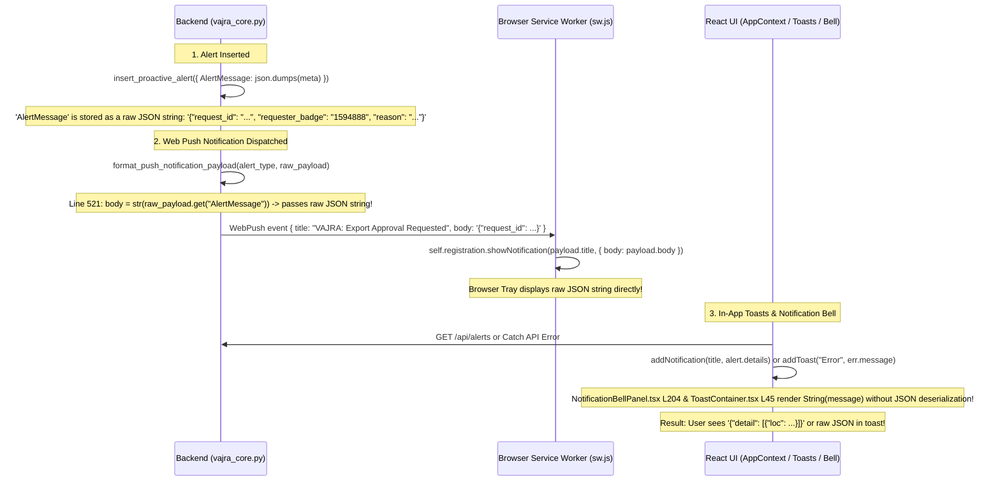
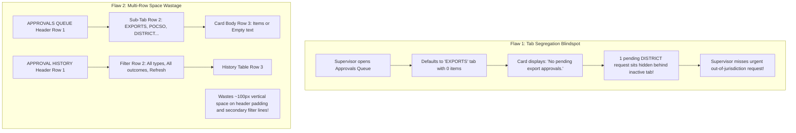
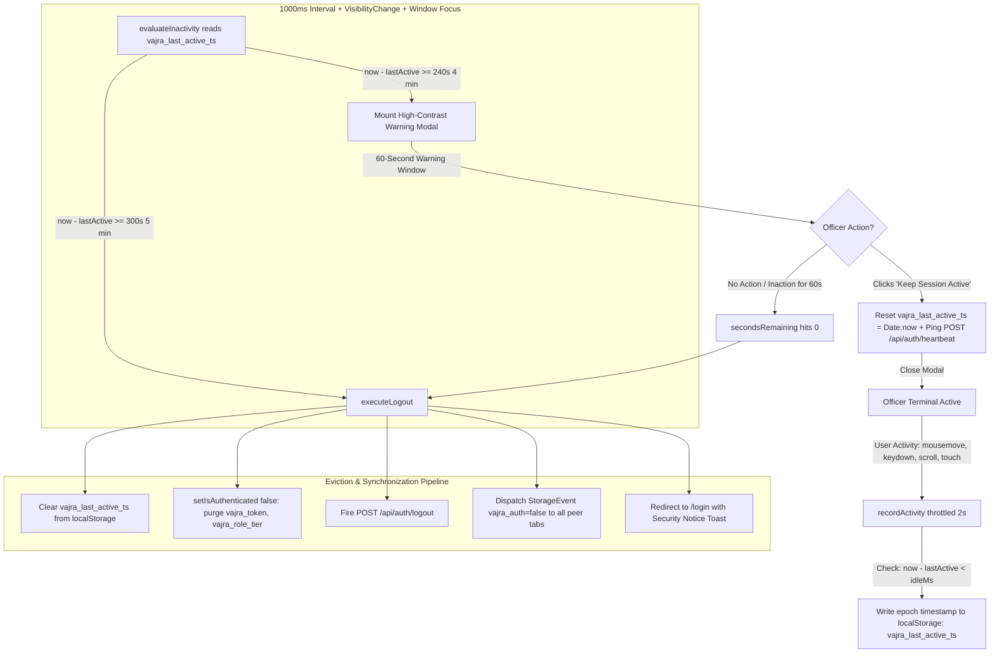
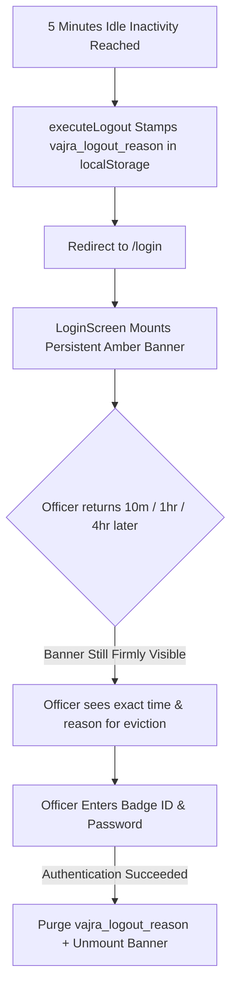

# VAJRA System Touchups: Architecture & Implementation Master Plan

> **Document Status**: Architectural Plan & Review Draft  
> **Target File**: `Touchups.md`  
> **Scope**: 
> 1. Concurrency Control & Two-Tier Supervisor Escalation Flow
> 2. Theme & Dark/Light Mode Contrast & Readability Fixes
> 3. Universal Notification & Error Message Formatting (Browser Push, In-App Toasts, System Alerts, and Modal Errors)
> 4. Time-Boxed Granular Access Windows (District Analysis & POCSO Act Prompt Gating)
> 5. Approval Queue & History Space-Optimized Unified Architecture (Single-Line Headers & All-In-One Unified Queue)
> 6. Inactive User Timeout Guard Verification & 5-Minute Reduction Architecture
>
> **Execution Constraint**: Strict Planning Mode — no git operations, no code modification until plan sign-off.

---

## Executive Summary & Objectives

This document establishes the comprehensive design and implementation plan for six critical user experience, operational, and statutory touchups in the **VAJRA** platform:

1. **Concurrency Control & Supervisor Escalation Flow**: Streamlines the officer session eviction experience by eliminating the modal text field in favor of a one-click silent report, introduces a non-intrusive supervisor notification followed by an automated **60-second inaction escalation reminder**, and centralizes forensic triage within a dedicated **Security Incident Queue** in the Supervisor Dashboard.
2. **Theme Consistency & Dark/Light Mode Readability**: Resolves styling collisions caused by custom property inversion in [index.css](file:///c:/Projects/VAJRA/src/index.css) when switching between Dark and Light modes. Ensures high contrast for modal overlays, SVG district map labels, Leaflet map popup cards, Recharts tooltips, and gold action buttons.
3. **Universal Notification & Error Message Formatting**: Eliminates raw JSON strings (`{"detail": ...}`, `{"requester_badge": ...}`) currently dumped into browser OS notifications, on-screen toasts, the notification bell dropdown, and component error banners. Implements dual-layer sanitization (backend push synthesis and frontend recursive unmarshalling).
4. **Time-Boxed Granular Access Windows (District Analysis & POCSO Act)**:
   - **District Analysis Access**: Allows the investigator to specify the required duration window via a dropdown menu with intervals of **`1, 2, 5, 10, and 15 minutes`** at request time.
   - **POCSO Act Access**: Empowers the supervisor to decide and allocate the exact time window for which POCSO prompts and unmasked victim identities are permitted, selectable from a dropdown of intervals: **`1, 2, 5, 10, 15, 20, 25, and 30 minutes`**. Enforces automated prompt re-redaction and client-side countdown tickers upon expiry.
5. **Approval Queue & History Space-Optimized Unified Architecture**:
   - **Unified Approvals Queue**: Merges all pending approval types (Exports, POCSO, District, Profile, Security) into **one unified default view** so supervisors never miss pending actions siloed behind hidden tabs. Officers/supervisors can still filter by type via an inline filter.
   - **Single-Line Header Alignment**: Aligns section titles and filter controls on the **exact same horizontal line** across both the Approvals Queue and Approval History panels, eliminating unnecessary vertical line wraps and reclaiming ~100px of vertical screen real estate.
6. **Inactive User Timeout Guard Verification, 5-Minute Reduction & Persistent Login Banner**:
   - **Verification & Hardening**: Validates that the 4 anti-fragility mechanics (epoch wall-clock delta, post-idle activity refusal, decoupled React 18 updater, cross-tab storage synchronization) are operating properly, and resolves edge cases around stale timestamp re-login immunity and uniform cleanup across all logout paths.
   - **5-Minute Reduction**: Reduces the total inactivity threshold down to strictly **5 minutes** (**4 minutes silent idle + 60-second warning countdown**), synchronizes user-facing policy copy in [SettingsScreen.tsx](file:///c:/Projects/VAJRA/src/screens/SettingsScreen.tsx), and implements instant keep-alive heartbeat refresh.
   - **Persistent Amber Login Banner**: Solves the "8-second disappearing toast" flaw. When an officer returns to their workstation minutes or hours after eviction, a prominent, persistent amber advisory banner remains mounted directly on [LoginScreen.tsx](file:///c:/Projects/VAJRA/src/screens/LoginScreen.tsx) above the login form, explicitly informing them of the automated 5-minute inactivity lockdown until they re-authenticate.

---

## 1. Concurrency Control & Supervisor Escalation Flow

### 1.1 Current Architecture & Identified Deficiencies

```mermaid
flowchart TD
    subgraph Current Flow
        A1[Officer Terminal Evicted] --> A2[Modal with Reason Textfield]
        A2 -->|Officer types reason| A3[POST /api/security/report-unauthorized-eviction]
        A3 --> A4[Supervisor Terminal: Full-Screen Warning Modal immediately pops up]
        A4 -->|Acknowledge / Terminate| A5[Ad-hoc Modal Action]
    end

    subgraph Proposed Flow
        B1[Officer Terminal Evicted] -->|One-Click Silent Report| B2[POST /api/security/report-unauthorized-eviction]
        B2 --> B3[Clean Logout + Login Badge: 'Reported to Supervisor']
        B2 --> B4[Supervisor Terminal: Tier-1 Non-Intrusive Toast & Bell Badge]
        B4 -->|60s Inaction Timer| B5[Tier-2 Full-Screen Reminder Modal]
        B5 -->|Click 'Consult Supervisor Dashboard'| B6[Supervisor Dashboard: Security Incident Queue]
        B6 --> B7{3 Triage Actions}
        B7 --> B7a[1. Lock Account]
        B7 --> B7b[2. Escalate to Cyber Command]
        B7 --> B7c[3. Dismiss as Authorized Handover]
    end
```



#### Deficiencies in Existing Implementation:
- **Officer Friction**: When an officer terminal is evicted by a concurrent login ([RemoteEvictionModal.tsx](file:///c:/Projects/VAJRA/src/components/RemoteEvictionModal.tsx)), the officer is prompted to fill out a textarea with a "reason", adding cognitive load during an unexpected security eviction.
- **Supervisor Disruption**: In [App.tsx](file:///c:/Projects/VAJRA/src/App.tsx#L200), [UnrecognizedLoginWarningModal.tsx](file:///c:/Projects/VAJRA/src/components/UnrecognizedLoginWarningModal.tsx) immediately mounts as an aggressive full-screen blocking overlay on the supervisor's screen, interrupting active command workflows.
- **Lack of Dedicated Incident Queue**: The supervisor currently has no centralized workspace with audit histories, remote IP geolocation, device fingerprints, and standard operating procedure (SOP) actions.

---

### 1.2 Proposed Multi-Tier Concurrency Architecture

#### A. Officer Terminal Experience (Silent One-Tap Reporting)
1. **Remove Text Input**: Eliminate the textarea and manual reason submission from [RemoteEvictionModal.tsx](file:///c:/Projects/VAJRA/src/components/RemoteEvictionModal.tsx).
2. **One-Tap Action**: 
   - Button: `"Don't recognise this logout? Report to supervisor"` (`supervisor_reported`).
   - Immediately invokes `POST /api/security/report-unauthorized-eviction` with automatic client telemetry:
     - KGID, local timestamp, client user-agent, local IP/session identifier.
3. **Clean Session Exit & Login Badge**:
   - Automatically executes `logout()` to flush cached state and tokens.
   - Redirects to `/login` with transient state or query parameter:
     - `?reported_unauthorized=true&kgid=...`
   - [LoginScreen.tsx](file:///c:/Projects/VAJRA/src/screens/LoginScreen.tsx) renders a prominent, reassuring amber badge:
     > **Security Notice**: Your report has been dispatched to the Duty Supervisor. Your session was safely terminated and flagged for forensic verification.

#### B. Supervisor Terminal Experience (Two-Tier Alert Escalation)
1. **Tier 1: Non-Intrusive In-App Alert (0 – 60 Seconds)**:
   - When the officer reports an eviction, the supervisor's active polling ([/api/security/unrecognized-logins](file:///c:/Projects/VAJRA/vajra_backend/main.py#L11824)) detects the new pending report.
   - Pops an on-screen toast (`"⚠️ Security Alert: Officer [Name] (KGID: [KGID]) reported unauthorized session eviction."`) and updates the notification bell badge with a pulsing amber shield icon.
   - Starts a client-side **60-second countdown timer** tied to the alert ID.
2. **Tier 2: Escalation Takeover Modal (Triggered after 60s Inaction)**:
   - If the supervisor has neither clicked the toast nor triaged the incident within 60 seconds:
   - A high-visibility full-screen reminder modal mounts:
     > **ATTENTION REQUIRED: Unresolved Security Alert**  
     > Officer **[Officer Name]** (KGID: **[KGID]**) reported an unauthorized remote eviction **60 seconds ago**.  
     > *Protocol requires supervisor review to prevent unauthorized credential usage.*  
     > **[Open Supervisor Dashboard]** &bull; **[Snooze 2 Minutes]**
   - Clicking `"Open Supervisor Dashboard"` redirects directly to `/supervisor?tab=security-incidents&focus=[IncidentID]`.

#### C. Supervisor Dashboard: Dedicated Security Incident Queue
Inside [SupervisorDashboardScreen.tsx](file:///c:/Projects/VAJRA/src/screens/SupervisorDashboardScreen.tsx), add a specialized sub-panel: **"Concurrent Login & Eviction Incident Ledger"**:
- **Incident Card / Table Row Elements**:
  - **Officer Details**: Name, KGID, Station, Rank.
  - **Evicted Session**: IP Address, Browser/OS, Login Time, Eviction Timestamp.
  - **New (Evicting) Session**: Remote IP, Device Fingerprint, Timestamp, Geolocation.
  - **Status Indicator**: `PENDING REVIEW` &bull; `ESCALATED` &bull; `RESOLVED`.
- **Three Standard Operating Procedure (SOP) Action Buttons**:
  1. <kbd>Lock Account Immediately</kbd>:
     - Calls `POST /api/security/officer/{kgid}/lock` -> sets `IsBlocked = True`, terminates all active tokens, dispatches SMS alert to the officer's registered mobile number.
  2. <kbd>Escalate to Cyber Command</kbd>:
     - Calls `POST /api/security/incident/{rowid}/escalate-cyber` -> creates an urgent ticket in the CCTNS Cyber Crime division and logs the source IP for perimeter blacklisting.
  3. <kbd>Dismiss as Authorized Handover</kbd>:
     - Calls `POST /api/security/unrecognized-logins/{rowid}/dismiss` with supervisor notes, confirming shift handover or verified multi-terminal access.

---

## 2. Theme Consistency & Dark/Light Readability System

### 2.1 Root Cause Analysis of Theme Inconsistencies

In [src/index.css](file:///c:/Projects/VAJRA/src/index.css#L48-L76), switching to light mode (`html.light`) inverts the entire Tailwind `stone` palette:
```css
html.light {
  --color-stone-900: oklch(92.3% 0.003 48.7);  /* Light grey/off-white */
  --color-stone-950: oklch(97% 0.001 48.7);    /* Near-white */
}
```
While this works well for standard panels, several specialized UI elements mix **hardcoded dark colors** with **inverted stone utility classes**:

```mermaid
graph TD
    A[index.css: html.light inverts stone-900 to 92% Lightness] --> B[Modal Overlay Bug]
    A --> C[District Map Text Bug]
    A --> D[Leaflet Popup Bubble Bug]
    A --> E[Recharts Tooltip Bug]
    A --> F[Gold Action Button Bug]

    B --> B1[Hardcoded bg-black/90 + Inverted bg-stone-900 Card -> Pitch black backdrop with stark white card]
    C --> C1[Hardcoded fill='#1A1715' on SVG -> Dark text on dark map tiles in dark mode]
    D --> D1[className='text-stone-900' in Leaflet white popup -> White text on white background in light mode]
    E --> E1[contentStyle={{ background: '#211f1d' }} inherits dark text -> Black text on dark grey card in light mode]
    F --> F1[bg-[#C79A4E] text-stone-950 -> White text on gold button in light mode]
```

---

### 2.2 Component Remediation Plan

#### 1. Remote Eviction & Warning Modals ([RemoteEvictionModal.tsx](file:///c:/Projects/VAJRA/src/components/RemoteEvictionModal.tsx) & [UnrecognizedLoginWarningModal.tsx](file:///c:/Projects/VAJRA/src/components/UnrecognizedLoginWarningModal.tsx))
- **Overlay**: Replace hardcoded `bg-black/90` with theme-responsive backdrop:
  `bg-stone-950/80 backdrop-blur-md`
- **Card Container**: Ensure explicit border and background definitions:
  `bg-stone-900 border border-stone-800 text-stone-100 shadow-2xl`
- **Action Buttons**: Replace `text-stone-950` on gold backgrounds with explicit dark text:
  `bg-[#C79A4E] hover:bg-[#d8a95d] text-[#1A1816] font-bold` (ensures dark, legible text on gold regardless of theme).

#### 2. District SVG Map Labels ([DistrictDashboardScreen.tsx:L253](file:///c:/Projects/VAJRA/src/screens/DistrictDashboardScreen.tsx#L253))
- **Current Issue**: SVG text elements use hardcoded dark charcoal:
  ```tsx
  fill={active ? "#1A1715" : "rgba(33,31,29,0.7)"}
  ```
- **Remediation**: Use dynamic fill based on current theme:
  ```tsx
  fill={
    theme === "light"
      ? (active ? "#1A1715" : "rgba(33,31,29,0.75)")
      : (active ? "#F5F5F4" : "rgba(230,228,226,0.75)")
  }
  ```
  Ensure SVG `<text>` elements have `className="font-mono text-[9px] pointer-events-none select-none"`.

#### 3. Leaflet Map Popups ([DistrictSpatialAnalystPanel.tsx:L153, L519, L533, L575](file:///c:/Projects/VAJRA/src/components/DistrictSpatialAnalystPanel.tsx#L153))
- **Current Issue**: Inside Leaflet popups (which default to `#ffffff` background in Leaflet's DOM), elements use `className="text-stone-900"`. In light mode, `text-stone-900` becomes `oklch(92.3%)` (white), rendering text completely invisible.
- **Remediation**:
  - Option A (Global Leaflet Theme Styling in `index.css`):
    ```css
    .leaflet-popup-content-wrapper {
      background: var(--color-stone-900) !important;
      color: var(--color-stone-100) !important;
      border: 1px solid var(--color-stone-750) !important;
      border-radius: 0.75rem !important;
      box-shadow: 0 20px 25px -5px rgb(0 0 0 / 0.5) !important;
    }
    .leaflet-popup-tip {
      background: var(--color-stone-900) !important;
    }
    ```
  - Option B: Use fixed color tokens (`text-neutral-900 dark:text-neutral-100` or explicit hex `#1C1917`) inside popup JSX.

#### 4. Recharts Chart Tooltips ([DistrictDashboardScreen.tsx](file:///c:/Projects/VAJRA/src/screens/DistrictDashboardScreen.tsx), [DistrictDemographicPanel.tsx](file:///c:/Projects/VAJRA/src/components/DistrictDemographicPanel.tsx))
- **Current Issue**: `contentStyle={{ background: "#211f1d", border: "1px solid #333" }}` lacks explicit font `color`, so light mode cascades dark text into a dark tooltip box.
- **Remediation**: Centralize a theme-aware tooltip configuration:
  ```tsx
  contentStyle={{
    backgroundColor: theme === "light" ? "#FAFAF9" : "#1C1917",
    borderColor: theme === "light" ? "#E7E5E4" : "#292524",
    color: theme === "light" ? "#1C1917" : "#F5F5F4",
    borderRadius: "0.5rem",
    boxShadow: "0 10px 15px -3px rgba(0, 0, 0, 0.3)",
    fontSize: "11px",
    fontFamily: "monospace",
  }}
  ```

#### 5. Universal Gold Action Buttons (`bg-[#C79A4E]`)
- Audit all instances of `bg-[#C79A4E] text-stone-950` across screens ([DistrictDashboardScreen.tsx:L1108, L1209, L1323](file:///c:/Projects/VAJRA/src/screens/DistrictDashboardScreen.tsx#L1108), [SupervisorDashboardScreen.tsx](file:///c:/Projects/VAJRA/src/screens/SupervisorDashboardScreen.tsx)).
- Replace `text-stone-950` with `text-[#1A1816] font-semibold tracking-wide` so button labels stay deep charcoal/black against gold in both light and dark themes.

---

## 3. Universal Notification & Error Message Formatting Architecture

### 3.1 Problem Analysis: Why Raw JSON Files & Strings Appear in UI

The user observed:
> *"The notifications are very broken (The ones from the browser and error messages in the regular app interface). What I mean by broken is that, it directly gives the JSON FIle content without adjusting the formatting."*

Investigation uncovered the exact mechanism causing this behavior:



1. **Backend Serialization in ProactiveAlerts**:
   - In [vajra_backend/main.py:L10282](file:///c:/Projects/VAJRA/vajra_backend/main.py#L10282) (`EXPORT_APPROVAL`), [main.py:L12375](file:///c:/Projects/VAJRA/vajra_backend/main.py#L12375) (`PROFILE_CHANGE`), [vajra_core.py:L1081](file:///c:/Projects/VAJRA/vajra_backend/vajra_core.py#L1081) (`POCSO_ACCESS`), and [vajra_core.py:L1214](file:///c:/Projects/VAJRA/vajra_backend/vajra_core.py#L1214) (`DISTRICT_ACCESS`), structured workflow payloads are inserted using `json.dumps(meta)` into `AlertMessage`.
2. **Push Payload Passthrough**:
   - In [vajra_backend/vajra_core.py:L521](file:///c:/Projects/VAJRA/vajra_backend/vajra_core.py#L521):
     ```python
     body = str(raw_payload.get("AlertMessage") or "New alert requires your attention.")
     ```
     Because `AlertMessage` is a JSON string, the service worker receives raw JSON as the `body`.
3. **Frontend String Coercion**:
   - In [AppContext.tsx:L570](file:///c:/Projects/VAJRA/src/AppContext.tsx#L570), [NotificationBellPanel.tsx:L185](file:///c:/Projects/VAJRA/src/components/NotificationBellPanel.tsx#L185), and [ToastContainer.tsx:L31](file:///c:/Projects/VAJRA/src/components/ToastContainer.tsx#L31), messages are converted with `String(message)` without checking if the string starts with `{` or `[`.
4. **FastAPI & Network Error Objects**:
   - When an API endpoint fails, FastAPI responds with `{ "detail": "..." }` or `{ "detail": [{ "loc": [...], "msg": "..." }] }` (422 validation errors).
   - In multiple components (`catch (err: any)`), the code passes `err.message` or `data.detail` directly into `addToast` or `setErrorMsg`. If `err.message` is stringified JSON, the user sees raw JSON code on their screen.

---

### 3.2 Dual-Layer Remediation Plan

#### Layer 1: Backend Web Push Notification Formatter (`vajra_core.py`)
In `format_push_notification_payload`, intelligently parse `raw_payload["AlertMessage"]` before constructing the push payload:

```python
def format_push_notification_payload(alert_type: str, raw_payload: Dict[str, Any]) -> Dict[str, str]:
    """Generates human-readable title, body, and action URL for OS/browser push notifications."""
    raw_message = raw_payload.get("AlertMessage")
    meta = {}
    
    # Safely parse JSON if serialized
    if isinstance(raw_message, str) and raw_message.strip().startswith(("{", "[")):
        try:
            meta = json.loads(raw_message)
        except Exception:
            meta = {}
    elif isinstance(raw_message, dict):
        meta = raw_message

    # Human-friendly message synthesis based on AlertType
    if alert_type == "EXPORT_APPROVAL":
        requester = meta.get("requester_name", "An officer")
        badge = meta.get("requester_badge", "")
        summary = meta.get("summary", "Case data export")
        title = "VAJRA: Case Export Approval Requested"
        body = f"{requester} (KGID: {badge}) requested export for: {summary}."
        url = "/supervisor?tab=approvals"

    elif alert_type == "POCSO_ACCESS":
        requester = meta.get("requester_name", "An officer")
        case_no = meta.get("case_no", "Restricted Case")
        reason = meta.get("reason", "Statutory investigation")
        title = "VAJRA: POCSO Sensitive Record Access"
        body = f"{requester} requested access to Case #{case_no}. Reason: {reason}."
        url = "/supervisor?tab=approvals"

    elif alert_type == "DISTRICT_ACCESS":
        requester = meta.get("requester_name", "An officer")
        target_dist = meta.get("target_district_name", "Adjacent District")
        duration = meta.get("duration_minutes", 5)
        title = "VAJRA: Cross-District Access Request"
        body = f"{requester} requested {duration}-minute access for {target_dist}."
        url = "/supervisor?tab=approvals"

    elif alert_type == "PROFILE_CHANGE":
        requester = meta.get("requester_name", "An officer")
        title = "VAJRA: Officer Profile Update"
        body = f"{requester} requested updates to official contact credentials."
        url = "/supervisor?tab=personnel"

    elif alert_type == "UNAUTHORIZED_LOGOUT_ALERT":
        badge = meta.get("badge") or raw_payload.get("DistrictID")
        title = "🚨 VAJRA Security Alert: Session Eviction"
        body = f"Officer (KGID: {badge}) reported an unrecognized remote logout. Immediate triage advised."
        url = "/supervisor?tab=security-incidents"

    else:
        title = _PUSH_TITLE_BY_TYPE.get(alert_type, f"VAJRA: {(alert_type or '').replace('_', ' ').title()}")
        body = str(meta.get("message") or meta.get("detail") or raw_message or "New alert requires your attention.")
        url = _PUSH_URL_BY_TYPE.get(alert_type, "/supervisor")

    return {"title": title, "body": body[:200], "url": url}
```

#### Layer 2: Browser Service Worker Defense ([public/sw.js](file:///c:/Projects/VAJRA/public/sw.js) & [client/sw.js](file:///c:/Projects/VAJRA/client/sw.js))
In `sw.js`, add defensive fallback parsing so even if a third-party source or legacy payload delivers a JSON string, the worker parses it into clean text:

```javascript
self.addEventListener("push", (event) => {
  let payload = { title: "VAJRA Alert", body: "New alert requires your attention.", url: "/" };
  try {
    if (event.data) payload = { ...payload, ...event.data.json() };
  } catch (e) {
    if (event.data) payload.body = event.data.text();
  }

  // Defensive sanitization: if payload.body is a stringified JSON object
  if (typeof payload.body === "string" && payload.body.trim().startsWith("{")) {
    try {
      const parsed = JSON.parse(payload.body);
      payload.body = parsed.message || parsed.detail || parsed.reason || parsed.summary ||
        Object.entries(parsed)
          .filter(([k]) => !k.includes("id") && !k.includes("token"))
          .map(([k, v]) => `${k.replace(/_/g, " ")}: ${v}`)
          .join(" • ") || payload.body;
    } catch (_) {}
  }

  event.waitUntil(
    self.registration.showNotification(payload.title, {
      body: payload.body,
      icon: "/vite.svg",
      badge: "/vite.svg",
      data: { url: payload.url || "/" },
      tag: "vajra-alert",
      renotify: true,
    })
  );
});
```

#### Layer 3: Centralized Frontend Notification & Error Sanitizer ([src/lib/formatUtils.ts](file:///c:/Projects/VAJRA/src/lib/formatUtils.ts))
Create a dedicated utility to normalize any error, API response, or notification payload:

```typescript
export interface SanitizedAlert {
  title: string;
  message: string;
  metadata?: Record<string, any>;
}

export function formatErrorMessage(error: unknown): string {
  if (!error) return "An unexpected error occurred.";
  if (typeof error === "string") {
    const trimmed = error.trim();
    if (trimmed.startsWith("{") || trimmed.startsWith("[")) {
      try {
        const parsed = JSON.parse(trimmed);
        return formatErrorMessage(parsed);
      } catch (_) {
        return trimmed;
      }
    }
    return trimmed;
  }
  if (error instanceof Error) {
    return formatErrorMessage(error.message);
  }
  if (typeof error === "object") {
    const obj = error as any;
    // FastAPI HTTP 422 validation errors: { detail: [{ loc: [...], msg: "..." }] }
    if (Array.isArray(obj.detail)) {
      return obj.detail.map((d: any) => d.msg || JSON.stringify(d)).join(". ");
    }
    if (typeof obj.detail === "string") return obj.detail;
    if (typeof obj.message === "string") return obj.message;
    if (typeof obj.error === "string") return obj.error;
    if (typeof obj.reason === "string") return obj.reason;

    // Structured metadata objects (e.g., Export/POCSO)
    const pairs: string[] = [];
    if (obj.requester_name) pairs.push(`Officer: ${obj.requester_name}`);
    if (obj.case_no) pairs.push(`Case: #${obj.case_no}`);
    if (obj.summary) pairs.push(`Summary: ${obj.summary}`);
    if (obj.reason) pairs.push(`Reason: ${obj.reason}`);
    if (pairs.length > 0) return pairs.join(" • ");

    try {
      return Object.entries(obj)
        .filter(([k]) => !k.toLowerCase().includes("token") && !k.toLowerCase().includes("id"))
        .map(([k, v]) => `${k.replace(/_/g, " ")}: ${v}`)
        .join(" • ");
    } catch (_) {
      return "Operation failed. Please check connection.";
    }
  }
  return String(error);
}
```

#### Layer 4: Integration into [AppContext.tsx](file:///c:/Projects/VAJRA/src/AppContext.tsx)
Integrate `formatErrorMessage` directly into `addToast` and `addNotification`:
- Resolves titles and messages automatically through `formatErrorMessage`.
- Handles both object arguments `{ title, message, severity }` and positional arguments `(title, message, severity)`.
- If an alert passes a raw JSON string in `message`, `addNotification` converts it into cleanly formatted text before saving to `localStorage` or `notifications` state.

#### Layer 5: UI Card Badge Enhancement ([NotificationBellPanel.tsx](file:///c:/Projects/VAJRA/src/components/NotificationBellPanel.tsx) & [ToastContainer.tsx](file:///c:/Projects/VAJRA/src/components/ToastContainer.tsx))
- If an alert has structured metadata (e.g., `officer`, `case_no`, `status`), render discrete UI badge chips.
- Guarantees zero raw curly braces `{}` or quotation marks `"` appear in notifications.

---

## 4. Time-Boxed Granular Access Windows Architecture

### 4.1 Comparative Functional Specification

The security architecture bifurcates jurisdictional access (District Analysis) and statutory child protection (POCSO Act) based on legal accountability:

| Attribute | District Analysis Access | POCSO Act Prompts Access |
| :--- | :--- | :--- |
| **Legal Basis** | BNSS Section 185 (Jurisdictional Inquiry) | POCSO Act 2012 §33(7) & JJA 2015 §74 |
| **Duration Decider** | **Investigator (Requester)** specifies operational window | **Supervisor (Approver)** mandates allocated window |
| **Dropdown Intervals** | **`1, 2, 5, 10, 15 minutes`** | **`1, 2, 5, 10, 15, 20, 25, 30 minutes`** |
| **Default Value** | `5 minutes` | `10 minutes` |
| **UI Location of Dropdown** | [ReasonCollectionModal.tsx](file:///c:/Projects/VAJRA/src/components/ReasonCollectionModal.tsx) (Investigator screen) | [SupervisorDashboardScreen.tsx](file:///c:/Projects/VAJRA/src/screens/SupervisorDashboardScreen.tsx) (Approval queue) |
| **Backend Storage** | `ProactiveAlerts.AlertMessage.duration_minutes` | `ProactiveAlerts.AlertMessage.duration_minutes` |
| **Grant Expiration** | `datetime.utcnow() + timedelta(minutes=duration)` | `datetime.utcnow() + timedelta(minutes=duration)` |
| **Enforcement Layer** | [DistrictDashboardScreen.tsx](file:///c:/Projects/VAJRA/src/screens/DistrictDashboardScreen.tsx) rapid heartbeat + API gate | [agent_loop.py](file:///c:/Projects/VAJRA/vajra_backend/agent_loop.py) prompt unmasker + [ChatBubble.tsx](file:///c:/Projects/VAJRA/src/components/ChatBubble.tsx) |
| **Expiry Consequence** | Immediate terminal lock, cache wipe, home redirect | Immediate LLM re-redaction (`[REDACTED UNDER §74 JJA]`) |

```mermaid
flowchart TD
    subgraph District Analysis Flow
        D1[Investigator clicks Foreign District] --> D2[ReasonCollectionModal opens]
        D2 --> D3[Investigator selects Duration: 1, 2, 5, 10, or 15 mins]
        D3 --> D4[POST /api/district-access/request with duration_minutes]
        D4 --> D5[Supervisor views card with Requested Duration badge]
        D5 -->|Approve| D6[Backend sets grant_expires_at = now + duration_mins]
        D6 --> D7[Investigator Screen: Live Countdown Ticker 04:59]
        D7 -->|Timer = 00:00| D8[Instant Session Purge & Revocation Shield Modal]
    end

    subgraph POCSO Act Prompts Flow
        P1[Officer views Masked POCSO Bubble] --> P2[Officer clicks Request Access with Reason]
        P2 --> P3[POST /api/pocso/request without duration]
        P3 --> P4[Supervisor Pending Queue: POCSO Request Card]
        P4 --> P5[Supervisor selects Allocation: 1, 2, 5, 10, 15, 20, 25, 30 mins]
        P5 -->|Approve with Duration| P6[POST /api/pocso/rowid/decision with duration_minutes]
        P6 --> P7[Backend sets grant_expires_at = now + duration_mins]
        P7 --> P8[Officer Chat: Live POCSO Authorization Ticker]
        P8 -->|Officer Prompts within window| P9[LLM delivers unmasked victim/facts]
        P8 -->|Timer = 00:00| P10[has_active_pocso_grant = False: LLM re-masks with §74 JJA tag]
    end
```



---

### 4.2 District Analysis Access: Investigator-Specified Duration Window

#### A. Investigator Request Modal ([ReasonCollectionModal.tsx](file:///c:/Projects/VAJRA/src/components/ReasonCollectionModal.tsx))
Enhance `ReasonCollectionModal` to accept an optional `durationOptions` array:
```typescript
interface ReasonCollectionModalProps {
  isOpen: boolean;
  title: string;
  subtitle: string;
  actionLabel?: string;
  placeholder?: string;
  minChars?: number;
  durationOptions?: number[]; // [1, 2, 5, 10, 15]
  defaultDuration?: number;   // 5
  onClose: () => void;
  onSubmit: (reason: string, durationMinutes?: number) => Promise<void> | void;
}
```

When `durationOptions` is passed:
1. Render a styled dropdown selector:
   ```tsx
   <div className="space-y-1.5">
     <label className="text-[11px] font-mono font-bold text-stone-300 uppercase tracking-wide flex justify-between">
       <span>Access Duration Window</span>
       <span className="text-[#C79A4E] text-[10px]">Auto-terminates upon elapsed time</span>
     </label>
     <select
       value={selectedDuration}
       onChange={(e) => setSelectedDuration(Number(e.target.value))}
       className="w-full bg-stone-900 border border-stone-750 focus:border-[#C79A4E] rounded-xl px-3 py-2 text-xs font-mono text-stone-100"
     >
       <option value={1}>1 Minute — Rapid Tactical Verification</option>
       <option value={2}>2 Minutes — Quick Record Inspection</option>
       <option value={5}>5 Minutes — Standard Station Inquiry (Default)</option>
       <option value={10}>10 Minutes — Complex Cross-District Audit</option>
       <option value={15}>15 Minutes — Full Spatial Pattern Investigation</option>
     </select>
   </div>
   ```
2. Passes `(reason, selectedDuration)` to `onSubmit`.

#### B. Backend API: Request Endpoint (`POST /api/district-access/request`)
Update `vajra_backend/main.py`:
```python
ALLOWED_DISTRICT_DURATIONS = {1, 2, 5, 10, 15}

@app.post("/api/district-access/request")
async def request_district_access(payload: Dict[str, Any] = Body(default={}),
                                  request: Request = None, location_context: str = Depends(security_firewall)):
    target_district_id = payload.get("district_id")
    duration_minutes = int(payload.get("duration_minutes") or 5)
    if duration_minutes not in ALLOWED_DISTRICT_DURATIONS:
        raise HTTPException(status_code=400, detail="Invalid duration window. Allowed intervals: 1, 2, 5, 10, 15 minutes.")
    
    # Store duration_minutes in meta payload
    meta = create_district_access_request(
        badge, officer_name,
        home_district_id, target_district_id, target_district_name,
        reason=reason,
        duration_minutes=duration_minutes
    )
```

#### C. Supervisor Decision Endpoint (`POST /api/district-access/{request_id}/decision`)
Update `decide_district_access` in [vajra_backend/main.py](file:///c:/Projects/VAJRA/vajra_backend/main.py#L12921):
```python
if decision == "approved":
    duration_mins = int(meta.get("duration_minutes") or 5)
    meta["grant_expires_at"] = (datetime.utcnow() + timedelta(minutes=duration_mins)).isoformat()
```
*(Replaces the deprecated 8-hour `DISTRICT_ACCESS_GRANT_HOURS` static duration).*

#### D. Live Countdown & Rapid Eviction Engine ([DistrictDashboardScreen.tsx](file:///c:/Projects/VAJRA/src/screens/DistrictDashboardScreen.tsx))
1. **Live Header Banner**: When out-of-jurisdiction access is active, pin a countdown bar across the top of the dashboard:
   ```tsx
   <div className="bg-amber-500/10 border-b border-amber-500/30 px-4 py-2 flex items-center justify-between text-xs font-mono">
     <div className="flex items-center gap-2 text-amber-400">
       <Clock className="w-4 h-4 animate-spin-slow" />
       <span>ACTIVE JURISDICTIONAL GRANT: {detail?.district}</span>
     </div>
     <div className="flex items-center gap-3">
       <span className="text-stone-300">Remaining Time:</span>
       <span className="px-2 py-0.5 rounded bg-amber-500/20 font-bold text-amber-300">
         {formatSeconds(remainingGrantSeconds)}
       </span>
     </div>
   </div>
   ```
2. **Automated Client Expiry**:
   - `useEffect` ticks every 1 second: `setRemainingGrantSeconds(prev => prev - 1)`.
   - When `remainingGrantSeconds <= 0`:
     - Triggers `terminateEmergencySession("Authorized district access duration has expired.")`.
     - Flushes state, switches district back to `homeDistrictId`, and displays the modal: `"District Access Window Expired. Return to Home Station."`

---

### 4.3 POCSO Act Access: Supervisor-Allocated Prompt Window

#### A. Supervisor Decision UI in Queue ([SupervisorDashboardScreen.tsx](file:///c:/Projects/VAJRA/src/screens/SupervisorDashboardScreen.tsx))
For each card in `pendingPocso`, add the statutory duration allocator:
1. **Duration Allocation State**:
   ```typescript
   const [pocsoAllocatedDurations, setPocsoAllocatedDurations] = useState<Record<string, number>>({});
   ```
2. **Supervisor Dropdown Component**:
   ```tsx
   <div className="flex items-center gap-2 pt-2 border-t border-stone-800">
     <label className="text-[10px] font-mono uppercase text-stone-400">Allocate Prompt Access:</label>
     <select
       value={pocsoAllocatedDurations[item.rowid] || 10}
       onChange={(e) => setPocsoAllocatedDurations(prev => ({ ...prev, [item.rowid]: Number(e.target.value) }))}
       className="bg-stone-900 border border-stone-750 text-stone-200 text-xs font-mono rounded px-2 py-1 focus:border-[#C79A4E]"
     >
       <option value={1}>1 Minute (Single Prompt Inspection)</option>
       <option value={2}>2 Minutes (Brief Inquiry)</option>
       <option value={5}>5 Minutes (Short Review)</option>
       <option value={10}>10 Minutes (Standard Review - Default)</option>
       <option value={15}>15 Minutes (Interrogation Reference)</option>
       <option value={20}>20 Minutes (Case Diary Compilation)</option>
       <option value={25}>25 Minutes (Comprehensive Cross-Check)</option>
       <option value={30}>30 Minutes (Maximum Statutory Window)</option>
     </select>
   </div>
   ```
3. **Approve Action**:
   ```typescript
   const duration = pocsoAllocatedDurations[item.rowid] || 10;
   await decidePocso(item.rowid, true, duration);
   ```

#### B. Backend Decision Endpoint (`POST /api/pocso/{request_id}/decision`)
Update `decide_pocso` in [vajra_backend/main.py](file:///c:/Projects/VAJRA/vajra_backend/main.py#L12635):
```python
ALLOWED_POCSO_DURATIONS = {1, 2, 5, 10, 15, 20, 25, 30}

@app.post("/api/pocso/{request_id}/decision")
async def decide_pocso(request_id: str, payload: Dict[str, Any] = Body(default={}),
                       request: Request = None, location_context: str = Depends(security_firewall)):
    decision = "approved" if payload.get("approve", True) else "rejected"
    duration_minutes = int(payload.get("duration_minutes") or 10)
    
    if decision == "approved":
        if duration_minutes not in ALLOWED_POCSO_DURATIONS:
            raise HTTPException(status_code=400, detail="Invalid POCSO duration window. Allowed intervals: 1, 2, 5, 10, 15, 20, 25, 30 minutes.")
        meta["duration_minutes"] = duration_minutes
        meta["grant_expires_at"] = (datetime.utcnow() + timedelta(minutes=duration_minutes)).isoformat()
```

#### C. Provenance & Audit Update
In `ChatMessage` dynamic unmasking:
```python
expiry_dt = datetime.fromisoformat(meta["grant_expires_at"]).strftime("%H:%M:%S UTC")
provenance = (
    f"\n\n[🔓 UNMASKED · SUPERVISOR APPROVED by KSP-{request.state.kgid} "
    f"· Valid for {duration_minutes}m until {expiry_dt}]"
)
```

#### D. Prompt Gating in AI Agent Loop ([vajra_backend/agent_loop.py](file:///c:/Projects/VAJRA/vajra_backend/agent_loop.py#L16393))
The function `has_active_pocso_grant(badge, crimeno)` automatically validates `grant_expires_at`:
```python
if m.get("status") == "approved" and m.get("grant_expires_at"):
    try:
        if datetime.fromisoformat(m["grant_expires_at"]) > datetime.utcnow():
            return m
    except Exception:
        pass
```
- **During the `duration_minutes` window**:
  The officer's prompts regarding this case execute unmasked; agent answers include real victim/complainant facts.
- **After expiry**:
  `has_active_pocso_grant` strictly returns `False`.
  Subsequent prompts receive standard §74 JJA masked responses:
  `[REDACTED UNDER POCSO ACT §74 JJA]`.
  The LLM states:
  > *"The supervisory authorization window ({duration_minutes} mins) for Case #{case_no} expired at {expiry_dt}. Prompts regarding sensitive identities are re-masked under Section 74 JJA. Please submit a new supervisor access request if further investigation is required."*

#### E. Client-Side Chat Experience ([AIChatScreen.tsx](file:///c:/Projects/VAJRA/src/screens/AIChatScreen.tsx) & [ChatBubble.tsx](file:///c:/Projects/VAJRA/src/components/ChatBubble.tsx))
1. **Active Authorization Ticker**: While grant is active for the current conversation case, pin an authorization bar above the chat input:
   ```tsx
   <div className="bg-emerald-500/10 border border-emerald-500/30 rounded-lg p-2 mb-2 flex items-center justify-between text-xs font-mono">
     <div className="flex items-center gap-2 text-emerald-400">
       <ShieldCheck className="w-4 h-4" />
       <span>POCSO PROMPT AUTHORIZATION ACTIVE: Case #{activeCaseNo}</span>
     </div>
     <span className="text-emerald-300 font-bold">{formatSeconds(remainingPocsoSeconds)} remaining</span>
   </div>
   ```
2. **Dynamic Re-masking on Expiry**:
   When `remainingPocsoSeconds` hits 0:
   - Banner changes to:
     `🔒 POCSO AUTHORIZATION EXPIRED · All future prompts will be masked under §74 JJA · [Request New Window]`
   - Message bubbles in the DOM that displayed unmasked victim names dynamically replace the unmasked badge with `[🔒 EXPIRED · MASKED]`.

---

## 5. Approval Queue & History Space-Optimized Unified Architecture

### 5.1 Root Cause Analysis: Tab Segregation & Vertical Space Wastage

Inspection of the current interface ([SupervisorDashboardScreen.tsx:L1042-L1350](file:///c:/Projects/VAJRA/src/screens/SupervisorDashboardScreen.tsx#L1042)) and the user's live system screenshot identified two major architectural UX flaws:



1. **Tab Segregation Blindspot**:
   - In `SupervisorDashboardScreen.tsx`, pending requests are partitioned into 5 mutually-exclusive tabs: `activeApprovalTab === "exports" | "pocso" | "district" | "profile" | "security"`.
   - When the screen loads, it defaults to `exports`. If there are 0 pending exports but 1 pending district request (as shown in the live screenshot: `APPROVALS QUEUE (1)` with `DISTRICT (1)`), the supervisor sees a blank `"No pending export approvals"` message.
   - The supervisor is forced to manually click through tabs to find where the 1 pending request is hiding.
2. **Multi-Row Header Space Wastage**:
   - Currently, `<SectionHeader>` renders the title on line 1 and establishes a bottom border.
   - Then, below `<SectionHeader>`, both cards render a separate secondary flex row for filters (`historyTypeFilter`, `historyStatusFilter`, or approval tab pills).
   - This causes unnecessary vertical stacking, pushing the actual pending items and history table down off-screen and requiring excessive scrolling.

---

### 5.2 Unified Single-View Approvals Queue Design

To eliminate the tab blindspot and match the unified, scannable layout of Approval History:
1. **Unified Queue Array**:
   Merge all pending items (`pendingExports`, `pendingPocso`, `pendingDistrict`, `pendingProfile`, `pendingSecurity`) into a single chronological array:
   ```typescript
   interface UnifiedApprovalItem {
     rowid: string | number;
     type: "export" | "pocso" | "district" | "profile" | "security";
     requester_badge: string;
     requester_name?: string;
     created_at?: string;
     trigger_time?: string;
     reason?: string;
     summary?: string;
     case_no?: string;
     target_district_name?: string;
     duration_minutes?: number;
     emergency?: boolean;
     requested_changes_display?: Record<string, any>;
     current_values_display?: Record<string, any>;
     incident_id?: string;
     reported_ip?: string;
     message?: string;
   }
   ```
2. **Default "All Types" View**:
   - By default, the queue displays **ALL pending approvals in one place**!
   - If there is 1 district request and 0 exports, the 1 district request appears immediately on screen—no tab clicking required!
3. **Type Badges for Instant Scanning**:
   Each card/row renders a distinctive, color-coded type badge:
   - `EXPORT` &bull; Gold (`bg-[#C79A4E]/15 border-[#C79A4E]/40 text-[#C79A4E]`)
   - `POCSO` &bull; Fuchsia (`bg-fuchsia-500/15 border-fuchsia-500/40 text-fuchsia-300`)
   - `DISTRICT` &bull; Sky Blue (`bg-sky-500/15 border-sky-500/40 text-sky-300`)
   - `PROFILE` &bull; Teal (`bg-teal-500/15 border-teal-500/40 text-teal-300`)
   - `SECURITY` &bull; Rose (`bg-rose-500/15 border-rose-500/40 text-rose-300`)
4. **Selective Filtering**:
   If an officer/supervisor specifically wants to focus on only one type of request, they can select it from the inline type filter (`All Types`, `Exports`, `POCSO`, `District`, `Profile`, `Security`).

---

### 5.3 Filter-on-Header Single-Line Alignment (Zero Wasted Space)

Both `APPROVALS QUEUE` and `APPROVAL HISTORY` will utilize `SectionHeader`'s built-in `extra` prop to place titles, filter controls, and action buttons on the **EXACT SAME HORIZONTAL FLEX ROW**:

```mermaid
graph TD
    subgraph Approvals Queue Header (Single Line)
        Q1[Left: Hourglass Icon + 'APPROVALS QUEUE' + Total Count Badge] 
        Q2[Right: Type Filter Dropdown + Refresh Button]
        Q1 --- Q2
    end

    subgraph Approval History Header (Single Line)
        H1[Left: Fingerprint Icon + 'APPROVAL HISTORY' + Total Count Badge] 
        H2[Right: Type Filter + Outcome Filter + Refresh Button]
        H1 --- H2
    end
```

#### A. Approvals Queue Header Specification
```tsx
<SectionHeader
  icon={<Hourglass className="w-4 h-4 text-[#C79A4E]" />}
  title={
    <span>
      {lang === "en" ? "Approvals Queue" : "ಅನುಮೋದನೆ ಸಾಲು"}
      <span className="text-[10px] font-mono px-1.5 py-0.5 rounded-full bg-[#C79A4E]/20 text-[#C79A4E] ml-1">
        {totalPendingApprovals}
      </span>
    </span>
  }
  extra={
    <div className="flex items-center gap-2">
      <select
        value={queueTypeFilter}
        onChange={(e) => setQueueTypeFilter(e.target.value as any)}
        className="text-[11px] font-mono bg-stone-950 border border-stone-700 rounded-md px-2.5 py-1 text-stone-300 cursor-pointer focus:border-[#C79A4E] outline-none"
      >
        <option value="all">{lang === "en" ? `All Types (${totalPendingApprovals})` : `ಎಲ್ಲಾ ಬಗೆ (${totalPendingApprovals})`}</option>
        <option value="export">{lang === "en" ? `Exports (${pendingExports.length})` : `ರಫ್ತು (${pendingExports.length})`}</option>
        <option value="pocso">POCSO ({pendingPocso.length})</option>
        <option value="district">{lang === "en" ? `District (${pendingDistrict.length})` : `ಜಿಲ್ಲೆ (${pendingDistrict.length})`}</option>
        <option value="profile">{lang === "en" ? `Profile (${pendingProfile.length})` : `ಪ್ರೊಫೈಲ್ (${pendingProfile.length})`}</option>
        <option value="security">{lang === "en" ? `Security (${pendingSecurity.length})` : `ಭದ್ರತೆ (${pendingSecurity.length})`}</option>
      </select>
    </div>
  }
  onRefresh={fetchAllPendingQueues}
  isRefreshing={isRefreshingQueue}
/>
```

#### B. Approval History Header Specification
```tsx
<SectionHeader
  icon={<Fingerprint className="w-4 h-4 text-[#C79A4E]" />}
  title={
    <span>
      {lang === "en" ? "Approval History" : "ಅನುಮೋದನೆ ಇತಿಹಾಸ"}
      <span className="text-[10px] font-mono px-1.5 py-0.5 rounded-full bg-stone-800 text-stone-400 ml-1">
        {historyItems.length}
      </span>
    </span>
  }
  extra={
    <div className="flex items-center gap-2">
      <select
        value={historyTypeFilter}
        onChange={(e) => setHistoryTypeFilter(e.target.value as any)}
        className="text-[11px] font-mono bg-stone-950 border border-stone-700 rounded-md px-2 py-1 text-stone-300 cursor-pointer focus:border-[#C79A4E] outline-none"
      >
        <option value="all">{lang === "en" ? "All types" : "ಎಲ್ಲಾ ಬಗೆ"}</option>
        <option value="export">{lang === "en" ? "Export" : "ರಫ್ತು"}</option>
        <option value="pocso">POCSO</option>
        <option value="district">{lang === "en" ? "District access" : "ಜಿಲ್ಲಾ ಪ್ರವೇಶ"}</option>
      </select>
      <select
        value={historyStatusFilter}
        onChange={(e) => setHistoryStatusFilter(e.target.value as any)}
        className="text-[11px] font-mono bg-stone-950 border border-stone-700 rounded-md px-2 py-1 text-stone-300 cursor-pointer focus:border-[#C79A4E] outline-none"
      >
        <option value="all">{lang === "en" ? "All outcomes" : "ಎಲ್ಲಾ ಫಲಿತಾಂಶ"}</option>
        <option value="approved">{lang === "en" ? "Approved" : "ಅನುಮೋದಿಸಲಾಗಿದೆ"}</option>
        <option value="rejected">{lang === "en" ? "Rejected" : "ತಿರಸ್ಕರಿಸಲಾಗಿದೆ"}</option>
        <option value="expired">{lang === "en" ? "Expired" : "ಅವಧಿ ಮುಗಿದಿದೆ"}</option>
      </select>
    </div>
  }
  onRefresh={() => fetchApprovalHistory(historyTypeFilter, historyStatusFilter)}
  isRefreshing={isLoadingHistory}
/>
```

---

### 5.4 Item-Specific Card & Action Rendering in Unified Queue

Nothing in the backend decision pipeline changes. When rendering items in the unified queue:
- **Export Item**:
  - Details: `Officer {badge} · {reasons}` &bull; Summary: `{summary}`
  - Actions: <kbd>Inspect</kbd> &bull; <kbd>Approve</kbd> &bull; <kbd>Reject</kbd>
- **POCSO Item**:
  - Details: `Officer {badge} ({name}) · Case #{case_no}` &bull; Reason: `"{reason}"`
  - Duration Allocation: Dropdown with intervals `1, 2, 5, 10, 15, 20, 25, 30 min`
  - Actions: <kbd>Inspect</kbd> &bull; <kbd>Approve</kbd> &bull; <kbd>Deny</kbd>
- **District Item**:
  - Details: `Officer {badge} ({name}) · District {target_district_name}`
  - Duration Badge: `⏱️ {duration_minutes}m requested`
  - Actions:
    - Normal: <kbd>Inspect</kbd> &bull; <kbd>Approve</kbd> &bull; <kbd>Deny</kbd>
    - Emergency (Break-Glass): <kbd>Acknowledge</kbd> &bull; <kbd>Revoke</kbd>
- **Profile Item**:
  - Details: `Officer {badge} ({name})` &bull; Requested Changes diff
  - Actions: <kbd>Approve</kbd> &bull; <kbd>Reject</kbd>
- **Security Item**:
  - Details: `Officer {badge} · {incident_id} · Reported IP {reported_ip}`
  - Actions: <kbd>Dismiss</kbd> &bull; <kbd>Review Officer</kbd>

---

## 6. Inactive User Timeout Guard: Verification & 5-Minute Reduction Architecture

### 6.1 Architectural Review & Core Anti-Fragility Mechanics

In law enforcement and intelligence software deployed on station duty desks and mobile patrol terminals, unattended terminal abandonment constitutes a critical security vulnerability. 

The VAJRA frontend implements a centralized, zero-dependency session guard in [SessionTimeoutGuard.tsx](file:///c:/Projects/VAJRA/src/components/SessionTimeoutGuard.tsx), mounted globally in [App.tsx:L190](file:///c:/Projects/VAJRA/src/App.tsx#L190).



#### Verification of the 4 Foundational Anti-Fragility Mechanics:
1. **Wall-Clock Epoch Delta (Immunity to Background Tab Throttling)**:
   - Modern browsers (Chrome, Edge, Firefox, Safari) throttle background-tab timers from 1000ms down to once every 60,000ms or suspend them completely under OS memory pressure.
   - [SessionTimeoutGuard.tsx](file:///c:/Projects/VAJRA/src/components/SessionTimeoutGuard.tsx) computes `elapsed = Date.now() - lastActive` against the stored epoch timestamp. Even if the browser timer froze for 30 minutes while minimized, the moment the tab is focused or its interval ticks, `elapsed >= totalMs` evaluates to `true` instantly, preventing indefinite zombie sessions.
2. **Guarded Activity Handler (Resolution of the Focus/MouseMove Race Condition)**:
   - When an officer returns to a physical terminal after 20 minutes away, waking the display or alt-tabbing triggers an immediate `mousemove` or `focus` event before the background interval loop can fire.
   - In [SessionTimeoutGuard.tsx:L70](file:///c:/Projects/VAJRA/src/components/SessionTimeoutGuard.tsx#L70), `recordActivity` explicitly checks:
     ```typescript
     if (lastActive > 0 && now - lastActive >= idleMs) return;
     ```
     If the idle limit has already expired, `recordActivity` strictly **refuses** to bump the timestamp. The subsequent `evaluateInactivity()` call immediately evicts the user rather than resetting their idle timer.
3. **Decoupled React 18 Pure Updater**:
   - In React 18 Concurrent Mode, state updater functions inside `setInterval` (e.g. `setSecondsRemaining((prev) => ...)`) can be batched, discarded, or double-invoked in strict mode. Invoking side-effects (`handleLogout()`) inside the state updater caused severe token deletion vs. UI desynchronization bugs.
   - [SessionTimeoutGuard.tsx](file:///c:/Projects/VAJRA/src/components/SessionTimeoutGuard.tsx) strictly separates state updates from side-effects:
     - The interval ONLY updates state: `setSecondsRemaining((prev) => (prev <= 1 ? 0 : prev - 1));`
     - A dedicated `useEffect` monitors the terminal value:
       ```typescript
       useEffect(() => {
         if (isWarningVisible && secondsRemaining === 0) executeLogout();
       }, [isWarningVisible, secondsRemaining, executeLogout]);
       ```
4. **Instant Multi-Tab Synchronization via `StorageEvent`**:
   - Police officers frequently have multiple tabs open (e.g. AI Chat, District Demographics, Supervisor Dashboard).
   - [SessionTimeoutGuard.tsx](file:///c:/Projects/VAJRA/src/components/SessionTimeoutGuard.tsx) listens to `window.addEventListener("storage", handleStorageChange)`:
     - If `vajra_auth` flips to `"false"` or `vajra_token` is cleared in Tab 1, all other open tabs immediately invoke `executeLogout()` and return to `/login` within milliseconds.
     - If `STORAGE_LAST_ACTIVE_KEY` is updated in Tab 1 (user actively typing), Tab 2 immediately re-evaluates and resets its own warning timer.

---

### 6.2 Identified Deficiencies & Edge Cases in Existing Code

Our forensic code review revealed three specific vulnerabilities in the current implementation that must be corrected during the 5-minute reduction:

#### 1. Stale Timestamp on Re-Login (The "Immediate Eviction" Trap)
- In [SessionTimeoutGuard.tsx:L101-L103](file:///c:/Projects/VAJRA/src/components/SessionTimeoutGuard.tsx#L101-L103):
  ```typescript
  if (!isAuthenticated) return;
  if (!localStorage.getItem(STORAGE_LAST_ACTIVE_KEY)) {
    localStorage.setItem(STORAGE_LAST_ACTIVE_KEY, String(Date.now()));
  }
  ```
  If `vajra_last_active_ts` remained in `localStorage` from a previous session (e.g., if a browser tab crashed, was killed via task manager, or terminated via an unhandled 401), `!localStorage.getItem(...)` evaluates to `false`.
  Consequently, upon logging back in, `vajra_last_active_ts` is **not reset**. Within 1 second, `evaluateInactivity` reads the ancient timestamp, calculates `elapsed > totalMs`, and instantly evicts the officer right after login.
  **Fix**: When `isAuthenticated` transitions to `true`, `SessionTimeoutGuard` must **unconditionally** overwrite `STORAGE_LAST_ACTIVE_KEY` with `Date.now()`.

#### 2. Incomplete Storage Cleanup on Alternative Logout Paths
- `localStorage.removeItem(STORAGE_LAST_ACTIVE_KEY)` was called inside `executeLogout()`, but **not** inside [AppContext.tsx:L763](file:///c:/Projects/VAJRA/src/AppContext.tsx#L763) (`setIsAuthenticated(false)`), which handles manual sign-outs from the sidebar and remote eviction notices.
  **Fix**: Add `localStorage.removeItem("vajra_last_active_ts")` directly inside `setIsAuthenticated(false)` in [AppContext.tsx](file:///c:/Projects/VAJRA/src/AppContext.tsx).

#### 3. Hardcoded UI Documentation Mismatch in Settings Screen
- In [SettingsScreen.tsx:L1862](file:///c:/Projects/VAJRA/src/screens/SettingsScreen.tsx#L1862), the security policy card explicitly states:
  > *"Logs you out of this device and clears your local session after **15 minutes** of operator inactivity."*  
  > *"ಆಪರೇಟರ್ ನಿಷ್ಕ್ರಿಯತೆಯ **೧೫ ನಿಮಿಷಗಳ** ನಂತರ ಲಾಗ್ ಔಟ್ ಮಾಡುತ್ತದೆ."*
  Failing to update this copy when reducing the timeout down to 5 minutes will cause confusion and audit compliance flags during hackathon jury evaluation.
  **Fix**: Update both English and Kannada strings to reflect **5 minutes** (`೫ ನಿಮಿಷಗಳ`).

#### 4. Timer Rendering Robustness
- In [SessionTimeoutGuard.tsx:L176](file:///c:/Projects/VAJRA/src/components/SessionTimeoutGuard.tsx#L176):
  ```tsx
  <span>00:{secondsRemaining < 10 ? `0${secondsRemaining}` : secondsRemaining}</span>
  ```
  If `secondsRemaining` is ever greater than 59 (such as during test overrides with `vajra_warning_sec = 90`), it renders `00:90`.
  **Fix**: Standardize to `MM:SS` calculation:
  ```typescript
  const mins = Math.floor(secondsRemaining / 60);
  const secs = secondsRemaining % 60;
  const timeStr = `${String(mins).padStart(2, "0")}:${String(secs).padStart(2, "0")}`;
  ```

---

### 6.3 5-Minute Inactivity Window Specification & Mathematical Breakdown

To align with police security standards (SP/DGP terminal security directives), the timeout is reduced from 15 minutes down to **strictly 5 minutes total**:

| Metric | Previous Configuration | New 5-Minute Configuration | Description |
| :--- | :--- | :--- | :--- |
| **Silent Inactivity Window (`idleMs`)** | `14 * 60 * 1000` (14 mins) | **`4 * 60 * 1000` (4 mins / 240,000 ms)** | Duration of total operator inactivity before the advisory warning modal appears. |
| **Advisory Countdown Window (`warnSec`)** | `60` (60 seconds) | **`60` (60 seconds / 1 min)** | Visual/audible warning duration allowing officer to click "Keep Session Active". |
| **Total Inactivity to Eviction (`totalMs`)** | `15 * 60 * 1000` (15 mins) | **`5 * 60 * 1000` (5 mins / 300,000 ms)** | Hard ceiling. At 300 seconds of inactivity, session is revoked and evicted. |
| **Dev / Testing Override** | `vajra_idle_limit_ms` &bull; `vajra_warning_sec` | Preserved (`vajra_idle_limit_ms` &bull; `vajra_warning_sec`) | Allows testing the full flow in 15 seconds (e.g. 10s idle + 5s warning) in dev console. |

#### Keep-Alive Heartbeat Synchronizer
When the officer clicks `"Keep Session Active"`:
1. `localStorage.setItem(STORAGE_LAST_ACTIVE_KEY, String(Date.now()))`
2. `setIsWarningVisible(false)`
3. Resets `secondsRemaining` to `60`
4. **Immediate Backend Liveness Sync**: Dispatches an immediate asynchronous `POST /api/auth/heartbeat` with the active token, ensuring the backend session manager's `last_heartbeat` is synchronously updated without waiting for the next 25-second background ping.

---

### 6.4 Exact Implementation Code Changes & Diffs

#### File 1: [src/components/SessionTimeoutGuard.tsx](file:///c:/Projects/VAJRA/src/components/SessionTimeoutGuard.tsx)
```diff
- const DEFAULT_INACTIVITY_LIMIT_MS = 14 * 60 * 1000;
- const DEFAULT_WARNING_DURATION_SEC = 60;
+ const DEFAULT_INACTIVITY_LIMIT_MS = 4 * 60 * 1000; // 4 minutes silent inactivity
+ const DEFAULT_WARNING_DURATION_SEC = 60;          // 60 seconds advisory countdown (Total: 5 minutes)

...

   useEffect(() => {
     if (!isAuthenticated) return;
-    if (!localStorage.getItem(STORAGE_LAST_ACTIVE_KEY)) {
-      localStorage.setItem(STORAGE_LAST_ACTIVE_KEY, String(Date.now()));
-    }
+    // Always re-seed a fresh active timestamp upon authentication to prevent stale timestamp immediate-eviction
+    localStorage.setItem(STORAGE_LAST_ACTIVE_KEY, String(Date.now()));

...

   const handleKeepActive = () => {
     const now = Date.now();
     localStorage.setItem(STORAGE_LAST_ACTIVE_KEY, String(now));
     lastWriteTimeRef.current = now;
     setIsWarningVisible(false);
     const { warnSec } = getLimits();
     setSecondsRemaining(warnSec);
+    // Proactively dispatch liveness heartbeat to backend
+    const token = localStorage.getItem("vajra_token");
+    if (token) {
+      fetch("/api/auth/heartbeat", {
+        method: "POST",
+        headers: { "Content-Type": "application/json", Authorization: `Bearer ${token}` },
+        body: JSON.stringify({ token }),
+      }).catch(() => {});
+    }
   };

...

-          <span>00:{secondsRemaining < 10 ? `0${secondsRemaining}` : secondsRemaining}</span>
+          <span>
+            {String(Math.floor(secondsRemaining / 60)).padStart(2, "0")}:
+            {String(secondsRemaining % 60).padStart(2, "0")}
+          </span>

...

         <button
           type="button"
           onClick={handleKeepActive}
-          className="w-full bg-[#C79A4E] hover:bg-[#C79A4E]/90 text-stone-950 font-bold py-2.5 rounded-xl text-xs uppercase tracking-wider transition-all cursor-pointer shadow-lg shadow-[#C79A4E]/20"
+          className="w-full bg-[#C79A4E] hover:bg-[#C79A4E]/90 text-[#1A1816] font-bold py-2.5 rounded-xl text-xs uppercase tracking-wider transition-all cursor-pointer shadow-lg shadow-[#C79A4E]/20"
         >
```

#### File 2: [src/screens/SettingsScreen.tsx](file:///c:/Projects/VAJRA/src/screens/SettingsScreen.tsx)
```diff
                   <div className="bg-stone-950/40 p-4 rounded-xl border border-stone-900 flex gap-3.5 items-start">
                     <Clock className="w-6 h-6 text-amber-400 shrink-0 mt-0.5" />
                     <div className="space-y-1">
                       <span className="font-bold text-stone-200 block text-[12px] uppercase tracking-wide">{t.settingsSessionTimeoutTitle}</span>
                       <p className="text-[11px] leading-relaxed text-stone-500">
                         {lang === "en" ? (
-                          <>Logs you out of this device and clears your local session after <strong>15 minutes</strong> of operator inactivity.</>
+                          <>Logs you out of this device and clears your local session after <strong>5 minutes</strong> of operator inactivity.</>
                         ) : (
-                          <>ಆಪರೇಟರ್ ನಿಷ್ಕ್ರಿಯತೆಯ <strong>೧೫ ನಿಮಿಷಗಳ</strong> ನಂತರ ಲಾಗ್ ಔಟ್ ಮಾಡುತ್ತದೆ.</>
+                          <>ಆಪರೇಟರ್ ನಿಷ್ಕ್ರಿಯತೆಯ <strong>೫ ನಿಮಿಷಗಳ</strong> ನಂತರ ಲಾಗ್ ಔಟ್ ಮಾಡುತ್ತದೆ.</>
                         )}
                       </p>
                       <div className="text-[10px] text-amber-500 font-bold uppercase tracking-wider">{t.settingsPolicyEnforced}</div>
                     </div>
                   </div>
```

#### File 3: [src/AppContext.tsx](file:///c:/Projects/VAJRA/src/AppContext.tsx)
```diff
   const setIsAuthenticated = (auth: boolean) => {
     setIsAuthenticatedState(auth);
     if (auth) {
+      localStorage.setItem("vajra_last_active_ts", String(Date.now()));
       setCurrentScreenState("ai_chat");
     } else {
       setBadgeNumberState(null);
       setRoleTierState(null);
       const outgoingToken = localStorage.getItem("vajra_token");
       if (outgoingToken) {
         fetch(`${API_BASE}/api/auth/logout`, {
           method: "POST",
           headers: { Authorization: `Bearer ${outgoingToken}` },
         }).catch(() => {});
       }
       localStorage.removeItem("vajra_token");
       localStorage.removeItem("vajra_role_tier");
       localStorage.removeItem("vajra_must_change_pwd");
+      localStorage.removeItem("vajra_last_active_ts");
       setMustChangePasswordState(false);
       setCurrentScreenState("login");
     }
   };
```

---

### 6.5 Persistent Post-Timeout Amber Banner on Login Screen

#### The Operational Vulnerability:
When an automated session eviction occurs due to 5 minutes of inactivity, [SessionTimeoutGuard.tsx](file:///c:/Projects/VAJRA/src/components/SessionTimeoutGuard.tsx) currently calls `addToast("Session Expired", ...)`. However, in [ToastContainer.tsx](file:///c:/Projects/VAJRA/src/components/ToastContainer.tsx), toasts automatically dismiss and disappear from the viewport after **8 seconds** (`AUTO_DISMISS_MS = 8000`).

In physical police operations, an officer who leaves their workstation to interview a witness, attend roll call, or inspect evidence typically returns **10 minutes, 1 hour, or several hours later**. By that time, the 8-second toast has long vanished. The officer is confronted with a completely blank, generic login form with no indication of why they were kicked out, leading to confusion, repeat bug reports, or suspected server outages.

#### Architectural Design:
1. **Durable Eviction Stamping**: When `executeLogout()` executes in [SessionTimeoutGuard.tsx](file:///c:/Projects/VAJRA/src/components/SessionTimeoutGuard.tsx), it writes an atomic eviction envelope to `localStorage`:
   ```typescript
   localStorage.setItem("vajra_logout_reason", JSON.stringify({
     reason: "INACTIVITY_TIMEOUT",
     timestamp: new Date().toLocaleTimeString([], { hour: "2-digit", minute: "2-digit" }),
     limit_minutes: 5,
   }));
   ```
2. **Persistent Advisory Mount on [LoginScreen.tsx](file:///c:/Projects/VAJRA/src/screens/LoginScreen.tsx)**:
   - On component mount, `LoginScreen` inspects `localStorage.getItem("vajra_logout_reason")`.
   - If `reason === "INACTIVITY_TIMEOUT"`, it renders a high-visibility, glassmorphic amber advisory banner situated directly inside the central auth container right above the Badge ID input.
   - The banner remains permanently visible across page refreshes (F5) and display wakeups until the officer submits their credentials.
3. **Automatic Clearance upon Authentication**:
   - In [LoginScreen.tsx](file:///c:/Projects/VAJRA/src/screens/LoginScreen.tsx), once authentication succeeds (in `handleLogin` or `handleConflictSuccess`), `localStorage.removeItem("vajra_logout_reason")` is called, ensuring subsequent sessions start clean.
   - Voluntary sign-outs via the sidebar profile menu do not set this flag, ensuring normal sign-outs do not show a false timeout alert.



#### Visual Specification & Bilingual Copy:
- **Container**: `glass-panel border border-amber-500/40 bg-amber-500/10 rounded-xl p-4 shadow-xl text-amber-300 animate-fade-in`
- **Icon**: Pulsing `<ShieldAlert className="w-5 h-5 text-amber-400 shrink-0 mt-0.5" />`
- **Title**: 
  - English: `"SESSION LOCKED DUE TO INACTIVITY"`
  - Kannada: `"ನಿಷ್ಕ್ರಿಯತೆಯಿಂದಾಗಿ ಅಧಿವೇಶನ ಲಾಕ್ ಆಗಿದೆ"`
- **Timestamp Badge**: Clock icon + e.g. `[14:32]`
- **Body Text**:
  - English: *"Terminal session was automatically secured after 5 minutes of operator inactivity in compliance with Police IT Security Directives. Re-enter your credentials to resume your workspace."*
  - Kannada: *"ಪೊಲೀಸ್ ಐಟಿ ಭದ್ರತಾ ನಿರ್ದೇಶನಗಳಿಗೆ ಅನುಗುಣವಾಗಿ ೫ ನಿಮಿಷಗಳ ಆಪರೇಟರ್ ನಿಷ್ಕ್ರಿಯತೆಯ ನಂತರ ಟರ್ಮಿನಲ್ ಅಧಿವೇಶನವನ್ನು ಸ್ವಯಂಚಾಲಿತವಾಗಿ ಲಾಕ್ ಮಾಡಲಾಗಿದೆ. ನಿಮ್ಮ ಕೆಲಸವನ್ನು ಮುಂದುವರಿಸಲು ದಯವಿಟ್ಟು ನಿಮ್ಮ ರುಜುವಾತುಗಳನ್ನು ಮರು-ನಮೂದಿಸಿ."*

#### Code Implementation Diff for [LoginScreen.tsx](file:///c:/Projects/VAJRA/src/screens/LoginScreen.tsx):
```diff
+ import { ShieldAlert } from "lucide-react";

...

   const [conflictData, setConflictData] = useState<any>(null);
+  const [timeoutNotice, setTimeoutNotice] = useState<{ time: string } | null>(() => {
+    try {
+      const saved = localStorage.getItem("vajra_logout_reason");
+      if (saved) {
+        const parsed = JSON.parse(saved);
+        if (parsed.reason === "INACTIVITY_TIMEOUT") {
+          return { time: parsed.timestamp || "" };
+        }
+      }
+    } catch {}
+    return null;
+  });

   const handleConflictSuccess = (data: any) => {
+    localStorage.removeItem("vajra_logout_reason");
+    setTimeoutNotice(null);
     localStorage.setItem("vajra_token", data.access_token);

...

   const handleLogin = async (e: React.FormEvent) => {
     ...
     const data = await response.json();
+    localStorage.removeItem("vajra_logout_reason");
+    setTimeoutNotice(null);
     localStorage.setItem("vajra_token", data.access_token);

...

           <div className="border-b border-stone-850 pb-4 mb-6">
             <h3 className="text-xs font-black text-stone-350 uppercase tracking-wider flex items-center space-x-2">
               <Lock className="w-4 h-4 text-[#C79A4E]" />
               <span>{t.loginHeader}</span>
             </h3>
           </div>

+          {/* Persistent Inactivity Timeout Security Banner */}
+          {timeoutNotice && (
+            <div className="p-3.5 rounded-xl bg-amber-500/10 border border-amber-500/35 text-amber-300 flex items-start gap-3 shadow-xl mb-5 animate-fade-in">
+              <ShieldAlert className="w-5 h-5 text-amber-400 shrink-0 mt-0.5 animate-pulse" />
+              <div className="space-y-1 min-w-0 flex-1">
+                <div className="flex items-center justify-between gap-2">
+                  <h4 className="text-[11px] font-black uppercase tracking-wider text-amber-400 font-mono">
+                    {lang === "en" ? "Session Locked · Inactivity" : "ಅಧಿವೇಶನ ಲಾಕ್ ಆಗಿದೆ · ನಿಷ್ಕ್ರಿಯತೆ"}
+                  </h4>
+                  {timeoutNotice.time && (
+                    <span className="text-[10px] text-amber-500/90 font-mono shrink-0">
+                      {timeoutNotice.time}
+                    </span>
+                  )}
+                </div>
+                <p className="text-[11px] text-stone-300 leading-relaxed font-sans">
+                  {lang === "en"
+                    ? "Your session was safely terminated after 5 minutes of inactivity for terminal security compliance. Please re-authenticate to resume."
+                    : "ಟರ್ಮಿನಲ್ ಭದ್ರತಾ ಅನುಸರಣೆಗಾಗಿ ೫ ನಿಮಿಷಗಳ ನಿಷ್ಕ್ರಿಯತೆಯ ನಂತರ ನಿಮ್ಮ ಅಧಿವೇಶನವನ್ನು ಸುರಕ್ಷಿತವಾಗಿ ಕೊನೆಗೊಳಿಸಲಾಗಿದೆ. ಮುಂದುವರಿಯಲು ದಯವಿಟ್ಟು ಮರು-ದೃಢೀಕರಿಸಿ."}
+                </p>
+              </div>
+            </div>
+          )}
```

---

## 7. Implementation Step-by-Step Matrix

| Phase | Target File | Action Description | Validation Target |
| :--- | :--- | :--- | :--- |
| **Phase 1: Concurrency** | [RemoteEvictionModal.tsx](file:///c:/Projects/VAJRA/src/components/RemoteEvictionModal.tsx) | Remove reason textarea; implement one-tap silent reporting button; cleanly terminate session and pass flash state to `/login`. | Officer is logged out instantly without prompt, and sees confirmation badge on Login screen. |
| | [UnrecognizedLoginWarningModal.tsx](file:///c:/Projects/VAJRA/src/components/UnrecognizedLoginWarningModal.tsx) & [App.tsx](file:///c:/Projects/VAJRA/src/App.tsx) | Remove aggressive instant full-screen mount; replace with 60-second inactivity escalation timer tied to supervisor notification state. | Supervisor gets a toast first; reminder modal only appears if 60s passes without triage. |
| | [SupervisorDashboardScreen.tsx](file:///c:/Projects/VAJRA/src/screens/SupervisorDashboardScreen.tsx) | Implement dedicated **Security Incident Queue** table with 3 actions: "Lock Account", "Escalate to Cyber Command", "Dismiss as Handover". | Full forensic IP and device data shown; all 3 buttons execute audit-logged actions. |
| **Phase 2: Theme System** | [src/index.css](file:///c:/Projects/VAJRA/src/index.css) | Add scoped Leaflet popup rules `.leaflet-popup-content-wrapper` and normalize `.glass-panel` contrast. | Leaflet popup text remains crisp dark charcoal in light mode and dark mode. |
| | [DistrictDashboardScreen.tsx](file:///c:/Projects/VAJRA/src/screens/DistrictDashboardScreen.tsx) | Update SVG map label `fill` to check `theme === 'light' ? '#1A1715' : '#F5F5F4'`. | District names remain 100% legible against dark and light map tiles. |
| | [DistrictSpatialAnalystPanel.tsx](file:///c:/Projects/VAJRA/src/components/DistrictSpatialAnalystPanel.tsx) | Remove conflicting `text-stone-900` classes in Leaflet popup templates; use explicit contrast tokens. | Zero white-on-white text inside cluster popup bubbles. |
| | [DistrictDashboardScreen.tsx](file:///c:/Projects/VAJRA/src/screens/DistrictDashboardScreen.tsx) & [DistrictDemographicPanel.tsx](file:///c:/Projects/VAJRA/src/components/DistrictDemographicPanel.tsx) | Set explicit `color` and `backgroundColor` on all Recharts `<Tooltip contentStyle={{ ... }} />`. | Tooltip text is never black-on-black or white-on-white. |
| | Action Buttons across app | Replace `bg-[#C79A4E] text-stone-950` with `bg-[#C79A4E] text-[#1A1816] font-bold`. | Gold action buttons maintain high contrast in both themes. |
| **Phase 3: Notifications** | [vajra_backend/vajra_core.py](file:///c:/Projects/VAJRA/vajra_backend/vajra_core.py) | Update `format_push_notification_payload` to synthesize clean human-readable sentences for all 5 approval/alert types. | Browser push notifications display clean sentences, never raw JSON. |
| | [public/sw.js](file:///c:/Projects/VAJRA/public/sw.js) & [client/sw.js](file:///c:/Projects/VAJRA/client/sw.js) | Add defensive stringified JSON unpacker to `self.addEventListener("push")`. | Service worker handles malformed or raw payloads safely. |
| | [src/lib/formatUtils.ts](file:///c:/Projects/VAJRA/src/lib/formatUtils.ts) | Create universal `formatErrorMessage(error)` helper for FastAPI and JavaScript exceptions. | Reusable utility converts any error/JSON into clean human sentences. |
| | [src/AppContext.tsx](file:///c:/Projects/VAJRA/src/AppContext.tsx) | Integrate sanitization into `addToast` and `addNotification`. | All app alerts and toasts automatically stripped of raw JSON. |
| | [NotificationBellPanel.tsx](file:///c:/Projects/VAJRA/src/components/NotificationBellPanel.tsx) & [ToastContainer.tsx](file:///c:/Projects/VAJRA/src/components/ToastContainer.tsx) | Safely format stored legacy notifications and render structured metadata as chips. | Bell dropdown renders clean, scannable incident cards. |
| **Phase 4: Time Windows** | [ReasonCollectionModal.tsx](file:///c:/Projects/VAJRA/src/components/ReasonCollectionModal.tsx) | Add `durationOptions` prop and dropdown selector for intervals `[1, 2, 5, 10, 15]` minutes. | Investigator selects operational window before requesting district analysis. |
| | [main.py](file:///c:/Projects/VAJRA/vajra_backend/main.py) (`/api/district-access/*`) | Validate `duration_minutes in (1, 2, 5, 10, 15)`; calculate `grant_expires_at = now + duration_mins`. | Replaces old static 8-hour grant with investigator's requested window. |
| | [DistrictDashboardScreen.tsx](file:///c:/Projects/VAJRA/src/screens/DistrictDashboardScreen.tsx) | Add sticky live countdown ticker; enforce instant session termination and state purge at 00:00. | Access automatically locks and redirects home immediately when minutes expire. |
| | [SupervisorDashboardScreen.tsx](file:///c:/Projects/VAJRA/src/screens/SupervisorDashboardScreen.tsx) | Add duration allocation dropdown with intervals `[1, 2, 5, 10, 15, 20, 25, 30]` on pending POCSO cards. | Supervisor explicitly chooses duration window before granting access. |
| | [main.py](file:///c:/Projects/VAJRA/vajra_backend/main.py) (`/api/pocso/{id}/decision`) | Accept `duration_minutes in (1, 2, 5, 10, 15, 20, 25, 30)`; set `grant_expires_at = now + duration_mins`. | Replaces old static `POCSO_GRANT_HOURS = 8`. |
| | [agent_loop.py](file:///c:/Projects/VAJRA/vajra_backend/agent_loop.py) | Verify `has_active_pocso_grant` respects `grant_expires_at`; return unmasked facts only while active. | AI prompts are unmasked during window; strictly re-masked under §74 JJA after expiry. |
| | [AIChatScreen.tsx](file:///c:/Projects/VAJRA/src/screens/AIChatScreen.tsx) & [ChatBubble.tsx](file:///c:/Projects/VAJRA/src/components/ChatBubble.tsx) | Add live POCSO prompt authorization countdown bar; transition to masked state and toast at 00:00. | UI clearly indicates active time window and switches to re-masked status. |
| **Phase 5: Queue & History UI** | [SupervisorDashboardScreen.tsx](file:///c:/Projects/VAJRA/src/screens/SupervisorDashboardScreen.tsx) | Merge all pending approval arrays (`exports, pocso, district, profile, security`) into a single unified queue view by default. | All pending requests immediately visible in one place; no hidden tab blindspots. |
| | [SupervisorDashboardScreen.tsx](file:///c:/Projects/VAJRA/src/screens/SupervisorDashboardScreen.tsx) | Inline type filter dropdown directly into `SectionHeader`'s `extra` prop on Approvals Queue. | Title and filter on the exact same line; eliminates secondary sub-tab row. |
| | [SupervisorDashboardScreen.tsx](file:///c:/Projects/VAJRA/src/screens/SupervisorDashboardScreen.tsx) | Inline type filter, status filter, and refresh button directly into `SectionHeader`'s `extra` prop on Approval History. | Title and filters on the exact same line; removes secondary filter container and eliminates ~50px of vertical space. |
| **Phase 6: Inactivity Timeout** | [SessionTimeoutGuard.tsx](file:///c:/Projects/VAJRA/src/components/SessionTimeoutGuard.tsx) | Reduce `DEFAULT_INACTIVITY_LIMIT_MS` to 4 minutes (`4 * 60 * 1000`); keep 60s warning countdown (5 min total). Fix stale timestamp re-login bug and stamp `vajra_logout_reason` on eviction. | Session automatically warns at 4 minutes and evicts at 5 minutes; stamps eviction reason for Login screen. |
| | [LoginScreen.tsx](file:///c:/Projects/VAJRA/src/screens/LoginScreen.tsx) | Render persistent glassmorphic amber banner when `vajra_logout_reason` indicates inactivity timeout; auto-clear on successful login. | Officer returns hours later and sees clear explanation of 5-minute timeout lockdown. |
| | [SettingsScreen.tsx](file:///c:/Projects/VAJRA/src/screens/SettingsScreen.tsx) | Update session policy description from "15 minutes" ("೧೫ ನಿಮಿಷಗಳ") to "5 minutes" ("೫ ನಿಮಿಷಗಳ"). | UI security policy card accurately communicates the enforced 5-minute timeout. |
| | [AppContext.tsx](file:///c:/Projects/VAJRA/src/AppContext.tsx) | Add `localStorage.removeItem("vajra_last_active_ts")` to `setIsAuthenticated(false)` and seed `Date.now()` on `setIsAuthenticated(true)`. | Complete cleanup across all logout vectors (sidebar, 401, concurrency eviction). |

---

## 8. Verification & Testing Matrix

### 1. Concurrency Flow Testing
- **Test 1**: Log in as Officer A on Browser Tab 1. Log in as Officer A on Browser Tab 2.
- **Verify**: Browser Tab 1 triggers remote eviction modal.
- **Test 2**: On Tab 1, click `"Don't recognise this logout? Report to supervisor"`.
- **Verify**: Tab 1 terminates session immediately, redirects to `/login`, and displays: `"Security Notice: Your report has been dispatched to the Duty Supervisor."`
- **Test 3**: Switch to Supervisor Browser Tab.
- **Verify**: Toast appears immediately: `"⚠️ Security Alert: Officer reported unauthorized session eviction."` Bell icon badge increments.
- **Test 4**: Leave supervisor tab untouched for 60 seconds.
- **Verify**: Tier-2 reminder modal pops up: `"ATTENTION REQUIRED: Unresolved Security Alert..."`
- **Test 5**: Click `"Open Supervisor Dashboard"`.
- **Verify**: Navigates to Security Incident Queue; test all 3 action buttons ("Lock Account", "Escalate to Cyber Command", "Dismiss as Handover").

### 2. Theme & Contrast Testing
- **Test 1**: Toggle from Dark Mode to Light Mode on District Dashboard.
- **Verify**: SVG map district labels switch to dark `#1A1715` text, remaining clearly legible.
- **Test 2**: Click on a spatial incident cluster to open a Leaflet popup.
- **Verify**: Popup card text is dark on light or light on dark, with zero white-on-white text.
- **Test 3**: Hover over crime trend line chart and demographic bar chart.
- **Verify**: Recharts tooltip displays crisp white text on dark background (or dark on light).
- **Test 4**: Inspect all gold action buttons (`#C79A4E`).
- **Verify**: Button labels are crisp charcoal `#1A1816` in both modes.

### 3. Notification & Error Formatting Testing
- **Test 1**: Dispatch an export approval or POCSO request from officer chat.
- **Verify**: Browser OS desktop push notification displays: `"VAJRA: Case Export Approval Requested — Officer Ramesh requested export for: Homicide case transcript."` (Zero `{}` or quotes).
- **Test 2**: Check Notification Bell dropdown.
- **Verify**: Alert appears as clean text with metadata badges (e.g. `[Officer: Ramesh]` `[Case: #142/2026]`).
- **Test 3**: Trigger a deliberate API validation error (e.g. invalid input).
- **Verify**: Toast displays: `"Failed to save directives. Required field missing."` instead of `{"detail": [{"loc": ...}]}`.

### 4. Time-Boxed Granular Access Testing
- **District Access Test 1 (Request with Interval)**:
  - As Investigator, click on out-of-jurisdiction district (e.g. Belagavi).
  - Select `2 Minutes` from the dropdown in `ReasonCollectionModal` and enter reason.
  - Verify `POST /api/district-access/request` sends `{ district_id: 2, duration_minutes: 2 }`.
- **District Access Test 2 (Supervisor Approval)**:
  - In Supervisor Dashboard, verify pending card displays `"⏱️ Requested: 2 mins"`.
  - Approve request. Verify backend sets `grant_expires_at = now + 2 minutes`.
- **District Access Test 3 (Countdown & Auto-Lock)**:
  - On Investigator screen, observe live countdown banner: `⏱️ 01:59 remaining`.
  - Wait for 2 minutes (or test with 1 minute).
  - Verify that at 00:00, dashboard immediately locks, sensitive map and stats purge, and modal appears: `"District Access Window Expired. Return to Home Station."`
- **POCSO Prompts Test 1 (Supervisor Allocation)**:
  - Officer submits POCSO access request for Case #102/2026.
  - In Supervisor Dashboard, pending POCSO card renders allocation dropdown (`1, 2, 5, 10, 15, 20, 25, 30 mins`).
  - Supervisor selects `5 Minutes` and clicks `Approve`.
  - Verify `POST /api/pocso/{id}/decision` sends `{ approve: true, duration_minutes: 5 }`.
- **POCSO Prompts Test 2 (Active Prompting & Unmasking)**:
  - In Officer Chat, verify live banner appears: `🛡️ POCSO PROMPT AUTHORIZATION ACTIVE: Case #102/2026 (04:59 remaining)`.
  - Officer submits prompt: `"Who is the complainant and victim in case 102/2026?"`
  - Verify AI answers with unmasked names and provenance banner: `[🔓 UNMASKED · SUPERVISOR APPROVED · Valid for 5m until HH:MM:SS]`.
- **POCSO Prompts Test 3 (Expiry & Automated Re-Redaction)**:
  - Wait for 5 minutes (or test with 1 minute).
  - When countdown reaches 00:00, verify banner switches to `🔒 POCSO AUTHORIZATION EXPIRED`.
  - Officer submits subsequent prompt: `"Tell me more about the victim in case 102/2026"`.
  - Verify agent strictly redacts: `[REDACTED UNDER POCSO ACT §74 JJA]` and informs officer that the 5-minute supervisory window has lapsed.

### 5. Approval Queue & History UI Testing
- **Test 1 (Unified Queue Display)**:
  - Create 1 District Access request, 1 POCSO request, and 1 Export request.
  - Navigate to Supervisor Dashboard.
  - Verify that under `APPROVALS QUEUE (3)`, all 3 pending requests appear together in the same list with their respective badges (`[DISTRICT]`, `[POCSO]`, `[EXPORT]`). No tab switching required.
- **Test 2 (Single-Line Header on Approvals Queue)**:
  - Inspect the Approvals Queue card header.
  - Verify that the title `APPROVALS QUEUE (3)` is on the left and the filter dropdown `[All Types (3) v]` and Refresh button are on the **exact same horizontal line** on the right, above the divider border.
  - Verify that the secondary pill tab row is gone, saving vertical screen space.
- **Test 3 (Single-Line Header on Approval History)**:
  - Inspect the Approval History card header.
  - Verify that the title `APPROVAL HISTORY (33)` is on the left, and `[All types v]`, `[All outcomes v]`, and the Refresh button are on the **exact same horizontal line** on the right.
  - Verify that no secondary filter line exists between the title and the history table.
- **Test 4 (Selective Filtering in Queue)**:
  - In the Approvals Queue header, select `POCSO (1)`.
  - Verify the list filters down to only the POCSO request.
  - Select `Exports (1)`. Verify only the export request appears.
  - Select `All Types (3)`. Verify all 3 appear.
- **Test 5 (Action Pipeline Integrity)**:
  - From the unified queue view, approve the District request and inspect the POCSO request.
  - Verify that `decideDistrict`, `decidePocso`, and `SupervisorApprovalReviewModal` function identically to before.

### 6. Inactive User Timeout 5-Minute Verification Testing
- **Test 1 (Standard 5-Minute Lifecycle)**:
  - Log in as Officer. Leave browser completely untouched.
  - At 4 minutes (240 seconds) of inactivity: Verify amber security advisory modal pops up with title `"Security Timeout Advisory"` and countdown timer starting at `00:59` (or `01:00`).
  - Let the countdown run down to `00:00`.
  - At 5 minutes (300 seconds total): Verify terminal automatically terminates session, flushes cached tokens, redirects to `/login`, and displays warning toast: `"Session Expired: You have been logged out due to inactivity for security compliance."`.
  - Verify `vajra_token`, `vajra_auth`, and `vajra_last_active_ts` are completely purged from `localStorage`.
- **Test 2 (Rapid 15-Second Dev Override Verification)**:
  - In browser devtools console, run:
    ```javascript
    localStorage.setItem("vajra_idle_limit_ms", "10000"); 
    localStorage.setItem("vajra_warning_sec", "5");
    ```
  - Reload page and leave idle.
  - Verify modal appears after exactly 10 seconds.
  - Verify countdown ticks `00:05` -> `00:04` -> `00:03` -> `00:02` -> `00:01` -> `00:00` and automatically evicts at 15 seconds.
  - Clean up overrides:
    ```javascript
    localStorage.removeItem("vajra_idle_limit_ms"); 
    localStorage.removeItem("vajra_warning_sec");
    ```
- **Test 3 (Session Keep-Active Renewal)**:
  - Let session sit idle until warning modal mounts at 4 minutes.
  - Click `"Keep Session Active"` button.
  - Verify modal immediately unmounts, `secondsRemaining` resets to 60, and `vajra_last_active_ts` is bumped to `Date.now()`.
  - In DevTools Network tab, verify an immediate asynchronous `POST /api/auth/heartbeat` ping was dispatched to update the backend session manager.
  - Verify the session continues uninterrupted for another 4 minutes.
- **Test 4 (Post-Idle Activity Refusal & Focus Wakeup Immunity)**:
  - Background the tab or minimize the browser for 6 minutes (> 5-minute total timeout).
  - Restore the window and immediately move the mouse rapidly across the viewport.
  - Verify that `recordActivity` refuses to bump `vajra_last_active_ts` (because `now - lastActive >= 240,000ms`), and `evaluateInactivity` immediately executes `executeLogout()` rather than erroneously granting a fresh 4-minute session.
- **Test 5 (Cross-Tab Synchronization)**:
  - Open Officer session in Tab A (AI Chat) and Tab B (District Demographics).
  - Allow Tab A to sit idle for 5 minutes until automatic eviction occurs.
  - Verify Tab B immediately intercepts the `storage` event (`vajra_auth="false"`), unmounts authenticated views, and returns to `/login` within milliseconds without requiring user interaction.
- **Test 6 (Stale Timestamp Re-Login Immunity)**:
  - In browser console, simulate an uncleaned timestamp from a prior session: `localStorage.setItem("vajra_last_active_ts", "1000");`.
  - Enter credentials on `/login` and submit.
  - Verify that `SessionTimeoutGuard` and `AppContext.tsx` unconditionally overwrite `vajra_last_active_ts` with `Date.now()`.
  - Verify the officer enters `ai_chat` with a fresh 4-minute timer and is NOT immediately booted out.
- **Test 7 (UI Policy Text Verification)**:
  - Navigate to Settings -> Security Policy.
  - In English mode: verify policy card renders: `"...after 5 minutes of operator inactivity."` (bold `5 minutes`).
  - Switch to Kannada mode: verify policy card renders: `"...೫ ನಿಮಿಷಗಳ ನಂತರ ಲಾಗ್ ಔಟ್ ಮಾಡುತ್ತದೆ."` (bold `೫ ನಿಮಿಷಗಳ`).
- **Test 8 (Persistent Amber Banner on Login Screen)**:
  - Trigger an automated timeout (either via 5-minute wait or 15-second dev override).
  - Observe `/login` after 15+ seconds (well past the 8-second toast auto-dismiss window).
  - Verify that the glassmorphic amber banner (`"Session Locked · Inactivity"`) remains firmly mounted above the login form, displaying the exact eviction time.
  - Press `F5` / reload the browser; verify the banner remains visible across page reloads.
  - Enter valid credentials and submit login; verify the banner is cleanly purged and unmounted upon successful logon.
  - Log in, then manually click "Sign Out" from the sidebar menu; verify the amber timeout banner does NOT mount on voluntary sign-outs.


