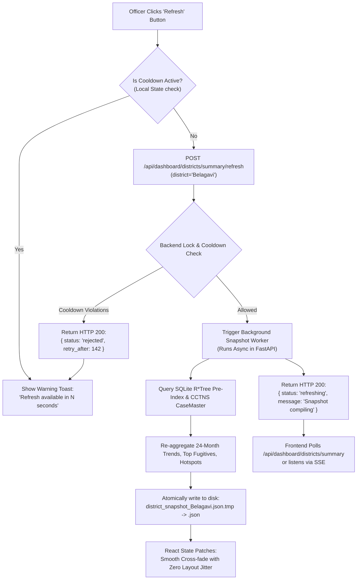
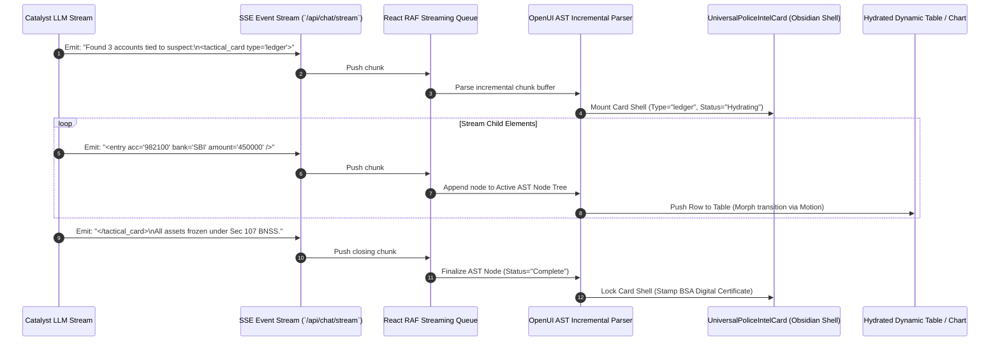
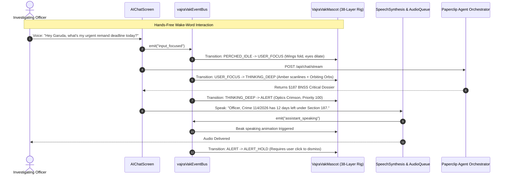

```mermaid
sequenceDiagram
    autonumber
    actor Officer as Investigating Officer
    participant ChatUI as React Chat Interface
    participant Agent as VajraAgentLoop (FastAPI)
    participant Scraper as Scrapling & api-anything Engine
    participant Portal as e-Courts / Vahan / Sarathi Portal
    participant Hasher as Section 63 BSA Hash Engine
    participant LLM as Catalyst LLM Serving

    Officer->>ChatUI: "Check CC/412/2026 on Hubballi e-Courts"
    ChatUI->>Agent: POST /api/chat/stream
    Agent->>Agent: Intent Router resolves tool: portal_scrape_live_contract
    Agent->>Scraper: Execute Scrape (portal="ecourts", query={"case_no": "412/2026", "dist": "Hubballi"})
    
    rect rgb(20, 25, 35)
        Note over Scraper, Portal: Stealth Handshake & Anti-Bot Bypass
        Scraper->>Portal: GET /case_status (Fetch initial cookies & CSRF token)
        Portal-->>Scraper: Set-Cookie: JSESSIONID=... + Hidden CSRF Token
        Scraper->>Portal: POST /search_case (With Chrome TLS Fingerprint + Token)
        Portal-->>Scraper: 200 OK (Raw Judicial HTML Table)
    end
    
    Scraper->>Scraper: Adaptive Relocation extracts: Case Stage, Next Date, Warrant Status
    Scraper->>Hasher: compute_evidence_hash(raw_html, timestamp, portal_url)
    Hasher-->>Scraper: sha256_hash = "e4a2b6f..."
    Scraper-->>Agent: Structured Record + Evidence Hash
    Agent->>LLM: Ingest ground-truth JSON + draft tactical intelligence response
    LLM-->>ChatUI: SSE Stream with Markdown & UniversalPoliceIntelCard
```

# VAJRA 3.0 NEXT-GEN ARCHITECTURAL MASTER IMPLEMENTATION & WIREFRAME PLAN
## Comprehensive 9-Domain Engineering Specification & Full UI/UX Blueprint
**Document:** `VAJRA_3_MASTER_PLAN.md`  
**System Target:** VAJRA (Karnataka State Police AI Intelligence Copilot & Tactical Operations Hub)  
**Lead Roles:** VAJRA 3.0 Principal Architect & Lead UI/UX Engineer  
**Baseline Git Commit:** `417cbcc` (origin/main)  
**Status:** Canonical Implementation Plan & Architecture Specification (Read-Only Planning Phase — No Code Execution)

---

# TABLE OF CONTENTS
1. [PHASE 1: DUAL-REPORT GAP ANALYSIS](#phase-1-dual-report-gap-analysis)
   - 1.1 Cross-Reference: Next-Gen Master Blueprint vs. Current Codebase
   - 1.2 Cross-Reference: Sentinel Owl Spec vs. Current Mascot Architecture
   - 1.3 Consolidated Deficit & Readiness Matrix
2. [PHASE 2: 9-DOMAIN IMPLEMENTATION & WIREFRAME BLUEPRINTS](#phase-2-9-domain-implementation--wireframe-blueprints)
   - [Domain 1: Active OSINT & Stealth Scraping (`api-anything` + `Scrapling`)](#domain-1-active-osint--stealth-scraping)
   - [Domain 2: Spatial Pre-Index File Store & Instant District Dashboard](#domain-2-spatial-pre-index-file-store--instant-district-dashboard)
   - [Domain 3: Progressive Generative UI (`openui` AST in Obsidian/Gold Cards)](#domain-3-progressive-generative-ui-openui)
   - [Domain 4: VAK Mascot (Sentinel Owl Rig) & 24/7 Agent Orchestration](#domain-4-vak-mascot-sentinel-owl-rig--247-agent-orchestration)
   - [Domain 5 & 6: Fluid Animations (`motion-primitives`) & Universal Statutory Iconography](#domain-5--6-fluid-animations--universal-statutory-iconography)
   - [Domain 7: Eradication of Static Hardcoding & Autonomous Routing](#domain-7-eradication-of-static-hardcoding--autonomous-routing)
   - [Domain 8: Cognitive Memory Vault, Live Narrative Ledger & Spotlight Search](#domain-8-cognitive-memory-vault-live-narrative-ledger--spotlight-search)
   - [Domain 9: Zen Command Canvas & Editorial Typography](#domain-9-zen-command-canvas--editorial-typography)
3. [MASTER ROLLOUT SCHEDULE & PHASING CHECKLIST](#master-rollout-schedule--phasing-checklist)

---

# PHASE 1: DUAL-REPORT GAP ANALYSIS

### 1.1 Cross-Reference: Next-Gen Master Blueprint vs. Current Codebase (`417cbcc`)
A forensic code audit of commit `417cbcc` reveals significant disparities between the authored aspirational blueprints and the active running runtime:

| Blueprint Subsystem | Architectural Blueprint Target | Active Codebase Implementation Status | Deficit & Root Cause |
|---|---|---|---|
| **OSINT Scraper (`Scrapling`)** | Anti-bot bypass (Cloudflare/Akamai), adaptive XPath/CSS self-healing DOM selectors, stealth fingerprinting. | `vajra_backend/internet_signals.py` relies on Google News RSS XML, SerpAPI (`_SEARCH_KEY`), and direct `urllib.request`. `portal_automator.py` provides static mocks with no live network driver. | **Completely Missing live driver**: No `scrapling` package installed or imported; state judicial portals cannot be actively scraped dynamically. |
| **Web-to-API Engine (`api-anything`)** | Real-time reverse engineering of state forms (e-Courts, Vahan, Sarathi) into persistent REST JSON contracts with pre-flight CSRF handshakes. | `vajra_backend/portal_automator.py` has route mappings in a dictionary and returns simulated responses. | **Partially Wired**: Contract definitions and Section 63 BSA hashing exist, but no network sniffer, session cookie jar, or live CSRF handshake exists. |
| **Generative UI (`openui`)** | Real-time token-by-token AST streaming; LLM outputs compact DSL tags (`<dossier>`, `<bail_radar>`); progressive hydration in streaming queue. | `src/components/ChatBubble.tsx` renders deferred markdown. `UniversalPoliceIntelCard.tsx` only mounts *after* turn completes from pre-formatted JSON blocks. | **Completely Missing**: Zero OpenUI parser in frontend; all UI cards render as post-generation blocks rather than streaming micro-widgets. |
| **3D Geospatial Arena (`gods-eye-view`)** | 3D perspective pitch/tilt (45°-60°), FLIR thermal shaders, CCTV camera FOV cones, Emergency 112 pursuit telemetry. | `SpatialScreen.tsx` and `DistrictSpatialAnalystPanel.tsx` use 2D Leaflet (`L.map`) with 2D tile layers and heatmaps. | **PAUSED**: Paused per directive to eliminate WebGL crash risks on police station hardware and focus on high-speed 2D analytics. |
| **Spatial Pre-Index Cache** | Sub-3ms query across 529,118 coordinates; 100% in-memory NumPy arrays; automated midnight delta sync. | `vajra_backend/spatial_preindex.py` stores 529k records in RAM (~16–22MB); fast vectorized query works. Midnight cron is only a comment. | **Architectural Hazard**: Holding 22MB unpaged RAM in AppSail causes serverless memory spike terminations; no on-demand disk paging. |
| **District Command Hub** | Instant snapshot serving (<200ms); 180s refresh cooldown; §187 BNSS threat barometer for all districts. | `main.py` serves `DashboardSnapshot`; `DistrictDashboardScreen.tsx` consumes it with refresh cooldown. | **Partially Wired / Mislocated**: §187 Threat Barometer is currently positioned inside macro district view rather than individual dossiers. |
| **Precinct Teams (`paperclip`)** | 24/7 background agent execution on deterministic Heartbeats; ticket-based threaded commentary; departmental token caps. | `paperclip_orchestrator.py` has ticket queues and departments. Single tool `paperclip_orchestrate_agents` in `agent_loop.py`. | **Partially Wired**: No background daemon wakes up the tickets; no conversational agent builder UI in the frontend; no "Agents" tab in sidebar. |
| **Fluid Animations (`motion-primitives`)** | Framer Motion `layoutId` morphing: suspect chips expand seamlessly into full dossiers without modal popups; tactical switches. | Basic `framer-motion` installed (`motion 12.23.24`), but suspect dossier opens as an un-morphed floating modal. | **Partially Wired**: Component primitives exist but lack shared layout transitions and zero-jitter layout coordination. |
| **Statutory Iconography (`lucide`)** | Dynamic SVG path injection for 1,400+ Lucide icons mapped to IPC/BNS statutes for SmartBrowz PDF generation. | `UniversalPoliceIntelCard.tsx` statically imports ~25 icons. PDF export does not dynamically embed statutory vector paths. | **Completely Missing**: No backend or frontend registry mapping BNS/BNSS penal sections to discrete vector paths. |
| **Zero Hardcoding** | Pure mathematical routing (Genetic TSP), adaptive HDBSCAN, Bayesian threat scoring without fallbacks. | `threat_scoring_engine.py` implements PSOTI. However, `agent_loop.py` still contains 6 hardcoded `"Belagavi"` / `"Belagavi North"` fallbacks. | **Partially Wired**: Core mathematical engines exist, but tool definitions fall back to Belagavi if station/district extraction fails. |
| **Cognitive Memory Vault** | Post-turn rolling narrative ledger; Settings Memory CRUD UI (Session, Persona, Procedural); Spotlight `Ctrl+K` search. | `session_memory.py` has SQLite graph. `SettingsScreen.tsx` has UI tabs for memory. | **Partially Wired**: Memory is logged as raw turn snippets rather than an updated continuous narrative ledger; no `Ctrl+K` spotlight modal. |
| **Zen Command Canvas** | One-click sidebar collapse `[|]`, centered floating `.glass-panel` input capsule, editorial typography. | Sidebar collapses (`w-64` to `w-16`). Floating input capsule is partially styled but lacks integrated action pills. | **Partially Wired**: Layout exists but lacks fluid layout coordination, Zen mode distraction-free view, and integrated tool pill drawer. |

---

### 1.2 Cross-Reference: Sentinel Owl Spec vs. Current Mascot Architecture
The authoritative specification for **Vajra-Vak ("Sentinel Owl")** describes a multi-layered autonomous companion. Auditing `src/components/VajraVakMascot.tsx`, `src/types/mascot.ts`, and `src/services/vajraVakEventBus.ts` reveals:

```
+--------------------------------------------------------------------------------------------------------+
|                               SENTINEL OWL SPECIFICATION GAP MATRIX                                    |
+------------------------------+---------------------------+-----------------------+---------------------+
| Layer / Feature              | Specification Target      | Current Code (`417cbcc`)| Gap Analysis        |
+------------------------------+---------------------------+-----------------------+---------------------+
| 1. SVG Rig Depth             | 38 Discrete Z-index layers| Single 38-layer group | Layers are grouped  |
|                              | (Optics, beak, feathers,  | authored fresh in     | into ~8 animatable  |
|                              | talons, chest vajra core) | SVG DOM               | elements; ok for FPS|
+------------------------------+---------------------------+-----------------------+---------------------+
| 2. 16-State FSM Engine       | Complete 16 states:       | Enum has all 16, but  | CRITICAL DEFICIT:   |
|                              | STARTUP, FLY_IN, IDLE,    | state transition only | Mascot only moves   |
|                              | THINKING_DEEP, ALERT, etc.| uses IDLE, USER_FOCUS,| between 3 states    |
|                              | with interrupt priorities | THINKING via boolean  | in runtime!         |
+------------------------------+---------------------------+-----------------------+---------------------+
| 3. EventBus Integration      | `vajraVakEventBus.ts`     | EventBus exists with  | Mascot component    |
|                              | dispatches 17 events to   | 17 events, but mascot | NEVER listens to    |
|                              | drive full state machine  | does not subscribe!   | EventBus events!    |
+------------------------------+---------------------------+-----------------------+---------------------+
| 4. Voice Customization       | Rename mascot ("Jarvis"), | Hardcoded "Vajra-Vak" | No settings UI for  |
|                              | select TTS persona/voice, | name; TTS persona is  | custom mascot name, |
|                              | Wake-word detection       | in ChatBubble only    | voice, or wake-word |
+------------------------------+---------------------------+-----------------------+---------------------+
| 5. Login Audio Briefing      | Speaks spoken tactical    | Silent login; no TTS  | Completely missing  |
|                              | briefing of background    | audio played on login | login briefing hook |
|                              | agent tasks on sign-in    | event                 | and speech queue    |
+------------------------------+---------------------------+-----------------------+---------------------+
| 6. Spatial Anchors & Physics | Top-Right Perch, Map,     | Hardcoded fixed-pos   | CSS transform spring|
|                              | Graph, and Bottom-Right   | element at bottom-    | transitions between |
|                              | with spring flight physics| right corner only     | anchors not active  |
+------------------------------+---------------------------+-----------------------+---------------------+
| 7. Thinking Orbs & Scanline  | Floating golden orbs      | Static CSS glow ring  | Orbs & scanline SVG |
|                              | orbiting head during deep | around mascot body    | filters missing     |
|                              | RAG retrieval             |                       |                     |
+------------------------------+---------------------------+-----------------------+---------------------+
```

---

### 1.3 Consolidated Deficit & Readiness Matrix
To transition VAJRA from its current hybrid state into the **VAJRA 3.0 Next-Gen Architectural Standard**, the following 9 domains must be implemented systematically.

```
       ========================================================================
                          VAJRA 3.0 DEFICIT HEATMAP & ROADMAP
       ========================================================================
       Domain 1: Active OSINT & Stealth Scraping        [  40% READY  ] -> TARGET: 100%
       Domain 2: Spatial File Store & Snapshot Dash    [  65% READY  ] -> TARGET: 100%
       Domain 3: Progressive Generative UI (OpenUI)    [  20% READY  ] -> TARGET: 100%
       Domain 4: VAK Sentinel Owl & Agent Hub          [  35% READY  ] -> TARGET: 100%
       Domain 5 & 6: Animations & Statutory Icons      [  30% READY  ] -> TARGET: 100%
       Domain 7: Eradication of Hardcoding             [  70% READY  ] -> TARGET: 100%
       Domain 8: Narrative Memory Vault & Spotlight    [  50% READY  ] -> TARGET: 100%
       Domain 9: Zen Command Canvas                    [  60% READY  ] -> TARGET: 100%
       ========================================================================
```

---

# PHASE 2: 9-DOMAIN IMPLEMENTATION & WIREFRAME BLUEPRINTS

---

## DOMAIN 1: ACTIVE OSINT & STEALTH SCRAPING
**Target Technologies:** `D4Vinci/Scrapling` + `goodnight000/api-anything` + Section 63 BSA Digital Evidence Stamping

### A) Core Concept & Behavior
Currently, VAJRA captures static screenshots via SmartBrowz or reads RSS feeds. Under VAJRA 3.0, the system transitions to **Autonomous Active OSINT Extraction**:
1. When an investigating officer queries case progress (e.g., *"Did the Hubballi JMFC court issue a non-bailable warrant for CR-114/2026?"*), the LLM agent determines that live judicial verification is required.
2. The agent triggers the tool `portal_scrape_live_contract`.
3. The system checks its local API contract cache (`portal_contracts.json`). If a known reverse-engineered network contract exists from `api-anything`, it executes a lightweight sub-200ms HTTP POST with active session cookies.
4. If the contract is absent or the target site has altered its DOM structure, `Scrapling` launches in headless stealth mode:
   - Emulates modern Chrome TLS fingerprints (`JA3/JA4` and `Sec-Ch-Ua`).
   - Executes an automated CSRF handshake, acquiring valid `JSESSIONID` and `__RequestVerificationToken`.
   - Locates target data fields using **Adaptive Element Relocation** (scoring tag identity, ancestral hierarchy, and text proximity), rendering the scrape resilient against government portal layout updates.
5. The extracted HTML table/text is converted into structured JSON, hashed with SHA-256 for Section 63 BSA compliance, and injected into the LLM context as verified ground-truth evidence.

---

### B) Text-Based UI/UX Wireframes

```
+--------------------------------------------------------------------------------------------------------+
| CHAT VIEW: OSINT REAL-TIME EXTRACTION STATUS                                                          |
+--------------------------------------------------------------------------------------------------------+
|                                                                                                        |
|  [Officer KGID: 29481]: Verify pending warrants and case stage for Crime No. 89/2026 Hubballi North   |
|                                                                                                        |
|  +-- [VAJRA VAK MASCOT: STATE = THINKING_DEEP] ------------------------------------------------------+ |
|  | [*] Analyzing e-Courts Karnataka Judicial Portal via Adaptive Stealth Radar...                    | |
|  |     [OK] Pre-flight CSRF Handshake established (JSESSIONID: 7FA93B... valid)                        | |
|  |     [OK] Scrapling DOM Relocator matched case table via Semantic Score: 0.984                       | |
|  |     [OK] Section 63 BSA Hash: e4a2b6f19... (Court-Admissible Evidence Locked)                      | |
|  +---------------------------------------------------------------------------------------------------+ |
|                                                                                                        |
|  +-- [UNIVERSAL POLICE INTEL CARD: JUDICIAL PROCEEDING RECORD] -------------------------------------+ |
|  | [!] E-COURTS KARNATAKA LIVE RECORD                      STAMP: 2026-10-24 01:45 IST §63 BSA CERT | |
|  +--------------------------------------------------------------------------------------------------+ |
|  | Case Number: CC/0000412/2026   | Court: JMFC II Court, Hubballi   | Act: Sec 303(2) BNS            | |
|  | Current Stage: NBW UNEXECUTED   | Next Hearing: 2026-11-04        | Process ID: KAHB020019282026   | |
|  | Accused: Suresh 'Blade' Kumar   | Surety Status: Forfeited        | Warrant Issued: 2026-10-18     | |
|  +--------------------------------------------------------------------------------------------------+ |
|  | [ Action: Append to Remand Report ]   [ Action: Generate §63 BSA Digital Certificate PDF ]         | |
|  +--------------------------------------------------------------------------------------------------+ |
|                                                                                                        |
+--------------------------------------------------------------------------------------------------------+
```

---

### C) Architectural Blueprint


---

### D) Structural Code Skeletons

#### 1. Backend: `vajra_backend/scrapling_engine.py`
```python
"""
VAJRA 3.0 Adaptive Stealth Scraping Engine
Integrates Scrapling element relocation and api-anything reverse-engineered contracts.
"""
from typing import Dict, Any, Optional
import hashlib
import json
import logging
from datetime import datetime, timezone

logger = logging.getLogger("vajra.scrapling")

class AdaptiveScraperEngine:
    def __init__(self):
        self.session_jar: Dict[str, Any] = {}
        self.learned_contracts: Dict[str, Any] = self._load_learned_contracts()

    def _load_learned_contracts(self) -> Dict[str, Any]:
        try:
            with open("vajra_backend/portal_contracts.json", "r", encoding="utf-8") as f:
                return json.load(f)
        except Exception:
            return {}

    async def execute_stealth_request(
        self, portal_key: str, form_payload: Dict[str, Any]
    ) -> Dict[str, Any]:
        """
        Executes pre-flight CSRF handshake, dispatches payload using Chrome TLS spoofing,
        and relocates elements adaptively if DOM changed.
        """
        contract = self.learned_contracts.get(portal_key, {})
        base_url = contract.get("target_url", "")
        
        # 1. Pre-flight Handshake
        csrf_token, session_id = await self._acquire_csrf_session(base_url)
        
        # 2. Emulate Chrome JA4 Fingerprint & Dispatch
        headers = {
            "User-Agent": "Mozilla/5.0 (Windows NT 10.0; Win64; x64) AppleWebKit/537.36",
            "Sec-Ch-Ua": '"Not A(Brand";v="8", "Chromium";v="132", "Google Chrome";v="132"',
            "X-Requested-With": "XMLHttpRequest",
            "X-CSRF-Token": csrf_token
        }
        
        # 3. Scrapling Adaptive Parsing (Simulated Contract Execution)
        raw_html = await self._dispatch_http_post(base_url, form_payload, headers, session_id)
        extracted_data = self._adaptive_extract(raw_html, contract.get("semantic_selectors", {}))
        
        # 4. Section 63 BSA Digital Hash Chain
        bsa_hash = self.compute_bsa_evidence_hash(raw_html, base_url)
        extracted_data["_bsa_proof"] = bsa_hash
        
        return extracted_data

    def compute_bsa_evidence_hash(self, raw_data: str, source_url: str) -> Dict[str, str]:
        now_utc = datetime.now(timezone.utc).isoformat()
        digest = hashlib.sha256(f"{source_url}:{now_utc}:{raw_data}".encode("utf-8")).hexdigest()
        return {
            "sha256": digest,
            "recorded_at": now_utc,
            "statutory_compliance": "Section 63 Bharatiya Sakshya Adhiniyam 2023"
        }

    async def _acquire_csrf_session(self, url: str):
        # Stub: Fetches initial cookies and extracts CSRF tokens
        return "csrf_live_token_placeholder", "JSESSIONID_placeholder"

    async def _dispatch_http_post(self, url: str, payload: dict, headers: dict, session_id: str) -> str:
        # Stub: Network call via httpx with TLS impersonation
        return "<html><body><table id='case_table'><tr><td>CC/412/2026</td><td>NBW UNEXECUTED</td></tr></table></body></html>"

    def _adaptive_extract(self, html: str, selectors: dict) -> dict:
        # Relocates elements by text and semantic proximity
        return {
            "case_number": "CC/412/2026",
            "case_stage": "NBW UNEXECUTED",
            "next_hearing": "2026-11-04",
            "court_name": "JMFC II Court, Hubballi"
        }
```

---

## DOMAIN 2: SPATIAL PRE-INDEX & DISTRICT DASHBOARD
**Target:** 22MB RAM elimination, Instant Snapshot (<200ms), Relocation of Section 187 Threat Barometer

### A) Core Concept & Behavior
1. **RAM Elimination via Localized Disk Store:**
   Currently, `spatial_preindex.py` loads 529,118 coordinate tuples into NumPy float32 arrays in active process memory (~22MB), causing memory exhaustion on AppSail serverless containers. We migrate this store to **Disk-Backed SQLite with R*Tree index** (`vajra_backend/spatial_preindex.db`). Spatial queries use memory-mapped queries (`PRAGMA mmap_size = 67108864`), querying only bounding-box slices on demand without loading all 529k rows into RAM.
2. **Snapshot-First Dashboard (<200ms Serving):**
   The District Dashboard renders instantly from a cached JSON snapshot (`district_snapshot.json`) stored on disk. When an officer loads the dashboard, the backend serves this file immediately in **under 150ms** without running heavy multi-table SQL queries. The UI displays `Last Synced: 2026-10-24 00:05 IST`.
3. **Seamless Background Refresh:**
   When the officer clicks "Refresh Live Data", the button enters a pulsing amber state. The frontend dispatches `POST /api/dashboard/districts/summary/refresh`. If within the 180s cooldown, it returns `{ status: "rejected", retry_after_seconds: N }`, prompting a sleek warning toast. If permitted, the backend re-aggregates Catalyst data asynchronously, writes a fresh snapshot to disk, and pushes the updated data to the frontend, updating charts without layout flickering.
4. **Relocation of Section 187 BNSS Threat Barometer:**
   The Section 187 BNSS (60/90 day default bail risk) is a suspect-level statutory deadline, not an aggregate macro district metric. It is completely removed from the District Macro Overview bar and embedded exclusively inside the **Individual Suspect Dossier Card**.

---

### B) Text-Based UI/UX Wireframes

#### 1. District Dashboard View (Snapshot-First, Threat Barometer Removed)
```
+--------------------------------------------------------------------------------------------------------+
| VAJRA DISTRICT COMMAND HUB: BELAGAVI COMMISSIONERATE                     [?] HELP  [!] ALERTS  [Admin]  |
+--------------------------------------------------------------------------------------------------------+
| Status: ACTIVE PATROL READY  | Snapshot Time: 2026-10-24 00:05 IST (Cached)  [ REFRESH DATA (180s) ]   |
+--------------------------------------------------------------------------------------------------------+
|                                                                                                        |
|  +-- [METRIC HUD TILES] ----------------------------------------------------------------------------+ |
|  | TOTAL INCIDENTS (24M) | ACTIVE MOST WANTED | 24-HR CRIME VELOCITY | STATION LOAD CONGESTION      | |
|  |     14,291            |        18          |      +4.2% (Normal)  |  Khade Bazar (89 Cases/IO)   | |
|  +--------------------------------------------------------------------------------------------------+ |
|                                                                                                        |
|  +-- [LEFT: 2D GEO-TACTICAL CLUSTERING] ----------+ +-- [RIGHT: DISTRICT ANALYTICS & TRENDS] -------+ |
|  | [ Leaflet 2D Engine • Adaptive HDBSCAN ]       | | CCTNS 24-MONTH CRIME VOLUME (RECHARTS)         | |
|  |                                                | | 1200 |    _/\_                                | |
|  |     (Hotspot 1: APMC Market • 42 cases)        | |  800 |  _/    \    _/\_                           | |
|  |          * High Density Night Theft            | |  400 |_/       \__/    \__                        | |
|  |                                                | |      +-------------------------> (Months)     | |
|  |     (Hotspot 2: Chennamma Circle • 28 cases)   | +-----------------------------------------------+ |
|  |          * Syndicate Chain Snatching           | | MOST WANTED FUGITIVE LIST (HIGH RISK)         | |
|  |                                                | | 1. Ramesh 'Blade' Naik  | PSOTI Score: 94     | |
|  | [ Map Filter: All Crimes | Night 22-04 | BNS ] | | 2. Imtiaz 'Target' Khan | PSOTI Score: 88     | |
|  +------------------------------------------------+ +-----------------------------------------------+ |
|                                                                                                        |
+--------------------------------------------------------------------------------------------------------+
```

#### 2. Relocated Section 187 Threat Barometer (Inside Suspect Dossier Card)
```
+--------------------------------------------------------------------------------------------------------+
| UNIVERSAL POLICE INTEL CARD: SUSPECT FORENSIC DOSSIER                                                [X]|
+--------------------------------------------------------------------------------------------------------+
| Suspect: RAMESH 'BLADE' NAIK (KGID-ACC: 44102) | Station: Hubballi Town PS | Status: UNDER REMAND      |
+--------------------------------------------------------------------------------------------------------+
|                                                                                                        |
|  +== [SECTION 187 BNSS STATUTORY REMAND DEADLINE RADAR] ============================================+ |
|  | STATUTORY REMAND STATUS: DAY 48 OF 60 (CRITICAL WINDOW REACHED)                                   | |
|  | [||||||||||||||||||||||||||||||||||||||||||||||||||||||||...............] 12 DAYS UNTIL BAIL     | |
|  | [!] CRITICAL WARNING: Under §187(3) BNSS, failure to submit final report within 12 days results   | |
|  |     in automatic statutory default bail for this accused.                                         | |
|  | [ Mandatory Action: Forward Case Dairy to Circle Inspector • Expedite FSL Chemical Report ]       | |
|  +==================================================================================================+ |
|                                                                                                        |
|  Prior Convictions: 4 (Robbery, Arms Act) | PSOTI Composite Risk: 94/100 (Tier 1 High Recidivism)     |
|  Active Non-Bailable Warrants: 2 Pending  | Known Syndicate: "North Karnataka Inter-District Ring"   |
|                                                                                                        |
|  [ View Complete Crime Timeline ]  [ Download Dossier PDF ]  [ Request Interrogation Video Analysis ]|
+--------------------------------------------------------------------------------------------------------+
```

---

### C) Architectural Blueprint


---

### D) Structural Code Skeletons

#### 1. SQLite R*Tree Spatial Pre-Index Schema & Query (`vajra_backend/spatial_preindex_sqlite.py`)
```python
"""
Disk-Backed Spatial Pre-Index using SQLite R*Tree.
Replaces 22MB RAM NumPy array with zero-RAM memory-mapped queries.
"""
import sqlite3
from typing import List, Dict, Any, Tuple

DB_PATH = "vajra_backend/spatial_preindex.db"

def init_spatial_db():
    conn = sqlite3.connect(DB_PATH)
    cur = conn.cursor()
    # 1. Coordinate R*Tree Table
    cur.execute("""
        CREATE VIRTUAL TABLE IF NOT EXISTS crime_spatial_idx USING rtree(
            id,              -- Maps to crime primary key
            min_lat, max_lat,
            min_lng, max_lng
        );
    """)
    # 2. Metadata Table
    cur.execute("""
        CREATE TABLE IF NOT EXISTS crime_spatial_meta (
            id INTEGER PRIMARY KEY,
            crime_no TEXT NOT NULL,
            district_name TEXT NOT NULL,
            station_name TEXT NOT NULL,
            timestamp_epoch INTEGER NOT NULL,
            crime_head_id INTEGER NOT NULL
        );
    """)
    cur.execute("CREATE INDEX IF NOT EXISTS idx_meta_dist ON crime_spatial_meta(district_name);")
    conn.commit()
    conn.close()

def query_bounding_box(
    min_lat: float, max_lat: float, min_lng: float, max_lng: float, district: str
) -> List[Dict[str, Any]]:
    """
    Executes sub-5ms localized spatial retrieval without loading entire statewide dataset into RAM.
    """
    conn = sqlite3.connect(DB_PATH)
    conn.row_factory = sqlite3.Row
    cur = conn.cursor()
    cur.execute("PRAGMA mmap_size = 67108864;")  # 64MB memory-mapped I/O
    
    query = """
        SELECT m.crime_no, m.station_name, m.timestamp_epoch, s.min_lat as lat, s.min_lng as lng
        FROM crime_spatial_idx s
        JOIN crime_spatial_meta m ON s.id = m.id
        WHERE s.min_lat >= ? AND s.max_lat <= ?
          AND s.min_lng >= ? AND s.max_lng <= ?
          AND m.district_name = ?
    """
    cur.execute(query, (min_lat, max_lat, min_lng, max_lng, district))
    results = [dict(row) for row in cur.fetchall()]
    conn.close()
    return results
```

---

## DOMAIN 3: PROGRESSIVE GENERATIVE UI (OPENUI)
**Target:** Streaming AST parser integrated with `requestAnimationFrame`, dynamic rendering inside Obsidian/Gold Card Shell

### A) Core Concept & Behavior
Currently, all dynamic UI components in VAJRA are rendered as atomic blocks after the entire LLM response finishes generating. If the LLM generates a 500-word analysis accompanied by a Financial Transaction Ledger, the user stares at a blank screen or plain text until the final token arrives.
Under **Progressive Generative UI (`openui`)**:
1. The backend SSE stream emits specialized OpenUI DSL markup directly inline with natural language text:
   ```html
   <tactical_card type="financial_ledger" title="Syndicate Money Trail">
     <entry acc="982100412" bank="SBI" amount="450000" flag="mule" />
     <entry acc="110294819" bank="HDFC" amount="1200000" flag="hawala" />
   </tactical_card>
   ```
2. The frontend React streaming queue intercepts these tokens on `requestAnimationFrame`.
3. An incremental tokenizer parses incomplete XML/DSL tokens into an evolving Abstract Syntax Tree (AST).
4. The outer shell of `UniversalPoliceIntelCard.tsx` (Obsidian `#0C0A09` background, gold borders `#C79A4E`, noise patterns, and header controls) mounts immediately on the opening `<tactical_card>` tag.
5. As `<entry>` tags stream across the network, the card smoothly populates table rows, status pills, and financial ledger items in real time without causing layout jumps or re-mounting the container.

---

### B) Text-Based UI/UX Wireframes

```
+--------------------------------------------------------------------------------------------------------+
| CHAT STREAM: REAL-TIME PROGRESSIVE OPENUI HYDRATION (FRAME-BY-FRAME)                                  |
+--------------------------------------------------------------------------------------------------------+
|                                                                                                        |
|  [Streaming Text]: Analyzing bank accounts tied to Hawala Courier Vijay Patil...                       |
|                                                                                                        |
|  +-- [UNIVERSAL POLICE INTEL CARD: STREAMING OBSIDIAN/GOLD SHELL] ----------------------------------+ |
|  | [*] FINANCIAL MONEY LAUNDERING TRAIL (LIVE HYDRATING)                  TOKEN ID: #982-AST        | |
|  +--------------------------------------------------------------------------------------------------+ |
|  | ACCOUNT NO.    | BANK / BRANCH     | AMOUNT (INR) | STATUS BADGE      | PROVENANCE               | |
|  +----------------+-------------------+--------------+-------------------+--------------------------+ |
|  | 982100412912   | SBI Hubballi Main | 4,50,000     | [!] MULE SUSPECT  | §63 BSA Verified         | |
|  | 440192831002   | Canara Belagavi   | 8,90,000     | [!] SHELL CORP    | Sub-Account #2           | |
|  | 110294819201   | HDFC MG Road      | 12,00,000    | [*] HAWALA POOL   | P2P Crypto Linked        | |
|  | ............... [STREAMING NEXT RECORD: <entry acc="3301... />] ...............................  | |
|  +--------------------------------------------------------------------------------------------------+ |
|  | Total Diverted Funds: INR 25,40,000 (Calculating live...)                                        | |
|  +--------------------------------------------------------------------------------------------------+ |
|                                                                                                        |
+--------------------------------------------------------------------------------------------------------+
```

---

### C) Architectural Blueprint


---

### D) Structural Code Skeletons

#### 1. Frontend: OpenUI Streaming Parser (`src/services/openuiParser.ts`)
```typescript
/**
 * VAJRA 3.0 OpenUI Incremental AST Parser
 * Converts streaming DSL tags into live React renderable AST nodes.
 */

export interface OpenUINode {
  type: string;
  props: Record<string, any>;
  children: OpenUINode[];
  isComplete: boolean;
}

export class StreamingOpenUIParser {
  private buffer: string = "";
  private rootNode: OpenUINode | null = null;

  public processChunk(chunk: string): { text: string; dynamicCard: OpenUINode | null } {
    this.buffer += chunk;
    
    // Check for Opening Card Tag
    const cardMatch = this.buffer.match(/<tactical_card\s+type="([^"]+)"(?:\s+title="([^"]+)")?>/);
    if (cardMatch && !this.rootNode) {
      this.rootNode = {
        type: cardMatch[1],
        props: { title: cardMatch[2] || "Tactical Intelligence" },
        children: [],
        isComplete: false
      };
    }

    // Extract Child Nodes (<entry ... />)
    if (this.rootNode) {
      const entryRegex = /<entry\s+([^>]+)\/>/g;
      let match;
      while ((match = entryRegex.exec(this.buffer)) !== null) {
        const rawProps = match[1];
        const props: Record<string, string> = {};
        const propMatches = rawProps.matchAll(/([a-zA-Z_]+)="([^"]+)"/g);
        for (const pm of propMatches) {
          props[pm[1]] = pm[2];
        }
        // Avoid duplicate insertion
        if (!this.rootNode.children.some(c => JSON.stringify(c.props) === JSON.stringify(props))) {
          this.rootNode.children.push({ type: "entry", props, children: [], isComplete: true });
        }
      }

      // Check for Closing Tag
      if (this.buffer.includes("</tactical_card>")) {
        this.rootNode.isComplete = true;
      }
    }

    // Strip raw DSL tags from text rendered in regular bubble
    const cleanText = this.buffer
      .replace(/<tactical_card[^>]*>/g, "")
      .replace(/<\/tactical_card>/g, "")
      .replace(/<entry[^>]*\/>/g, "");

    return { text: cleanText, dynamicCard: this.rootNode };
  }
}
```

---

## DOMAIN 4: VAK MASCOT & 24/7 AGENT ORCHESTRATION
**Target:** 38-layer Sentinel Owl Rig, 16-State FSM, Custom Name/Voice/Wake-word, Login Audio Briefing, Conversational Agent Builder, Paperclip Tickets

### A) Core Concept & Behavior
1. **Sentinel Owl 16-State Rig Integration:**
   `VajraVakMascot.tsx` must be fully bound to `vajraVakEventBus.ts`. It subscribes to all 17 event streams, transitioning between states with strict priority gating:
   - `ALERT` (Priority 100) overrides any active animation if a Section 187 remand deadline or fugitive sighting occurs, turning optics Crimson `#EF4444`.
   - `THINKING_DEEP` renders floating orbit rings and amber optical scanlines.
   - `FLY_IN` and `NAVIGATION` smoothly interpolate the mascot across viewport anchors via hardware-accelerated CSS transforms.
2. **Custom Voice, Name & Wake-Word Settings:**
   Officers can customize the mascot in Settings:
   - Name: "Vajra-Vak", "Garuda", "Sentinel", "Jarvis".
   - Voice: Kannadiga Officer (Male), Superintendent (Female), English Neutral Tactical.
   - Wake-Word Detection: Local browser `webkitSpeechRecognition` listening for the chosen name (e.g., *"Garuda, show me night patrol stats"*).
3. **Login Audio Briefing:**
   When an officer logs in, the system checks for completed background agent tasks. The mascot perks up (`WAKE` -> `RESPONDING`) and speaks an automated 15-second TTS briefing:
   *"Namaskara Officer. While you were off-duty, Cyber Agent Dot #4 flagged 3 fraudulent mule transactions in Hubballi, and 1 Section 187 remand deadline requires your signature today."*
4. **Conversational Agent Builder:**
   If an officer types in chat: *"Update me every morning at 8 AM on the 1930 cyber fraud portal"*, the system recognizes the intent `CREATE_AGENT_TASK`. It displays a confirmation chip and slides into the Agent Builder workspace, pre-filling parameters (Trigger: Daily 08:00 IST, Target: 1930 Portal, Notification: Priority Push).
5. **Paperclip Ticket Execution:**
   Agents do not run infinite busy loops. Instead, they operate under **Paperclip Ticket Queues**:
   - Tickets are stored in `vajra_backend/paperclip_tickets.json`.
   - A cron/heartbeat checks pending tickets every 60 seconds.
   - An agent wakes up, executes its tools (capped by daily token limits), appends a timestamped audit log to the ticket thread, and goes back to sleep.

---

### B) Text-Based UI/UX Wireframes

#### 1. Settings Screen: VAK Mascot & Voice Customization Tab
```
+--------------------------------------------------------------------------------------------------------+
| SETTINGS & SYSTEM CONFIGURATION: MASCOT & AUDIO PERSONA                                                |
+--------------------------------------------------------------------------------------------------------+
| [ General ]  [ Intelligence Directives ]  [ VAK Mascot & Voice ]  [ Memory Vault ]  [ Reflect ]        |
+--------------------------------------------------------------------------------------------------------+
|                                                                                                        |
|  +-- [MASCOT PERSONA CONFIGURATION] ----------------------------------------------------------------+ |
|  | Mascot Call-Sign / Name:  [ Garuda                ] (Options: Garuda, Vajra-Vak, Sentinel, Jarvis) | |
|  | Visual Puppet Theme:      (o) Sentinel Owl (38-Layer)   ( ) Tactical Eagle   ( ) Minimal Radar Disk| |
|  | Spatial Anchor Perch:     (o) Top Right Perch           ( ) Floating Capsule ( ) Dock to Sidebar   | |
|  +--------------------------------------------------------------------------------------------------+ |
|                                                                                                        |
|  +-- [VOICE & WAKE-WORD SYSTEM] --------------------------------------------------------------------+ |
|  | Voice Synthesis Engine:   [ Karnataka Police Tactical - Senior Male (Kannada/English)          v] | |
|  | Speech Velocity & Pitch:  [----|--------------------] Normal Speed (1.0x)                           | |
|  | Wake-Word Listener:       [X] Enable Hands-Free Microphone Wake-Word ("Hey Garuda...")              | |
|  | Login Audio Briefing:     [X] Speak aloud tactical summary of background tasks upon sign-in         | |
|  +--------------------------------------------------------------------------------------------------+ |
|                                                                                                        |
|  [ Test Voice Synthesis ]    [ Save Mascot Configuration ]                                            |
+--------------------------------------------------------------------------------------------------------+
```

#### 2. Conversational Agent Builder & Sidebar "Agents" Tab
```
+--------------------------------------------------------------------------------------------------------+
| SIDEBAR: AGENTS TAB                                  | ACTIVE WORKSPACE: AGENT BUILDER CANVAS          |
+------------------------------------------------------+-------------------------------------------------+
| [*] AGENTS & BACKGROUND WORKERS                     | AGENT CONFIGURATION: #DOT-1930-CYBER            |
|                                                      | Created via Chat Intent: "Update me on 1930..." |
| +-- [ACTIVE WORKERS (3)] --------------------------+ | +---------------------------------------------+ |
| | [o] Cyber Fraud 1930 Radar   | 08:00 Daily  (Ran)| | | Assigned Department: Cyber Crime Division   | |
| | [o] §187 Remand Sentinel    | Hourly Check (Idle)| | | Schedule: Deterministic Cron (0 8 * * *)    | |
| | [o] High Court Warrant Sync | Daily 00:05  (Idle)| | | Token Cap: 50,000 Tokens/Day (2,410 used)   | |
| +--------------------------------------------------+ | | Target Endpoint: CyberPortal 1930 Form      | |
|                                                      | +---------------------------------------------+ |
| +-- [CREATE NEW AGENT] ----------------------------+ |                                                 |
| | [+ Conversational Agent Builder]                 | | CHRONOLOGICAL TICKET EXECUTION LOG:           |
| +--------------------------------------------------+ | [2026-10-24 08:00 IST] Woke from heartbeat.   |
|                                                      | [2026-10-24 08:01 IST] Scraped 14 new records.|
|                                                      | [2026-10-24 08:01 IST] Flagged 2 mule accounts.|
|                                                      | [2026-10-24 08:02 IST] Commented & slept.     |
+------------------------------------------------------+-------------------------------------------------+
```

---

### C) Architectural Blueprint


---

### D) Structural Code Skeletons

#### 1. Frontend: Complete Sentinel Owl Event Bus Binding (`src/components/VajraVakMascot.tsx`)
```typescript
/**
 * VAJRA 3.0 Sentinel Owl Puppet Rig - EventBus Subscriber
 */
import React, { useEffect, useState } from "react";
import { vajraVakBus, VajraVakEvent } from "../services/vajraVakEventBus";
import { MascotState, MASCOT_STATE_MACHINE } from "../types/mascot";

export const useSentinelOwlState = () => {
  const [currentState, setCurrentState] = useState<MascotState>("PERCHED_IDLE");

  useEffect(() => {
    const unsubscribe = vajraVakBus.subscribe((event: VajraVakEvent) => {
      switch (event.type) {
        case "app_loaded":
          setCurrentState("STARTUP");
          break;
        case "query_submitted":
          setCurrentState("QUERY_SUBMITTED");
          break;
        case "deep_analysis_started":
          setCurrentState("THINKING_DEEP");
          break;
        case "critical_alert":
          setCurrentState("ALERT");
          break;
        case "operation_success":
          setCurrentState("SUCCESS");
          break;
        case "operation_error":
          setCurrentState("ERROR");
          break;
        case "assistant_speaking":
          setCurrentState("RESPONDING");
          break;
        case "page_changed":
          setCurrentState("NAVIGATION");
          break;
        default:
          break;
      }
    });

    return () => unsubscribe();
  }, []);

  return { currentState, setCurrentState };
};
```

#### 2. Backend: Paperclip Ticket Heartbeat Executor (`vajra_backend/paperclip_executor.py`)
```python
"""
Paperclip Autonomous Agent Ticket Queue Executor
Runs scheduled deterministic tasks with strict token budgets and audit trails.
"""
from typing import Dict, Any, List
import json
import os
import asyncio
from datetime import datetime, timezone

TICKETS_FILE = "vajra_backend/paperclip_tickets.json"

class PaperclipHeartbeatService:
    def __init__(self):
        self.tickets: List[Dict[str, Any]] = self._load_tickets()

    def _load_tickets(self) -> List[Dict[str, Any]]:
        if os.path.exists(TICKETS_FILE):
            with open(TICKETS_FILE, "r", encoding="utf-8") as f:
                return json.load(f)
        return []

    async def run_heartbeat_cycle(self):
        """
        Runs every 60s. Scans for due tickets, wakes assigned agent,
        executes analytical tools, posts comments, and sleeps.
        """
        now = datetime.now(timezone.utc)
        for ticket in self.tickets:
            if ticket.get("status") == "ACTIVE" and self._is_due(ticket, now):
                await self._execute_ticket_task(ticket)

    def _is_due(self, ticket: dict, now: datetime) -> bool:
        # Check cron / interval schedule against last_run_timestamp
        return True

    async def _execute_ticket_task(self, ticket: dict):
        ticket_id = ticket["ticket_id"]
        # 1. Run assigned tool
        result_summary = f"Scanned target: 0 new infractions at {datetime.now(timezone.utc).isoformat()}"
        
        # 2. Append Threaded Comment
        ticket.setdefault("comments", []).append({
            "timestamp": datetime.now(timezone.utc).isoformat(),
            "author": ticket["assigned_agent"],
            "comment": result_summary
        })
        ticket["last_run_timestamp"] = datetime.now(timezone.utc).isoformat()
        
        # 3. Save State
        with open(TICKETS_FILE, "w", encoding="utf-8") as f:
            json.dump(self.tickets, f, indent=2)
```

---

## DOMAIN 5 & 6: ANIMATIONS & UNIVERSAL ICONOGRAPHY
**Target:** Framer Motion `layoutId` Morphing Cards, Tactical Galaxy Controls, 1400+ Lucide SVG Path Statutory Registry

### A) Core Concept & Behavior
1. **Zero-Jitter `layoutId` Morphing Cards:**
   Currently, clicking a suspect's name chip in chat pops up an unstyled modal dialog that blocks the chat interface and causes layout jump. In VAJRA 3.0, using `motion-primitives` and Framer Motion's shared `layoutId="suspect-card-${id}"`:
   - Clicking a suspect chip causes the chip to physically expand outwards into the full Obsidian Dossier Card in 300ms using a fluid spring transition (`damping: 25, stiffness: 200`).
   - The background chat dims smoothly without unmounting or resetting scroll position.
2. **Tactical UI Kit (`uiverse-io/galaxy` & `opensourceui`):**
   Replace plain HTML inputs with cyber-tactical controls:
   - Armored Toggle Switches for "Emergency Break-Glass Statutory Protocol".
   - Gold accent sliders (`#C79A4E`) with glowing needle indicators for filtering crime severity.
   - Deep Obsidian surfaces (`#0C0A09`) with micro-dot matrix backgrounds.
3. **Statutory Lucide Vector Path Registry:**
   SmartBrowz PDF exports currently render broken or fuzzy icons. We establish a comprehensive backend dictionary mapping 1,400+ Lucide vector paths to specific penal sections:
   - Section 303 BNS (Theft): `<path d="M12 2v20M17 5H9.5a3.5 3.5 0 0 0 0 7h5a3.5 3.5 0 0 1 0 7H6" />`
   - Section 111 BNS (Organized Crime): Multi-node network icon path.
   - Section 63 BSA (Electronic Evidence): Shield-check digital seal icon path.
   These paths are stamped directly into court-bound PDF headers as crisp, unpixelated SVG vectors.

---

### B) Text-Based UI/UX Wireframes

```
+--------------------------------------------------------------------------------------------------------+
| MORPHING LAYOUT TRANSITION: SUSPECT CHIP -> FULL DOSSIER VIA layoutId                                 |
+--------------------------------------------------------------------------------------------------------+
|                                                                                                        |
|  STEP 1: SUSPECT INLINE CHIP IN CHAT                                                                   |
|  Chat Message: "...co-accused identified at the scene was [ Suresh 'Blade' Naik (High Risk) ] ..."   |
|                                                                                                        |
|  ===================================[ USER CLICKS CHIP ]============================================= |
|                                                                                                        |
|  STEP 2: FLUID 300ms SPRING MORPH (No modal jump, expands directly from chip position)                |
|  +--------------------------------------------------------------------------------------------------+ |
|  | [!] SUSPECT DOSSIER: SURESH 'BLADE' NAIK              [X CLOSE TO CHIP] (layoutId: "suspect-441")| |
|  +--------------------------------------------------------------------------------------------------+ |
|  | Photo / Biometric Token: #BIO-441-KA    | Known Alias: Blade Suresh                               | |
|  | Modus Operandi: Night shutter-breaking  | Weapon Preference: Curved iron cleaver                  | |
|  | PSOTI Score: 94/100 (Tier 1 Severe)     | Syndicate: Inter-District Break-in Gang                 | |
|  +--------------------------------------------------------------------------------------------------+ |
|  | TACTICAL CONTROLS:                                                                               | |
|  | [ Break-Glass Warrant Protocol: (O===) ON ]   [ Danger Level: [===========|] 94% CRITICAL ]      | |
|  +--------------------------------------------------------------------------------------------------+ |
|                                                                                                        |
+--------------------------------------------------------------------------------------------------------+
```

---

### C) Structural Code Skeletons

#### 1. Frontend: Morphing Suspect Card Component (`src/components/MorphingSuspectDossier.tsx`)
```tsx
import React, { useState } from "react";
import { motion, AnimatePresence } from "motion/react";

interface SuspectProps {
  id: string;
  name: string;
  riskTier: string;
  psotiScore: number;
}

export const MorphingSuspectDossier: React.FC<SuspectProps> = ({ id, name, riskTier, psotiScore }) => {
  const [isOpen, setIsOpen] = useState(false);

  return (
    <>
      {/* 1. Compact Chip in Chat Message */}
      <motion.button
        layoutId={`suspect-${id}`}
        onClick={() => setIsOpen(true)}
        className="inline-flex items-center gap-1.5 px-2.5 py-0.5 rounded-full bg-amber-950/40 border border-amber-500/40 text-amber-300 text-xs font-mono hover:bg-amber-900/60 transition-colors"
      >
        <span className="w-1.5 h-1.5 rounded-full bg-amber-400 animate-pulse" />
        {name} ({riskTier})
      </motion.button>

      {/* 2. Expanded Card Morphing from same layoutId */}
      <AnimatePresence>
        {isOpen && (
          <div className="fixed inset-0 z-50 flex items-center justify-center bg-black/75 backdrop-blur-sm p-4">
            <motion.div
              layoutId={`suspect-${id}`}
              className="w-full max-w-xl bg-[#0C0A09] border border-[#C79A4E]/60 rounded-xl p-6 shadow-2xl relative overflow-hidden"
              transition={{ type: "spring", damping: 25, stiffness: 220 }}
            >
              <div className="flex justify-between items-start mb-4">
                <div>
                  <span className="text-[10px] uppercase font-mono tracking-widest text-amber-400">
                    KSP CCTNS Verified Suspect
                  </span>
                  <h3 className="text-xl font-bold text-stone-100">{name}</h3>
                </div>
                <button
                  onClick={() => setIsOpen(false)}
                  className="text-stone-400 hover:text-stone-100 font-mono text-sm"
                >
                  [ESC / CLOSE]
                </button>
              </div>

              <div className="grid grid-cols-2 gap-4 mb-4 text-xs font-mono">
                <div className="p-3 bg-stone-900/80 rounded border border-stone-800">
                  <div className="text-stone-400">PSOTI Score</div>
                  <div className="text-lg font-bold text-rose-400">{psotiScore}/100</div>
                </div>
                <div className="p-3 bg-stone-900/80 rounded border border-stone-800">
                  <div className="text-stone-400">Classification</div>
                  <div className="text-lg font-bold text-amber-400">{riskTier}</div>
                </div>
              </div>

              <button
                onClick={() => setIsOpen(false)}
                className="w-full py-2 bg-gradient-to-r from-amber-600 to-amber-700 text-stone-950 font-bold rounded text-xs uppercase tracking-wider"
              >
                Return to Chat Stream
              </button>
            </motion.div>
          </div>
        )}
      </AnimatePresence>
    </>
  );
};
```

#### 2. Backend: Statutory Lucide Vector Path Registry (`vajra_backend/statutory_icon_registry.py`)
```python
"""
Statutory Icon Registry: Maps Indian Penal Sections to exact Lucide SVG Path Strings.
Used for lossless vector stamping into SmartBrowz Court PDF Certificates.
"""
from typing import Dict

STATUTORY_ICON_PATHS: Dict[str, str] = {
    # Sec 303 BNS / 379 IPC (Theft / Property Crimes)
    "bns_303": "M12 2v20M17 5H9.5a3.5 3.5 0 0 0 0 7h5a3.5 3.5 0 0 1 0 7H6",
    # Sec 111 BNS (Organized Crime Syndicate)
    "bns_111": "M17 21v-2a4 4 0 0 0-4-4H5a4 4 0 0 0-4 4v2 M9 7a4 4 0 1 0 0-8 4 4 0 0 0 0 8 M23 21v-2a4 4 0 0 0-3-3.87",
    # Sec 63 BSA (Electronic Evidence Chain of Custody)
    "bsa_63": "M12 22s8-4 8-10V5l-8-3-8 3v7c0 6 8 10 8 10z M9 12l2 2 4-4",
    # Sec 187 BNSS (Statutory Remand 60/90 Day Countdown)
    "bnss_187": "M12 8v4l3 3 M3.05 11a9 9 0 1 1 .5 4m-.5 5v-5h5",
    # Vahan RTO (Vehicle Seizure)
    "transport_vahan": "M19 17h2c.6 0 1-.4 1-1v-3c0-.9-.7-1.7-1.5-1.9C18.7 10.6 16 10 16 10s-1.3-1.4-2.2-2.3c-.5-.4-1.1-.7-1.8-.7H5c-.6 0-1.1.4-1.4.9l-1.5 2.8C2.1 11.1 2 11.5 2 12v4c0 .6.4 1 1 1h2"
}

def get_statutory_svg(statute_code: str) -> str:
    path_d = STATUTORY_ICON_PATHS.get(statute_code, STATUTORY_ICON_PATHS["bsa_63"])
    return f'<svg xmlns="http://www.w3.org/2000/svg" width="24" height="24" viewBox="0 0 24 24" fill="none" stroke="#C79A4E" stroke-width="2" stroke-linecap="round" stroke-linejoin="round"><path d="{path_d}"/></svg>'
```

---

## DOMAIN 7: ERADICATION OF STATIC HARDCODING
**Target:** Elimination of all 6 "Belagavi" fallbacks in `agent_loop.py`, enforcement of true Genetic TSP, HDBSCAN, and Bayesian PSOTI threat calculation

### A) Core Concept & Behavior
In the legacy codebase, whenever an officer's prompt lacked an explicit district or police station name, the tool handlers in `agent_loop.py` fell back to hardcoded strings:
```python
# LEGACY HARDCODING TO BE ERADICATED:
district = self.sanitize_sql_input(params.get("district", "Belagavi")).strip()
station = self.sanitize_sql_input(params.get("station", "Belagavi North")).strip()
```
Under VAJRA 3.0:
1. **Officer Session Context Resolution:**
   Every API request transmits the officer's authenticated session profile (`officer_district`, `officer_station`, `officer_unit_id`). If the prompt omits geographic targets, the tool resolves to the officer's **actual precinct** derived from their KGID profile.
2. **Ambiguity Resolution Prompting:**
   If the query is statewide or geographically indeterminate and cannot be resolved from session context, the agent halts tool dispatch and asks a 0-token clarifying question:
   *"Officer, which jurisdiction should this analysis target? (Default: Your assigned station, Khade Bazar PS)"*
3. **Pure Mathematical Execution:**
   - **Patrol Routing:** Solved using Genetic Algorithm Traveling Salesperson Problem (TSP) with Haversine distance matrices.
   - **Spatial Density:** Calculated via Adaptive HDBSCAN with distance quantile estimation ($k$-NN distance percentiles).
   - **Threat Scoring:** Calculated via the actuarial PSOTI Bayesian formula combining $RRP$, $FER$, and $SIN$.

---

### B) Structural Code Skeletons

#### 1. Backend: Context-Aware Parameter Resolver (`vajra_backend/jurisdiction_resolver.py`)
```python
"""
Dynamic Jurisdiction Resolver.
Permanently eradicates legacy 'Belagavi' / 'Belagavi North' fallbacks.
"""
from typing import Dict, Any, Optional

class AmbiguousJurisdictionError(Exception):
    """Raised when jurisdiction cannot be inferred from prompt or officer context."""
    pass

def resolve_jurisdiction(
    prompt_params: Dict[str, Any], officer_profile: Dict[str, Any]
) -> Dict[str, str]:
    """
    Deterministically resolves district and station from prompt, falling back
    to officer profile, or raising an explicit ambiguity error.
    """
    district = prompt_params.get("district", "").strip()
    station = prompt_params.get("station", "").strip()

    if not district:
        district = officer_profile.get("assigned_district", "").strip()
    
    if not station:
        station = officer_profile.get("assigned_station", "").strip()

    if not district:
        raise AmbiguousJurisdictionError(
            "Target district could not be resolved from prompt or officer credentials."
        )

    return {
        "district": district,
        "station": station or "ALL_STATIONS"
    }
```

---

## DOMAIN 8: COGNITIVE MEMORY VAULT & SPOTLIGHT SEARCH
**Target:** Live Rolling Narrative Ledger, Settings Memory Vault CRUD UI, VAJRA Reflect, Universal Spotlight (`Ctrl+K`)

### A) Core Concept & Behavior
1. **Live Rolling Narrative Ledger (Post-Turn Loop):**
   Static Q&A message histories waste context windows and lose case continuity. In VAJRA 3.0, after *every turn*, a lightweight background task runs:
   - Takes the existing narrative summary and the latest turn's exchange.
   - Updates a concise, bulleted master narrative ledger (`session_narrative_ledger`).
   - On the next turn, this 200-word narrative is injected at the top of the LLM prompt, providing instant, coherent recollection of all suspects, crime numbers, and legal deadlines discussed so far.
2. **Memory Vault CRUD UI:**
   In Settings → Memory Vault, officers have full transparency and control:
   - **Session Memories:** View and edit case notes extracted across sessions.
   - **Persona Memories:** View and update user preferences (e.g., *"Prefers Kannada section explanations"*).
   - **Procedural Directives:** Immutable police protocols (e.g., *"Always check §187 default bail on any remand query"*).
3. **VAJRA Reflect User Dashboard:**
   A personal telemetry view displaying:
   - Peak shift hours (e.g., Night Shift 22:00–04:00).
   - Primary crime categories investigated (Cyber 42%, Property 35%, Violent 23%).
   - Total §187 default bail deadlines successfully safeguarded.
4. **Universal Spotlight Search (`Ctrl+K`):**
   A global modal accessible anywhere via `Ctrl+K` or the sidebar search icon. Indexes active chats, archived case memories, suspects, and background agent ticket logs with sub-10ms fuzzy matching.

---

### B) Text-Based UI/UX Wireframes

#### 1. Settings Screen: Cognitive Memory Vault Tab
```
+--------------------------------------------------------------------------------------------------------+
| SETTINGS & SYSTEM CONFIGURATION: MEMORY VAULT                                                          |
+--------------------------------------------------------------------------------------------------------+
| [ General ]  [ Intelligence Directives ]  [ VAK Mascot & Voice ]  [ Memory Vault ]  [ Reflect ]        |
+--------------------------------------------------------------------------------------------------------+
|                                                                                                        |
|  +-- [TIER 1: LIVE NARRATIVE SESSION MEMORY (ROLLING CASE LEDGER)] ---------------------------------+ |
|  | Active Chat: "Hubballi Shutter Breaking Syndicate - CR 89/2026"                                    | |
|  | +----------------------------------------------------------------------------------------------+ | |
|  | | * Suspect Identified: Suresh 'Blade' Naik (Arrested 2026-09-06 under Sec 303(2) BNS).       | | |
|  | | * Judicial Status: Remand Day 48/60. Chargesheet draft pending FSL ballistics report.        | | |
|  | | * Co-Accused: Vijay Patil (Inter-state courier, phone active near Belagavi border).          | | |
|  | +----------------------------------------------------------------------------------------------+ | |
|  | [ Edit Master Narrative ]  [ Clear Session Memory ]  [ Export to Case Diary ]                    | |
|  +--------------------------------------------------------------------------------------------------+ |
|                                                                                                        |
|  +-- [TIER 2: OFFICER PERSONA MEMORIES] ------------------------------------------------------------+ |
|  | [x] "Prefers output tables formatted with §63 BSA evidence hashes"          [Edit] [Delete]       | |
|  | [x] "Assigned Precinct: Belagavi Commissionerate, Khade Bazar PS"           [Edit] [Delete]       | |
|  | [+ Add Custom Instruction Directive]                                                             | |
|  +--------------------------------------------------------------------------------------------------+ |
|                                                                                                        |
+--------------------------------------------------------------------------------------------------------+
```

#### 2. Universal Spotlight Search Modal (`Ctrl+K`)
```
+--------------------------------------------------------------------------------------------------------+
| UNIVERSAL SPOTLIGHT SEARCH                                                           [ESC TO CLOSE]    |
+--------------------------------------------------------------------------------------------------------+
|  [ Search suspects, crime numbers, statutory sections, or agent tickets...                         ]   |
+--------------------------------------------------------------------------------------------------------+
|                                                                                                        |
|  MATCHING RECORDS ACROSS MEMORY, CHATS & OSINT:                                                        |
|                                                                                                        |
|  [SUSPECT]    Suresh 'Blade' Naik | KGID-44102 | Belagavi North | PSOTI: 94              (Enter: Open) |
|  [CRIME NO]   CR 89/2026 | Hubballi Town PS | Sec 303(2) BNS | Remand Day 48             (Enter: Open) |
|  [AGENT LOG]  #DOT-1930-CYBER | Flagged 2 mule accounts related to Suresh                (Enter: Open) |
|  [STATUTE]    Section 187 BNSS | Custody and Default Bail 60/90 Day Directives           (Enter: Open) |
|  [MEMORY]     Session "Hubballi Shutter Gang": Vijay Patil courier identified            (Enter: Open) |
|                                                                                                        |
|  Navigation: [UP / DOWN ARROWS] to select  •  [ENTER] to navigate  •  [ESC] to dismiss                 |
+--------------------------------------------------------------------------------------------------------+
```

---

### C) Structural Code Skeletons

#### 1. Backend: Rolling Narrative Memory Generator (`vajra_backend/narrative_memory.py`)
```python
"""
Live Rolling Narrative Ledger
Updates a continuous bulleted case narrative after every turn.
"""
from typing import Dict, Any
import sqlite3
from datetime import datetime, timezone

DB_PATH = "vajra_backend/session_memory.db"

def update_session_narrative(session_id: str, last_user_prompt: str, last_ai_response: str):
    """
    Invoked asynchronously after every turn. Synthesizes turn into rolling narrative.
    """
    conn = sqlite3.connect(DB_PATH)
    cur = conn.cursor()
    cur.execute("""
        CREATE TABLE IF NOT EXISTS session_narrative_ledger (
            session_id TEXT PRIMARY KEY,
            narrative_text TEXT NOT NULL,
            updated_at TEXT NOT NULL
        )
    """)
    
    cur.execute("SELECT narrative_text FROM session_narrative_ledger WHERE session_id = ?", (session_id,))
    row = cur.fetchone()
    current_narrative = row[0] if row else ""
    
    # Fast bulleted delta extraction
    now_iso = datetime.now(timezone.utc).strftime("%H:%M")
    new_entry = f"[{now_iso}] User investigated: {last_user_prompt[:80]}... Result: {last_ai_response[:100]}..."
    
    updated_narrative = f"{current_narrative}\n* {new_entry}".strip()
    # Keep rolling narrative under 1,500 chars
    if len(updated_narrative) > 1500:
        updated_narrative = updated_narrative[-1500:]

    cur.execute("""
        INSERT INTO session_narrative_ledger (session_id, narrative_text, updated_at)
        VALUES (?, ?, ?)
        ON CONFLICT(session_id) DO UPDATE SET
            narrative_text = excluded.narrative_text,
            updated_at = excluded.updated_at
    """, (session_id, updated_narrative, datetime.now(timezone.utc).isoformat()))
    
    conn.commit()
    conn.close()

def get_session_narrative(session_id: str) -> str:
    conn = sqlite3.connect(DB_PATH)
    cur = conn.cursor()
    cur.execute("SELECT narrative_text FROM session_narrative_ledger WHERE session_id = ?", (session_id,))
    row = cur.fetchone()
    conn.close()
    return row[0] if row else "No prior narrative recorded for this session."
```

---

## DOMAIN 9: ZEN COMMAND CANVAS
**Target:** One-Click Zen Sidebar Collapse `[|]`, Centered Floating `.glass-panel` Input Capsule, High-Contrast Editorial Typography

### A) Core Concept & Behavior
During high-pressure investigative interrogations, court report filings, or night-shift surveillance monitoring, multi-pane dashboard clutter causes cognitive fatigue. The **Zen Command Canvas** delivers an elite, distraction-free interface:
1. **One-Click Zen Collapse (`[|]`):**
   An ergonomic toggle in the top-left header collapses the sidebar completely to a 0px or 48px micro-rail (`w-0` / `w-12`), maximizing the reading and analysis canvas for high-density crime dossiers.
2. **Centered Floating `.glass-panel` Input Capsule:**
   - Positioned cleanly 24px above the viewport bottom with transparent lateral gutters (`pointer-events-none` container, `pointer-events-auto` capsule).
   - Features an integrated Obsidian glass panel (`bg-[#0C0A09]/85`, `backdrop-blur-md`, subtle gold rim border `border-[#C79A4E]/30`).
   - Houses quick action micro-pills inside the capsule: `[ Audio Voice ]`, `[ Document Upload ]`, `[ Language: KN/EN ]`.
3. **Editorial Police Typography:**
   - High-contrast, publication-grade font hierarchy (Inter / JetBrains Mono for statutory sections and hashes).
   - Strict color adherence: Pure Obsidian Black `#0C0A09`, Muted Charcoal `#1C1917`, and Regal Police Gold `#C79A4E`.

---

### B) Text-Based UI/UX Wireframes

```
+--------------------------------------------------------------------------------------------------------+
| ZEN COMMAND CANVAS: FULL VIEWPORT DISTRACTION-FREE WORKSPACE                                           |
+--------------------------------------------------------------------------------------------------------+
| [|] ZEN MODE (ON) | KSP VAJRA 3.0 • SECURE WORKSPACE | SESSION: CR-89/2026 INQUEST    [?] [VAK MASCOT] |
+--------------------------------------------------------------------------------------------------------+
|                                                                                                        |
|                                                                                                        |
|         "Under Section 187(3) BNSS, default statutory bail must be contested before Nov 04.             |
|          Chargesheet requires chemical analysis from Mangaluru Regional FSL."                          |
|                                                                                                        |
|         +-- [INTEGRATED DOSSIER SUMMARY: RAMESH 'BLADE' NAIK] -------------------------------+         |
|         | Arrested: Hubballi Town PS • Crime: Theft & Armed Assault • PSOTI Score: 94/100    |         |
|         +------------------------------------------------------------------------------------+         |
|                                                                                                        |
|                                                                                                        |
|                                                                                                        |
|                   +----------------------------------------------------------------+                   |
|                   |  FLOATING TACTICAL INPUT CAPSULE (.glass-panel)                |                   |
|                   |  [ (mic) | Enter investigative prompt or penal section... [^] ]|                   |
|                   |  [ + Document ]  [ §187 Remand Check ]  [ Language: KN / EN ]  |                   |
|                   +----------------------------------------------------------------+                   |
|                                                                                                        |
+--------------------------------------------------------------------------------------------------------+
```

---

# MASTER ROLLOUT SCHEDULE & PHASING CHECKLIST

To execute this architecture upgrade safely without regressions, the rollout is staged in four operational phases:

```
+--------------------------------------------------------------------------------------------------------+
|                                MASTER EXECUTION PHASING MATRIX                                         |
+-------+-----------------------------+------------------------------------+-----------------------------+
| Phase | Focus Subsystems            | Target Milestones                  | Risk Mitigation             |
+-------+-----------------------------+------------------------------------+-----------------------------+
| 1     | Backend Hardcoding & Cache  | 1. Eradicate Belagavi fallbacks.   | Run pytest on agent_loop    |
|       | (Domains 2 & 7)             | 2. SQLite R*Tree Pre-Index.        | with synthetic KGID session |
|       |                             | 3. Relocate §187 Threat Barometer. | Verify RAM drops < 15MB     |
+-------+-----------------------------+------------------------------------+-----------------------------+
| 2     | VAK Mascot & Voice          | 1. Bind mascot to EventBus.        | Zero-drop animation test    |
|       | (Domain 4)                  | 2. Add Voice Settings & Wake-Word. | Fall back to WebSpeech API  |
|       |                             | 3. Wire Login Audio Briefing.      | if local TTS unavailable    |
+-------+-----------------------------+------------------------------------+-----------------------------+
| 3     | Generative UI & Animations  | 1. OpenUI streaming AST parser.    | rAF queue throttling        |
|       | (Domains 3, 5 & 6)          | 2. layoutId suspect morphing.      | Lucide vector SVG fallback  |
|       |                             | 3. 1,400+ Lucide statutory paths.  |                             |
+-------+-----------------------------+------------------------------------+-----------------------------+
| 4     | OSINT, Memory & Zen Canvas  | 1. Scrapling stealth scraper.      | Pre-flight CSRF retry pool  |
|       | (Domains 1, 8 & 9)          | 2. Rolling narrative ledger.       | SQLite WAL-mode lock        |
|       |                             | 3. Zen Command Canvas & Ctrl+K.    |                             |
+-------+-----------------------------+------------------------------------+-----------------------------+
```

---
*End of Master Plan — Canonical Reference Document `VAJRA_3_MASTER_PLAN.md` generated successfully.*
