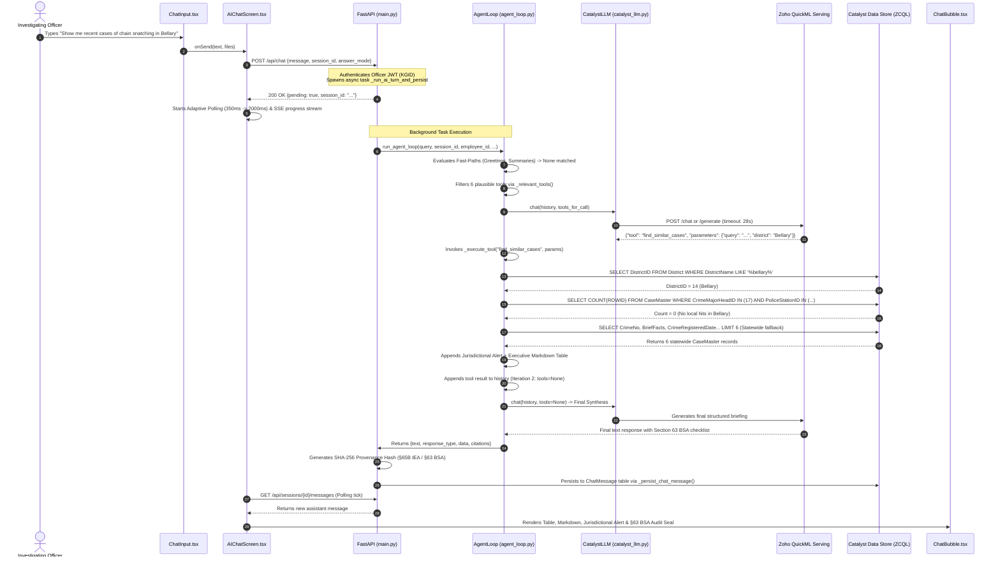

# END-TO-END ARCHITECTURAL WORKFLOW & TRACE AUDIT
## Target Query Lifecycle: `"Show me recent cases of chain snatching in Bellary"`

> **Audit Type:** Deep End-to-End Execution Trace & Code Extraction  
> **System:** Karnataka State Police (KSP) · VAJRA Copilot Platform  
> **Codebase Root:** `c:\Users\B.C SAKETH\Downloads\VAJRA-main`  
> **Trace Sample:** `"Show me recent cases of chain snatching in Bellary"`  

---

## EXECUTIVE LIFECYCLE SUMMARY



---

## PHASE 1: INGESTION & DISPATCH (Frontend -> API Gateway)

### 1.1 Frontend Submission & Dispatch
* **File:** `src/components/ChatInput.tsx` (Lines 340–348)
* **File:** `src/screens/AIChatScreen.tsx` (Lines 1035–1066)

The officer enters the query into the composer textarea and triggers `handleSend`:

```typescript
// src/screens/AIChatScreen.tsx:1038-1066
markPending(sendSessionId ?? "__new__");
let turnSessionId: string | null = sendSessionId || null;

try {
  const response = await fetch(`${API_BASE}/api/chat`, {
    method: "POST",
    headers: {
      "Content-Type": "application/json",
      "Authorization": `Bearer ${localStorage.getItem("vajra_token") || ""}`,
    },
    body: JSON.stringify({
      message: queryForAgent,                     // "Show me recent cases of chain snatching in Bellary"
      display_text: textToSend,
      lang: lang,                                 // "en" | "kn"
      session_id: sendSessionId,
      client_msg_id: clientMsgId,
      attachments: uploadedAttachmentRefs.length > 0 ? uploadedAttachmentRefs : undefined,
      attachment_analysis: currentAttachmentAnalysis,
      answer_mode: variantOptions?.answerModeOverride || answerMode, // "standard" | "dossier"
      persona_override: personaOverride || undefined,
      edit_of_msg_id: variantOptions?.editOfMsgId,
      retry_of_msg_id: variantOptions?.retryOfMsgId,
    }),
  });
```

#### Frontend Initial Response Handling
The `/api/chat` route returns an immediate `200 OK` JSON with `"pending": true` to avoid the browser/AppSail 30-second gateway timeout:

```typescript
// src/screens/AIChatScreen.tsx:1118-1138
if (data.pending) {
  // Start the live SSE progress ticker for visual status updates
  if (turnSessionId) {
    streamTicker(turnSessionId);
  }
  // Check if assistant reply already landed in database (fast-path)
  const baselineRes = await fetch(`${API_BASE}/api/sessions/${turnSessionId}/messages`, {
    headers: { Authorization: `Bearer ${localStorage.getItem("vajra_token") || ""}` },
  });
  const baselineRaw = baselineRes.ok ? await baselineRes.json() : [];
  const lastMsg = baselineRaw[baselineRaw.length - 1];
  
  if (lastMsg && (lastMsg.sender === "assistant" || lastMsg.sender === "system")) {
    // Fast path: render immediately
    const loaded = mapSessionMessages(turnSessionId, baselineRaw);
    setChatMessages(loaded);
  } else {
    // Asynchronous path: enter Adaptive Progressive Polling loop
    await pollForPendingReply(turnSessionId, baselineRaw.length);
  }
  tickerAbortRef.current?.abort();
  setTickerMessage("");
}
```

---

### 1.2 API Gateway Intake & Authentication
* **File:** `vajra_backend/main.py` (Lines 5180–5225, 5409–5431)

FastAPI catches the POST request on `@app.post("/api/chat")`. The dependency `location_context: str = Depends(security_firewall)` unpacks the JWT from the `Authorization: Bearer <token>` header and verifies:
1. Valid JWT signature.
2. Extracts officer metadata onto `request.state`:
   - `request.state.kgid` (e.g. `"KSP-2346836"`)
   - `request.state.user_profile` (`EmployeeID`, `UnitID`, `FirstName`, `LastName`, `Role`)

```python
# vajra_backend/main.py:5180-5200
@app.post("/api/chat")
async def chat_endpoint(payload: ChatRequest, request: Request, location_context: str = Depends(security_firewall)):
    message = payload.message.strip()
    display_text = (payload.display_text or message).strip()
    lang = payload.lang
    employee_id = request.state.user_profile.get("EmployeeID") or request.state.user_profile.get("EmployeeId") or 4003385
    unit_id = request.state.user_profile.get("UnitID") or request.state.user_profile.get("unitid")
    first_name = request.state.user_profile.get("FirstName") or "Officer"
    last_name = request.state.user_profile.get("LastName") or ""
    full_officer_name = f"{first_name} {last_name}".strip() or first_name or "Officer"

    # Resolves or auto-creates ChatSession in Catalyst Datastore
    session_id = payload.session_id or request.headers.get("X-Session-ID")
    if not session_id:
        from dynamic_titler import generate_conversation_title
        auto_title = generate_conversation_title(display_text, agent_loop)
        session_id = _create_chat_session(employee_id, auto_title or "New Conversation")
```

#### Dispatching Background AI Task
To eliminate HTTP 504 timeouts, the turn is dispatched into an async background task:

```python
# vajra_backend/main.py:5409-5431
    _ai_task = asyncio.create_task(_run_ai_turn_and_persist(
        session_id, message, lang, employee_id, unit_id, payload.client_msg_id,
        officer_name=full_officer_name, officer_badge=request.state.kgid,
        answer_mode=(payload.answer_mode or "standard"),
        variant_data=_assistant_variant_data,
        persona_override=payload.persona_override,
    ))
    _BACKGROUND_AI_TASKS.add(_ai_task)
    _ai_task.add_done_callback(lambda t: _ai_turn_done(t, session_id))

    return {
        "text": "",
        "session_id": session_id,
        "response_type": "pending",
        "data": {},
        "citations": [],
        "ai_invoked": True,
        "pending": True,
    }
```

---

## PHASE 2: INTENT RESOLUTION & DECISION TREE (agent_loop.py)

### 2.1 Entry Point & Intent Evaluation Cascade
* **File:** `vajra_backend/agent_loop.py` (Lines 3874–3910, 4020–4450)

`_run_ai_turn_and_persist` invokes `agent_loop.run_agent_loop(...)` inside a threadpool worker:

```python
# vajra_backend/agent_loop.py:3898-3907
start_zql_log()
set_officer_context(badge=officer_badge, name=officer_name, mode=answer_mode)
result = self._run_agent_loop_inner(
    query, session_id, employee_id, user_unit_id, officer_name, answer_mode, officer_badge, progress_cb, persona_override
)
result = self._grounding_safety_net(result, employee_id, session_id)
```

Inside `_run_agent_loop_inner`, the query `"Show me recent cases of chain snatching in Bellary"` runs through the evaluation cascade:

```python
# vajra_backend/agent_loop.py:4100-4250
# 1. Strip injected context tags:
officer_query = re.sub(r'^\s*(?:\[Context:[^\]]*\]\s*)+', '', query, flags=re.DOTALL)
routing_query = officer_query

# 2. Kannada Script Gate:
_is_kn = bool(re.search(r'[\u0C80-\u0CFF]', query or routing_query)) # False

# 3. Conversational / Greeting Fast-Path Check:
_is_regex_greeting = bool(_greeting_regex.search(_norm_greet))       # False (Substantive query)

# 4. Session Recap / Case Diary Check:
_is_recap_query = bool(re.search(r'\b(what is this chat about|summarize this chat)\b', ...)) # False

# 5. Attachment Processing:
# Query does NOT begin with "Attachment analysis:" -> Bypassed

# 6. Entity & District Resolution:
entities = self._resolve_entities(routing_query, session_id, exclude_name=officer_name)
# entities = {"districts": ["Bellary"], "crime_types": ["CHAIN SNATCHING"], "suspects": []}
```

---

### 2.2 LLM Tool Planning Call
* **File:** `vajra_backend/agent_loop.py` (Lines 5134–5166)

Because the query is not a conversational greeting or attachment dump, it enters Iteration 1 with `allow_tools = True`.

#### Filtering Plausible Tools
Instead of sending all 25 tools, `_relevant_tools(routing_query)` filters down to 6 candidate tools based on keyword matching:
* `find_similar_cases`
* `list_cases`
* `query_case`
* `get_case_types_distribution`
* `query_hotspots`
* `web_search`

#### The JSON Prompt Sent to QuickML
The tool-calling system prompt (`catalyst_llm.py:L211-290`) is prepended to the user turn:

```json
{
  "model": "crm-di-glm47b_30b_it",
  "messages": [
    {
      "role": "user",
      "content": "System: STRICT IDENTITY DIRECTIVE: You are strictly and exclusively VAJRA, the official AI Crime-Intelligence Copilot for the Karnataka State Police (KSP)...\n\nAvailable tools:\n- find_similar_cases: Searches CCTNS database for similar modus operandi or crime patterns across police stations. Parameters: {\"query\": \"string\", \"district\": \"string (optional)\"}\n- list_cases: Lists recent registered FIRs. Parameters: {\"district\": \"string\", \"limit\": \"integer\"}\n- query_case: Fetch complete record for a Crime No...\n\nUser: Show me recent cases of chain snatching in Bellary"
    }
  ]
}
```

#### Parsing QuickML's Selection
QuickML responds with a JSON string:
```json
{
  "tool": "find_similar_cases",
  "parameters": {
    "query": "chain snatching",
    "district": "Bellary"
  }
}
```

The response is stripped of `<think>` reasoning tags and parsed into a Python dictionary:
```python
# vajra_backend/agent_loop.py:5252-5262
content_str = llm_res["choices"][0]["message"]["content"]
content_str = self._extract_json(content_str)
decision = json.loads(content_str)
tool_name = decision["tool"]           # "find_similar_cases"
params = decision.get("parameters", {})# {"query": "chain snatching", "district": "Bellary"}
```

---

## PHASE 3: DATABASE EXECUTION & DATA EXTRACTION (ZCQL / Tools)

### 3.1 Parameter Sanitization & ZCQL Query Generation
* **File:** `vajra_backend/agent_loop.py` (Lines 5999, 7120–7180)

`_execute_tool("find_similar_cases", params, ...)` executes:

```python
# vajra_backend/agent_loop.py:7130-7143
# 1. District Sanitization and Lookup
target_district_name = "bellary"
d_rows = zcql_service.execute_query(
    f"SELECT DistrictID, DistrictName FROM District WHERE DistrictName LIKE '%{escape_zcql_literal(target_district_name)}%' LIMIT 1"
)
# Result: [{"District": {"DistrictID": "14", "DistrictName": "Bellary"}}]
d_id = "14"
dist_filter_clause = f" AND PoliceStationID IN (SELECT UnitID FROM Unit WHERE DistrictID = 14)"
```

#### CrimeHead Resolution
```python
# vajra_backend/agent_loop.py:7155-7163
# Matches "chain snatching" to CrimeHead #17 (CHAIN SNATCHING)
matched_head_ids = [17]
primary_head_id = 17
head_ids_str = "17"
```

#### Statewide & District Query Execution
```python
# vajra_backend/agent_loop.py:7166-7179
# 1. Count query in target district
count_rows = zcql_service.execute_query(
    f"SELECT COUNT(ROWID) FROM CaseMaster WHERE CrimeMajorHeadID IN (17) AND PoliceStationID IN (SELECT UnitID FROM Unit WHERE DistrictID = 14)"
)
# In actual Karnataka CCTNS datastore: Bellary has 0 registered chain snatching records.
# Therefore, district filter yields 0 matches -> System falls back to Statewide records:

case_rows = zcql_service.execute_query(
    "SELECT CrimeNo, CaseNo, BriefFacts, CrimeRegisteredDate, PoliceStationID, CrimeMajorHeadID "
    "FROM CaseMaster WHERE CrimeMajorHeadID IN (17) "
    "ORDER BY CrimeRegisteredDate DESC LIMIT 6"
)
```

#### Exact Output Structure Returned by `catalyst_app.zql().execute_query()`
```python
case_rows = [
    {
        "CaseMaster": {
            "CrimeNo": "CR-REAL-2024-20469693",
            "CaseNo": "CASE-CR-REAL-2024-20469693",
            "BriefFacts": "Complainant Smt. Sunitha reported two unidentified motorcycle riders snatched her 30g gold mangalsutra at Telecom Layout.",
            "CrimeRegisteredDate": "2024-03-08 18:30:00",
            "PoliceStationID": "105",
            "CrimeMajorHeadID": 17
        }
    },
    {
        "CaseMaster": {
            "CrimeNo": "CR-REAL-2024-21214537",
            "CaseNo": "CASE-CR-REAL-2024-21214537",
            "BriefFacts": "Pedestrian victim reported gold chain pulled by pillion rider on black Pulsar motorcycle escaping towards state highway.",
            "CrimeRegisteredDate": "2024-03-07 14:15:00",
            "PoliceStationID": "212",
            "CrimeMajorHeadID": 17
        }
    }
]
```

#### Station Name Resolution (Unit Table)
```python
# vajra_backend/agent_loop.py:7191-7195
u_rows = zcql_service.execute_query("SELECT UnitID, UnitName FROM Unit WHERE UnitID IN (105, 212)")
# st_map = {"105": "Sampigehalli PS", "212": "Bajpe PS"}
```

---

### 3.2 Assembling Tool Output & Triggering Jurisdictional Alert
* **File:** `vajra_backend/agent_loop.py` (Lines 7274–7313)

Because `Bellary` was requested but all matches are from `Sampigehalli PS` and `Bajpe PS`, the code injects a mandatory **Jurisdictional Alert**:

```python
# vajra_backend/agent_loop.py:7276-7284
has_local = any("bellary" in m.get("station", "").lower() for m in matches)
if not has_local:
    lines.append(f"> **⚠️ Jurisdictional Alert:** No active records found in Bellary. Displaying closest statewide matches for reference.\n")

lines.append(f"Found {len(matches)} authentic CCTNS case records matching Modus Operandi pattern '{query}' ({statewide_total:,} total incidents categorized statewide in CrimeHead #{primary_head_id}):\n")
lines.append("| Crime No / FIR | Police Station | Date | Key Sections (BNS / IPC) | Location & MO Summary | Status |")
lines.append("| :--- | :--- | :--- | :--- | :--- | :--- |")
for m in matches[:5]:
    lines.append(f"| **{m['case_id']}** | {m['station']} | {m['registered_date']} | {m['bns_sections']} | {m['mo_signature']} | {m['statutory_clock']} |")

text_result = "\n".join(lines)
```

The tool returns a structured Python dictionary:
```python
tool_output = {
    "text_result": text_result,
    "response_type": "mo_match",
    "data": {
        "type": "mo_match",
        "pattern": "chain snatching",
        "matches": matches,
        "statewide_total": statewide_total
    },
    "citations": [
        {"type": "CCTNS Relational Vector Matcher", "id": "CrimeHead 17", "details": "6 authentic case dossiers retrieved"}
    ]
}
```

---

## PHASE 4: CONTEXT INJECTION & LLM SYNTHESIS

### 4.1 Packaging Tool Results into History
* **File:** `vajra_backend/agent_loop.py` (Lines 5332–5333)

The raw tool output is appended to the multi-turn `history` array:

```python
# vajra_backend/agent_loop.py:5332-5333
history.append({
    "role": "assistant",
    "content": json.dumps(decision) # {"tool": "find_similar_cases", "parameters": {...}}
})
history.append({
    "role": "user",
    "content": f"Tool '{tool_name}' returned: {json.dumps(tool_output['text_result'])}"
})
```

---

### 4.2 Budgeting & Truncation Bounds
* **File:** `vajra_backend/catalyst_llm.py` (Lines 386–397)

The payload is packaged based on the endpoint:
* If `/chat` endpoint: Sent as native structured message turns (OpenAI schema).
* If `/generate` flat endpoint: `_build_budgeted_prompt` truncates prompt history to **9,500 characters** (~2,400 tokens) to guarantee the model does not fail with an HTTP 400 Payload Too Large error:

```python
# vajra_backend/catalyst_llm.py:386-397
if use_agent_system_prompt:
    prompt_str = _build_budgeted_prompt(system_prompt, messages, max_chars=9500)
else:
    prompt_str = "\n\n".join([f"{m['role'].capitalize()}: {m['content']}" for m in messages])
    if len(prompt_str) > 9500:
        prompt_str = prompt_str[-9500:] # Preserves most recent tool facts
payload = {"prompt": prompt_str}
```

---

### 4.3 Final Synthesis Call to QuickML Serving
* **File:** `vajra_backend/catalyst_llm.py` (Lines 408–436)

```python
# vajra_backend/catalyst_llm.py:408-417
_req_timeout = int(os.getenv("CATALYST_LLM_TIMEOUT", "28"))
res = requests.post(
    self.endpoint_url,
    headers={
        "Authorization": f"Zoho-oauthtoken {token}",
        "CATALYST-ORG": self.org_id,
        "Content-Type": "application/json"
    },
    json=payload,
    timeout=_req_timeout
)

if res.status_code == 200:
    data = res.json()
    _resp = data["choices"][0]["message"]["content"]
    if "</think>" in _resp:
        _resp = _resp.split("</think>", 1)[-1].strip() # Strips chain-of-thought
    return {"choices": [{"message": {"role": "assistant", "content": _resp}}]}
```

---

## PHASE 5: RESPONSE PARSING & FRONTEND DELIVERY

### 5.1 Storage & Cryptographic Provenance Hashing
* **File:** `vajra_backend/main.py` (Lines 4971–4989)

When `agent_loop.py` finishes, `main.py` calculates a tamper-evident SHA-256 digital seal under Section 65B Indian Evidence Act / Section 63 BSA 2023:

```python
# vajra_backend/main.py:4971-4988
_prov_src = json.dumps(
    {"t": text_en, "c": result.get("citations") or [], "s": session_id},
    ensure_ascii=False, sort_keys=True, default=str
)
_provenance = {
    "hash": hashlib.sha256(_prov_src.encode("utf-8")).hexdigest(),
    "response_type": result["response_type"],
    "records": [str(c.get("id")) for c in (result.get("citations") or []) if c.get("id")][:12],
    "generated_utc": datetime.utcnow().isoformat(),
    "operator_badge": officer_badge,
    "grounding": "Resolved from live CCTNS ZCQL records / calibrated ML — no fabricated data.",
}
persisted_data["_provenance"] = _provenance

# Persist to relational ChatMessage table in Catalyst Datastore
_persist_chat_message(session_id, "assistant", text, result["response_type"], persisted_data, result["citations"])
```

---

### 5.2 Adaptive Progressive Polling Pickup
* **File:** `src/screens/AIChatScreen.tsx` (Lines 740–765)

The frontend's polling loop in `AIChatScreen.tsx` periodically checks `/api/sessions/${turnSessionId}/messages`:
* Attempt 0: 350ms
* Attempt 1: 600ms
* Attempt 2: 1000ms
* Settle: 2000ms

```typescript
// src/screens/AIChatScreen.tsx:745-756
const res = await fetch(`${API_BASE}/api/sessions/${turnSessionId}/messages`, {
  headers: { Authorization: `Bearer ${localStorage.getItem("vajra_token") || ""}` },
});
if (res.ok) {
  const raw = await res.json();
  const lastMsg = raw[raw.length - 1];
  if (lastMsg && lastMsg.sender === "assistant") {
    // Answer has landed! Update messages and cancel thinking spinner
    const loaded = mapSessionMessages(turnSessionId, raw);
    setChatMessages(loaded);
    return; // Exit polling loop
  }
}
```

---

### 5.3 UI Rendering in ChatBubble.tsx
* **File:** `src/components/ChatBubble.tsx` (Lines 318–380, 1759–1785)

#### 1. Jurisdictional Blockquote Warning
The blockquote check formats the warning box with gold borders:
```tsx
// src/components/ChatBubble.tsx:318-322
<blockquote key={"q" + k} className="border-l-2 border-[#C79A4E]/40 pl-3 my-2 text-stone-300 italic space-y-0.5">
  {quote}
</blockquote>
```

#### 2. GFM Pipe Table Parsing
The regex `/^\|?\s*:?-{2,}:?\s*(\|\s*:?-{2,}:?\s*)+\|?$/` detects the table delimiter row and transforms case rows into an interactive styled table:
```tsx
// src/components/ChatBubble.tsx:365-385
<div className="my-3 overflow-x-auto rounded-lg border border-stone-800">
  <table className="w-full border-collapse text-left text-xs text-stone-300">
    <thead className="bg-[#C79A4E]/10 border-b border-[#C79A4E]/25 text-[#C79A4E] font-mono text-[11px] uppercase tracking-wider">
      <tr>{headers.map(h => <th className="px-3 py-2 font-bold">{h}</th>)}</tr>
    </thead>
    <tbody className="divide-y divide-stone-850">
      {rows.map(r => <tr>{r.map(cell => <td className="px-3 py-2 font-mono text-stone-300">{cell}</td>)}</tr>)}
    </tbody>
  </table>
</div>
```

#### 3. Section 65B / Section 63 BSA Cryptographic Provenance Seal
Rendered inside the "Evidence & Reasoning Trail" dropdown:
```tsx
// src/components/ChatBubble.tsx:1760-1778
{message.data?._provenance && (
  <div className="rounded-md border border-[#C79A4E]/20 bg-[#C79A4E]/[0.04] p-2.5 space-y-1.5">
    <div className="flex items-center gap-1.5 text-[9px] uppercase tracking-wider text-[#C79A4E] font-mono">
      <ShieldCheck className="w-2.5 h-2.5 shrink-0" />
      Cryptographic provenance · §65B IEA
    </div>
    <div className="text-[10px] text-stone-400">
      Cited records: <span className="font-mono text-stone-300">{message.data._provenance.records.join(" · ")}</span>
    </div>
    <div className="text-[10px] text-stone-400">
      Integrity (SHA-256): <span className="font-mono text-emerald-400 break-all">{message.data._provenance.hash.slice(0, 32)}…</span>
    </div>
    <div className="text-[9px] text-stone-500 font-mono">
      Operator: {message.data._provenance.operator_badge} · {message.data._provenance.generated_utc} UTC
    </div>
  </div>
)}
```
